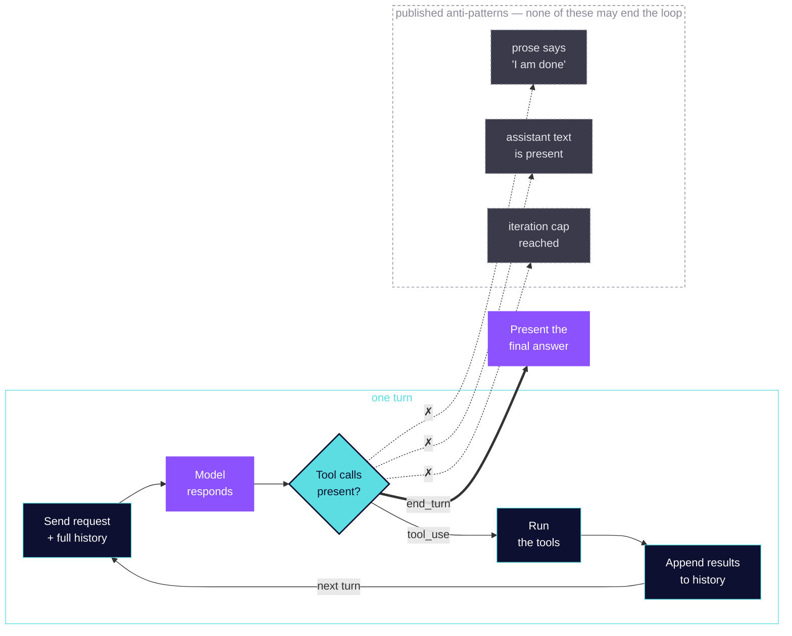

# Build to Pass — Claude Certified Architect – Foundations

**This file is generated. Do not edit it.**

It is the whole written course in one document, assembled from the per-lesson files
under `course/` by `scripts/build_guide.py`. Edit the lesson, then run:

```
python3 scripts/build_guide.py
```

The test suite checks this file against the lessons, so a stale guide fails the build
rather than quietly disagreeing with the course.

**This is the whole course, in reading order.** It opens with the current program notice,
then the study path, the prerequisite stack and the scope boundary; then the 29 lessons in
**dependency order** rather than exam-weight order; then the scenarios, the recurring
themes, the recall sheet, the glossary and the exam-day mechanics.

Every section below is also a standalone file, and each one says which — the files are the
source and this document is assembled from them, so nothing here is a second copy that can
drift. Two files are deliberately *not* included, because they are the course's own audit
trail rather than material for a candidate: [SOURCES.md](SOURCES.md), which records what
this course treats as a source, and [VERIFICATION.md](VERIFICATION.md), which records which
cited pages have been re-read verbatim and which have not. Read both if your question is
whether to trust this course. Each lesson also carries its own sources inline.

See the [repository README](README.md) for the exam details, the blueprint map, and how to
run the lab.

---

## Certification program update: December 7, 2026

Anthropic has announced that **the Associate – Foundations, Developer – Foundations, and
Architect – Professional exams will include updated content from December 7, 2026**, with
updated exam guides available **November 17, 2026**. If you are testing on or after
December 7 for one of those three, prepare from the updated guide.

**Architect – Foundations — the exam this course prepares for — is not named in that
announcement.** Three of the four certifications are listed and CCAR-F is not one of them.

Two consequences, stated plainly:

- **This course is built against the guide that remains current for its exam.** Version 1.0,
  effective July 2026, is what every claim here cites, and the announcement does not
  supersede it for CCAR-F.
- **Any study material covering all four certifications will be stale for three of them on
  December 7.** That is worth knowing if you are using more than one source.

When the updated guides publish on November 17, this course will be re-checked against
them regardless — if CCAR-F's guide moves at all, the version string in
[SOURCES.md](SOURCES.md) changes and every claim traced to a section gets re-read. The
guide's own §18 records its version history, and this repository records which version it
was written against.

**Verify this yourself before relying on it.** The announcement above is quoted from the
Anthropic Partner Academy certification pages; the authoritative source is those pages, not
this README, and an announcement can be revised.

---

> Read this first if you have a date booked. It is the only page here that tells you what to skip.
>
> Read it standalone at [STUDY-PATH.md](STUDY-PATH.md).

# How to use this course

Twenty-nine lessons, one per task statement. Four plans below depending on how much time
you have, and one thing to decide before you book anything.

## Decide this first: when to sit it

**The credential is valid for 12 months from the date it is awarded.** That is shorter
than most cloud certifications and it should shape *when* you sit, not just whether you
pass. Sitting it the week before a job search starts is worth more than sitting it eight
months earlier and renewing in the middle.

Exam mechanics, from the guide: **60 items, 4 scenarios drawn from a published bank of 6,
120 minutes, passing score 720 on a 100–1,000 scale, $125.** The score report gives
percent-correct **by domain** — useful diagnostics, and those section percentages do
**not** determine pass or fail. Only the total scaled score does.

---

## If you have a week

Dependency order, which is also the order the course is written in. Tools before the loop
that calls them; the loop before the output it shapes.

**Day 1 — Domain 3, configuration (20%).** Six lessons.
[3.1](course/domain-3-configuration/lesson-3-1-claude-md-hierarchy.md) ·
[3.2](course/domain-3-configuration/lesson-3-2-commands-and-skills.md) ·
[3.3](course/domain-3-configuration/lesson-3-3-path-specific-rules.md) ·
[3.4](course/domain-3-configuration/lesson-3-4-plan-mode.md) ·
[3.5 and 3.6](course/domain-3-configuration/lesson-3-5-3-6-iteration-and-pipelines.md)

Start here because it is the most concrete and because two of its lessons set up a
distinction the rest of the exam keeps using.

**Day 2 — Domain 2, tools and MCP (18%).** Five lessons.
[2.1](course/domain-2-tools-and-mcp/lesson-2-1-tool-interfaces.md) ·
[2.2](course/domain-2-tools-and-mcp/lesson-2-2-structured-errors.md) ·
[2.3](course/domain-2-tools-and-mcp/lesson-2-3-tool-distribution.md) ·
[2.4](course/domain-2-tools-and-mcp/lesson-2-4-mcp-integration.md) ·
[2.5](course/domain-2-tools-and-mcp/lesson-2-5-built-in-tools.md)

**Days 3 and 4 — Domain 1, agentic architecture (27%).** Seven lessons, the largest slice.
[1.1](course/domain-1-agentic-architecture/lesson-1-1-agentic-loops.md) ·
[1.2](course/domain-1-agentic-architecture/lesson-1-2-coordinator-patterns.md) ·
[1.3](course/domain-1-agentic-architecture/lesson-1-3-subagent-invocation.md) ·
[1.4](course/domain-1-agentic-architecture/lesson-1-4-enforcement-and-handoff.md) ·
[1.5](course/domain-1-agentic-architecture/lesson-1-5-hooks.md) ·
[1.6](course/domain-1-agentic-architecture/lesson-1-6-task-decomposition.md) ·
[1.7](course/domain-1-agentic-architecture/lesson-1-7-session-state.md)

Two days, not one. It is 27% of the items and the lessons are denser.

**Day 5 — Domain 4, prompting and output (20%).** Six lessons.
[4.1](course/domain-4-prompting-and-output/lesson-4-1-explicit-criteria.md) ·
[4.2](course/domain-4-prompting-and-output/lesson-4-2-few-shot.md) ·
[4.3](course/domain-4-prompting-and-output/lesson-4-3-structured-output.md) ·
[4.4](course/domain-4-prompting-and-output/lesson-4-4-validation-and-retry.md) ·
[4.5](course/domain-4-prompting-and-output/lesson-4-5-batch-processing.md) ·
[4.6](course/domain-4-prompting-and-output/lesson-4-6-multi-instance-review.md)

**Day 6 — Domain 5, context and reliability (15%).** Five lessons.
[5.1](course/domain-5-context-and-reliability/lesson-5-1-conversation-context.md) ·
[5.2](course/domain-5-context-and-reliability/lesson-5-2-escalation.md) ·
[5.3](course/domain-5-context-and-reliability/lesson-5-3-error-propagation.md) ·
[5.4](course/domain-5-context-and-reliability/lesson-5-4-codebase-exploration.md) ·
[5.5](course/domain-5-context-and-reliability/lesson-5-5-human-review-and-calibration.md)

**Do not skip this one because it is 15%.** It appears in five of the six scenarios — see
[SCENARIOS.md](SCENARIOS.md). The weights say how many items come from a domain; the
scenarios say how often you will need it.

**Day 7 — the two synthesis pages, then the scenarios.** Read
[THEMES.md](THEMES.md) — four ideas that recur across domains, and the most useful thing to
hold on exam day. Then walk [SCENARIOS.md](SCENARIOS.md) and answer the closing question
under each of the six before reading anything again.

---

## If you have a weekend

**Saturday:** Domains 3 and 2 in full (11 lessons). Then [THEMES.md](THEMES.md).

**Sunday:** Domain 1 in full (7 lessons), then the anti-pattern section only of each
Domain 4 and 5 lesson. Finish on [SCENARIOS.md](SCENARIOS.md).

You will be thin on Domain 5, which is a real cost given how often it recurs. Know that
going in rather than discovering it.

---

## If you have an evening

Read, in this order:

1. [THEMES.md](THEMES.md) — the four recurring ideas
2. [SCENARIOS.md](SCENARIOS.md) — the six scenarios and their closing questions
3. The **anti-pattern** section of every lesson, nothing else
4. [RECALL.md](RECALL.md) — last, and out loud if you can

The anti-patterns are the published wrong answers, and well-built distractors are the
plausible mistakes a competent person actually makes. Three hours of anti-patterns is the
highest-yield three hours available.

**Why the recall sheet goes last and not first.** It is the only page here you can usefully
read with no time left, because nothing on it needs to be understood — a convention is
either in your memory or it is not. Everything above it is the opposite: worth hours, worth
none of your last twenty minutes.

This is triage, not preparation. It will not make up for not knowing the material.

---

## If you are coming back to it after a gap

[GLOSSARY.md](GLOSSARY.md) first. It exists because several words mean different things in
different lessons — "fork" means three things — and those are the distinctions that decay
first.

Then [RECALL.md](RECALL.md), as a self-test rather than as reading: cover the middle column
and say what each term does. The rows you cannot produce are your revision list, and they
are the cheapest thing on it to fix — judgment takes a week to rebuild, a field name takes
a minute.

---

**Once you have a plan, read [EXAM-DAY.md](EXAM-DAY.md).** Registering, the ID rules, how
the 720 was set, what happens if you do not pass, and the renewal that is free only if you
are on time. It is also where this course signs off.

---

## What to do with the lab

The repository is a working system: [Course Doctor](README.md#the-lab-course-doctor), an
agent that checks training material against live documentation and reports what went stale,
what it could not check, and what needs a human.

Reading the course does not require running it. But if you learn by building, clone it, run
the tests, and read `src/course_doctor/` against lessons 2.1 and 2.2 — the error shapes and
the tool descriptions in there are the ones those lessons teach, and the comments say why
each decision was made rather than what the code does.

```
uv venv --python 3.12
uv pip install -e '.[test]'
./scripts/run-tests.sh
```

Several of its tests assert an **absence** — that a path escape is refused, that nothing is
read on a refusal. Use the script rather than bare `pytest`: it pins the collected count and
fails on any skip, because an absence test that never runs looks exactly like one that
passed.

---

## What this course cannot tell you

**Whether you are ready.** There is no practice exam here and there will not be. No
pass-rate, difficulty or score-distribution claim appears anywhere in this course, because
none is published and I have access to no such data for this exam. The guide's four
preparation exercises are the closest thing to practice material Anthropic publishes, and
**completing them is not a predictor of a score** and is not presented as one.

**What is on the exam.** The authoritative source is the exam guide on the Anthropic
Partner Academy certification page, which supersedes anything written here. Details change;
this course records what the guide said at the version noted in [SOURCES.md](SOURCES.md).

**That every claim here is current.** Every claim names its source and carries the date it
was read — but a page can return 200 and no longer say what it said. See the README's
section on how claims are checked, including the part that is **not** yet verified.

---

> What the exam sits on top of, and a readiness check. Skippable if you are already building with this stack daily.
>
> Read it standalone at [FUNDAMENTALS.md](FUNDAMENTALS.md).

# What this exam sits on top of

Every lesson has a Fundamentals block covering the terms *that lesson* needs. This page is
the layer underneath all of them: the prerequisite stack, what the guide assumes you
already have, and a way to find out whether you have it before you spend a week.

> [!NOTE]
> **Read this first if you are not sure the course is pitched at you.** Read it last, or
> not at all, if you build production systems for a living. Either way it is the one page
> here written to be skipped by half its readers — that is the design, not a filler page.

---

## The stack, for this exam specifically

```
                    measurement and calibration        Domain 5.5
                         LLM behaviour                 Domains 4, 5
                      distributed systems              Domain 1  (27%)
                software engineering + DevOps           assumed throughout
```

The guide's own statement of the floor: the ideal candidate *"typically has 6+ months of
practical experience building with Claude APIs, Agent SDK, Claude Code, and MCP,
understanding both the capabilities and limitations of large language models in production
environments."*

Note what that sentence does **not** say. It does not say machine learning.

---

## What is NOT a prerequisite, and this surprises people

If you came from a cloud or data certification track, the natural assumption is a ladder:
developer knowledge → DevOps → data engineering → machine learning → AI. That ladder is
real, and **it is not this exam's.**

The guide's appendix (§17) puts all of the following **explicitly out of scope**:

- Fine-tuning Claude models or training custom models
- Embedding models or vector database implementation details
- Constitutional AI, RLHF, or safety training methodologies
- Claude's internal architecture, training process, or model weights
- Performance benchmarking or model comparison metrics
- Token counting algorithms or tokenization specifics

**So the ML layer is not underneath this exam.** You do not need to know how a model is
trained, how embeddings work, or how tokenisation is implemented. You need to know how a
model *behaves* in production — which is a different subject with a different literature.

See [SCOPE.md](SCOPE.md) for the full out-of-scope list. It is the cheapest page in this
repository.

---

## Layer 1 — software engineering and DevOps

Assumed everywhere and never taught. If any of these is unfamiliar, start here rather than
with lesson 3.1.

| You need | Because | Where it bites |
|---|---|---|
| Reading and writing code in at least one language | Tools, schemas and hooks are code | all of Domain 2 |
| JSON, and YAML frontmatter | Every config file and every schema | [3.2](course/domain-3-configuration/lesson-3-2-commands-and-skills.md) · [3.3](course/domain-3-configuration/lesson-3-3-path-specific-rules.md) · [4.3](course/domain-4-prompting-and-output/lesson-4-3-structured-output.md) |
| Shell and CLI basics — flags, pipes, stdin and stdout, exit codes | `-p`, `--output-format`, `2>&1`, what a non-zero exit means | [3.6](course/domain-3-configuration/lesson-3-5-3-6-iteration-and-pipelines.md) |
| Glob patterns | `paths` scoping, file selection | [3.3](course/domain-3-configuration/lesson-3-3-path-specific-rules.md) · [2.5](course/domain-2-tools-and-mcp/lesson-2-5-built-in-tools.md) |
| Git, and version control hygiene | What is committed versus local, and why a secret in a committed file is published | [3.1](course/domain-3-configuration/lesson-3-1-claude-md-hierarchy.md) · [2.4](course/domain-2-tools-and-mcp/lesson-2-4-mcp-integration.md) |
| Environment variables | How a credential reaches a server without being written down | [2.4](course/domain-2-tools-and-mcp/lesson-2-4-mcp-integration.md) |
| CI/CD concepts — a pipeline, a step, a gate, a timeout | TS 3.6 is literally this | [3.6](course/domain-3-configuration/lesson-3-5-3-6-iteration-and-pipelines.md) |
| Least privilege | Half of Domain 2 and all of the hook material | [2.3](course/domain-2-tools-and-mcp/lesson-2-3-tool-distribution.md) · [1.5](course/domain-1-agentic-architecture/lesson-1-5-hooks.md) |

**If you are weak here**, the honest advice is that this is not the exam to study for yet.
It assumes six months of building, and the blueprint is written for someone who has made
these mistakes already.

---

## Layer 2 — distributed systems

**The missing layer, and the one that explains why Domain 1 is 27%.** Multi-agent
orchestration is a distributed system: independent components, partial failure, no shared
memory, coordination overhead. Every classic problem shows up with a new name.

| Classic concept | Appears as | Lesson |
|---|---|---|
| No shared memory between processes | Subagents inherit nothing; context must be passed explicitly | [1.3](course/domain-1-agentic-architecture/lesson-1-3-subagent-invocation.md) |
| Hub-and-spoke topology | The coordinator pattern, and why workers never talk to each other | [1.2](course/domain-1-agentic-architecture/lesson-1-2-coordinator-patterns.md) |
| Partial failure | Some workers succeed and some do not, and the join must say which | [5.3](course/domain-5-context-and-reliability/lesson-5-3-error-propagation.md) |
| Idempotence | Whether a retry is safe, and whether a resumed tool already took effect | [4.4](course/domain-4-prompting-and-output/lesson-4-4-validation-and-retry.md) · [1.7](course/domain-1-agentic-architecture/lesson-1-7-session-state.md) |
| Timeouts and bounded work | `max_turns`, `max_budget_usd`, and stop conditions | [1.1](course/domain-1-agentic-architecture/lesson-1-1-agentic-loops.md) |
| Map-reduce / fan-out and join | Parallel subagents, then synthesis | [1.2](course/domain-1-agentic-architecture/lesson-1-2-coordinator-patterns.md) · [1.6](course/domain-1-agentic-architecture/lesson-1-6-task-decomposition.md) |
| Error context propagation | Failure type, what was attempted, partial results, alternatives | [5.3](course/domain-5-context-and-reliability/lesson-5-3-error-propagation.md) |
| Crash recovery and state export | Manifests, scratchpads, resuming at the first gap | [5.4](course/domain-5-context-and-reliability/lesson-5-4-codebase-exploration.md) |
| Middleware / interception | Hooks on tool calls | [1.5](course/domain-1-agentic-architecture/lesson-1-5-hooks.md) |

**If you have operated a distributed system, Domain 1 will feel familiar and you will still
need the specifics** — which tool spawns a worker, what a background subagent loses, where
a budget cap overshoots.

**If you have not**, read Domain 1's lessons twice, and read them for the *shapes* rather
than the API names. The exam is judgment-weighted, and the judgment is distributed-systems
judgment.

---

## Layer 3 — how a model behaves in production

Not how one is built. How one behaves, which is the thing the guide actually asks for.

| You need to know | Lesson |
|---|---|
| A context window is finite, accumulates, and does not reset between turns | [1.1](course/domain-1-agentic-architecture/lesson-1-1-agentic-loops.md) · [5.1](course/domain-5-context-and-reliability/lesson-5-1-conversation-context.md) |
| Output is non-deterministic, so an instruction has a failure rate | [1.4](course/domain-1-agentic-architecture/lesson-1-4-enforcement-and-handoff.md) · [1.5](course/domain-1-agentic-architecture/lesson-1-5-hooks.md) |
| Models can produce confident wrong content, and fluency is not accuracy | [4.4](course/domain-4-prompting-and-output/lesson-4-4-validation-and-retry.md) · [5.4](course/domain-5-context-and-reliability/lesson-5-4-codebase-exploration.md) |
| Position in a long input affects what gets used | [5.1](course/domain-5-context-and-reliability/lesson-5-1-conversation-context.md) |
| Examples teach more reliably than descriptions | [4.2](course/domain-4-prompting-and-output/lesson-4-2-few-shot.md) |
| A model asked to review its own work inherits its own assumptions | [4.6](course/domain-4-prompting-and-output/lesson-4-6-multi-instance-review.md) |

**Prompt caching is on the boundary**: the guide says it is out of scope *"beyond knowing it
exists."* Know the term. Stop there.

---

## Layer 4 — measurement

One task statement, and it rests on a discipline nothing else in the exam touches.

Needed for [5.5](course/domain-5-context-and-reliability/lesson-5-5-human-review-and-calibration.md):

- **Aggregate versus segmented metrics** — why one number hides a population. The formal
  version is Simpson's paradox.
- **Stratified random sampling** — sampling *within* strata so a rare segment is actually
  represented.
- **Calibration** — whether a stated confidence matches observed accuracy, measured against
  labelled data.
- **Denominators** — why a rate without its n is not a claim.

This layer also explains the exam's own scoring, which is worth reading once in
[EXAM-DAY.md](EXAM-DAY.md): criterion-referenced, with a cut score set by a formal
standard-setting study, and scaled to equate across forms.

---

## A readiness check

Answer these before committing a week. Each maps to a layer, and a "no" tells you where to
start rather than whether to give up.

1. Can you explain the difference between a non-zero exit code and a program that printed
   an error? *(layer 1)*
2. Can you say what a glob pattern matches, including what `**` adds? *(layer 1)*
3. Can you explain why a retry is safe for one operation and unsafe for another?
   *(layer 2)*
4. Given five workers where one fails, can you name three defensible things the coordinator
   could do? *(layer 2)*
5. Can you say why an instruction in a config file is not a guarantee? *(layer 3 — and it
   is [theme 1](THEMES.md))*
6. Can you say what "97% accurate" does not tell you? *(layer 4)*

**Four or more yes:** start with [STUDY-PATH.md](STUDY-PATH.md).

**Two or three:** read this course and expect Domain 1 to be the hard part. Budget the
extra day the study path already allows for it.

**Fewer than two:** the guide's six-months-of-building floor is doing real work. Build
something with the Agent SDK and MCP first; the exam tests judgment you acquire by making
these mistakes, and no course substitutes for that.

---

## Where to learn each layer

Deliberately short, and deliberately not a link farm.

- **Layer 1** — your language's own documentation, `man` pages for shell semantics, and
  `git`'s book. There is no shortcut and no need for one.
- **Layer 2** — any distributed systems text covers partial failure, idempotence and
  coordination better than any AI material does. The concepts transfer intact; only the
  names change.
- **Layer 3** — Anthropic's own [Claude Academy](https://academy.claude.com/) courses on AI
  fluency and on capabilities and limitations are the right level for this layer, and they
  are free. They are not exam preparation and do not claim to be.
- **Layer 4** — standard sampling and measurement material. Calibration curves and
  stratified sampling are old, well-documented ideas.

## Other people's material

Named because leaving it out would be the more dishonest choice in a course about material
going stale. Not affiliated with this course, and has not reviewed it.

- **Matthew Purcell's consolidated prep list**, on LinkedIn at
  [linkedin.com/in/purcellmatthew](https://www.linkedin.com/in/purcellmatthew/) — free
  practice question sets for all four Claude certifications, a CCAR-F quick reference, and a
  written review of the exams. It is the most used community material for these exams by a
  wide margin, and it is the thing to read if what you want is **practice questions**, which
  [SCOPE.md](SCOPE.md) explains this course will never contain.

**Only one entry, and that is deliberate.** There is plenty of other free Claude and agent
material, some of it good. It is not listed here because **I have not worked through it**,
and a recommendation from someone who has not read the thing is worth exactly nothing —
which is the same standard this course applies to its own claims. If you have found
something that earned its place, tell me and I will read it before naming it.

**What this course does that the list above does not:** one task statement per lesson
against the published blueprint, a lab you build and run, and a claim table that says where
every factual statement came from and when it was read. That is the whole pitch, and it is
only worth anything if the sourcing claim is true — which is what
[VERIFICATION.md](VERIFICATION.md) tracks and keeps honest about the parts not yet done.

## Sources

The prerequisite layers and the readiness check are the author's, drawn from writing all 29
lessons. They are not in the exam guide.

What *is* from the guide: the audience statement and the six-months floor (§2), and every
out-of-scope item quoted above (§17). The claim that the ML layer is not a prerequisite is
an inference from §17's exclusions, and it is stated as one.

---

> What the guide says is in scope, and the sixteen topics it says will not appear at all. The out-of-scope list is the cheapest page in the course: it tells you what to stop studying.
>
> Read it standalone at [SCOPE.md](SCOPE.md).

# What is in scope, and what is explicitly not

The exam guide's appendix (§17) lists the technologies and concepts that may appear, the
topics explicitly tested, and — more useful than either — **the topics that explicitly will
not appear.**

That last list is the reason this page exists. Most study time is lost to material that was
never going to be tested, and the guide tells you what that is.

Everything here is from the exam guide, **Version 1.0, effective July 2026**, §17.

---

## Explicitly OUT of scope

> "The following related topics will **not** appear on the exam"

Sixteen items. If you find yourself studying one of these, stop.

- Fine-tuning Claude models or training custom models
- Claude API authentication, billing, or account management
- Detailed implementation of specific programming languages or frameworks, beyond what is
  needed for tool and schema configuration
- **Deploying or hosting MCP servers** — infrastructure, networking, container
  orchestration
- Claude's internal architecture, training process, or model weights
- Constitutional AI, RLHF, or safety training methodologies
- Embedding models or vector database implementation details
- Computer use — browser automation, desktop interaction
- Vision and image analysis capabilities
- Streaming API implementation or server-sent events
- Rate limiting, quotas, or API pricing calculations
- OAuth, API key rotation, or authentication protocol details
- Specific cloud provider configurations — AWS, GCP, Azure
- Performance benchmarking or model comparison metrics
- **Prompt caching implementation details, beyond knowing it exists**
- Token counting algorithms or tokenization specifics

Three of those are worth dwelling on, because they are where a competent engineer's
instincts will pull them off course.

**Deploying MCP servers is out; designing them is in.** You need tool descriptions, error
shapes, scoping and configuration — lessons 2.1 through 2.4. You do not need Docker,
networking, or how to host one.

**Prompt caching is out "beyond knowing it exists."** That is an unusually precise
boundary. Know the term; do not study the mechanics.

**Cloud provider configuration is out** — which, if you came from a cloud certification
background, is the hardest habit to drop.

---

## Technologies and concepts that may appear

The guide's own list, verbatim in substance, with the lesson that covers each.

| Technology or concept | Covered in |
|---|---|
| **Claude Agent SDK** — agent definitions, agentic loops, `stop_reason` handling, hooks (`PostToolUse`, tool call interception), subagent spawning via **Task tool**, `allowedTools` configuration | [1.1](course/domain-1-agentic-architecture/lesson-1-1-agentic-loops.md) · [1.3](course/domain-1-agentic-architecture/lesson-1-3-subagent-invocation.md) · [1.5](course/domain-1-agentic-architecture/lesson-1-5-hooks.md) |
| **Model Context Protocol** — servers, tools, resources, `isError` flag, tool descriptions, tool distribution, `.mcp.json`, environment variable expansion | [2.1](course/domain-2-tools-and-mcp/lesson-2-1-tool-interfaces.md) · [2.2](course/domain-2-tools-and-mcp/lesson-2-2-structured-errors.md) · [2.3](course/domain-2-tools-and-mcp/lesson-2-3-tool-distribution.md) · [2.4](course/domain-2-tools-and-mcp/lesson-2-4-mcp-integration.md) |
| **Claude Code** — CLAUDE.md hierarchy (user/project/directory), `.claude/rules/` with YAML frontmatter path-scoping, `.claude/commands/`, `.claude/skills/` with SKILL.md frontmatter (`context: fork`, `allowed-tools`, `argument-hint`), plan mode, direct execution, `/memory`, `/compact`, `--resume`, `fork_session`, **Explore subagent** | [3.1](course/domain-3-configuration/lesson-3-1-claude-md-hierarchy.md) · [3.2](course/domain-3-configuration/lesson-3-2-commands-and-skills.md) · [3.3](course/domain-3-configuration/lesson-3-3-path-specific-rules.md) · [3.4](course/domain-3-configuration/lesson-3-4-plan-mode.md) · [1.7](course/domain-1-agentic-architecture/lesson-1-7-session-state.md) · [5.4](course/domain-5-context-and-reliability/lesson-5-4-codebase-exploration.md) |
| **Claude Code CLI** — `-p` / `--print`, `--output-format json`, `--json-schema` | [3.5 and 3.6](course/domain-3-configuration/lesson-3-5-3-6-iteration-and-pipelines.md) |
| **Claude API** — `tool_use` with JSON schemas, `tool_choice` (`"auto"`, `"any"`, forced), `stop_reason` values (`"tool_use"`, `"end_turn"`), `max_tokens`, system prompts | [4.3](course/domain-4-prompting-and-output/lesson-4-3-structured-output.md) · [2.3](course/domain-2-tools-and-mcp/lesson-2-3-tool-distribution.md) · [1.1](course/domain-1-agentic-architecture/lesson-1-1-agentic-loops.md) |
| **Message Batches API** — 50% cost savings, up to 24-hour window, `custom_id`, polling, **no multi-turn tool calling support** | [4.5](course/domain-4-prompting-and-output/lesson-4-5-batch-processing.md) |
| **JSON Schema** — required vs optional fields, enums, nullable fields, `"other"` + detail string, strict mode for syntax error elimination | [4.3](course/domain-4-prompting-and-output/lesson-4-3-structured-output.md) |
| **Pydantic** — schema validation, semantic validation errors, validation-retry loops | [4.4](course/domain-4-prompting-and-output/lesson-4-4-validation-and-retry.md) — see the note below |
| **Built-in tools** — Read, Write, Edit, Bash, Grep, Glob, their purposes and selection criteria | [2.5](course/domain-2-tools-and-mcp/lesson-2-5-built-in-tools.md) |
| **Few-shot prompting** — targeted examples for ambiguous scenarios, format demonstration, generalisation to novel patterns | [4.2](course/domain-4-prompting-and-output/lesson-4-2-few-shot.md) |
| **Prompt chaining** — sequential decomposition into focused passes | [1.6](course/domain-1-agentic-architecture/lesson-1-6-task-decomposition.md) |
| **Context window management** — token budgets, progressive summarisation, lost-in-the-middle, context extraction, scratchpad files | [5.1](course/domain-5-context-and-reliability/lesson-5-1-conversation-context.md) · [5.4](course/domain-5-context-and-reliability/lesson-5-4-codebase-exploration.md) |
| **Session management** — resumption, `fork_session`, named sessions, session context isolation | [1.7](course/domain-1-agentic-architecture/lesson-1-7-session-state.md) |
| **Confidence scoring** — field-level confidence, calibration with labelled validation sets, stratified sampling | [5.5](course/domain-5-context-and-reliability/lesson-5-5-human-review-and-calibration.md) |

**Pydantic is named by the guide and the lessons treat it generically.** Lesson 4.4 teaches
validation, semantic-versus-syntactic errors and retry loops without tying them to a
library. The lab's `src/course_doctor/contracts.py` is Pydantic, so the concrete version is
there if you want it — but the exam is testing the *concepts* the guide lists, and this
course does not teach a library's API.

---

## In-scope topics, explicitly tested

The guide lists these separately from the technologies. Every one maps to a lesson except
the last, which is noted below.

Agentic loop implementation · multi-agent orchestration · subagent context management
including **crash recovery using manifests** · tool interface design · MCP tool and
resource design · MCP server configuration · error handling and propagation · escalation
decision-making · CLAUDE.md configuration including **`@import` patterns** · custom
commands and skills · plan mode versus direct execution · iterative refinement · structured
output via `tool_use` · few-shot prompting · batch processing · context window optimisation
· human review workflows.

### The one with no home

> **"Information provenance: claim-source mappings, temporal data handling, conflict
> annotation, coverage gap reporting"**

This is listed as explicitly tested and it maps to **no single task statement.** The course
covers its parts across [5.1](course/domain-5-context-and-reliability/lesson-5-1-conversation-context.md)
(metadata in structured outputs, attribution surviving handoffs),
[5.3](course/domain-5-context-and-reliability/lesson-5-3-error-propagation.md) (coverage
annotations for gaps from unavailable sources) and
[4.4](course/domain-4-prompting-and-output/lesson-4-4-validation-and-retry.md)
(`conflict_detected`), but never under that name.

Worth knowing as a phrase, because an item framed around "provenance" is asking about those
three things together: where did this claim come from, when was it true, and what did the
report fail to cover.

---

## Preparation material the guide publishes

Two things, and they are the only practice material with Anthropic's name on it.

**Sample questions with full rationales**, in §9. Each gives the correct answer and
explains why each distractor is wrong. Those explanations are the most valuable study
material in the entire guide, because they show you how the distractors are built.

**Four preparation exercises**, in §7 and §8. The guide's own suggested hands-on work.

**This course contains no practice questions and will not.** The guide's sample items are
published with reasoning; there is no reason to write worse ones, and good reason not to.
See [SOURCES.md](SOURCES.md) for what this course does and does not treat as a source.

## Sources

Exam guide **Version 1.0, effective July 2026**, §17 (Appendix: Technologies and Concepts,
In-Scope Topics, Out-of-Scope Topics), §9 (sample questions), §7 and §8 (preparation and
exercises).

The lesson mappings in the tables are the author's. The lists themselves are the guide's.

---

## Contents

- **TS 1.1** — Lesson 1.1 — The loop, and what is allowed to end it
- **TS 1.2** — Lesson 1.2 — The coordinator, and why everything goes through it
- **TS 1.3** — Lesson 1.3 — Spawning a subagent, and what it does not know
- **TS 1.4** — Lesson 1.4 — Gating a step, and handing off to someone who cannot see the conversation
- **TS 1.5** — Lesson 1.5 — Hooks, and the default that makes one useless
- **TS 1.6** — Lesson 1.6 — Fixed pipeline or adaptive plan
- **TS 1.7** — Lesson 1.7 — Resuming, branching, and what the saved state is no longer true about
- **TS 2.1** — Lesson 2.1 — The description is the routing logic
- **TS 2.2** — Lesson 2.2 — An error the agent can act on
- **TS 2.3** — Lesson 2.3 — Fewer tools, and forcing the first one
- **TS 2.4** — Lesson 2.4 — Wiring a server in, and what a populated `/mcp` does not prove
- **TS 4.1** — Lesson 4.1 — Criteria, not adverbs
- **TS 4.2** — Lesson 4.2 — Show the ambiguous case
- **TS 4.3** — Lesson 4.3 — A schema you cannot violate, and the errors it still lets through
- **TS 4.4** — Lesson 4.4 — Retrying what a retry can fix
- **TS 4.5** — Lesson 4.5 — Half price, if you can wait a day
- **TS 4.6** — Lesson 4.6 — The author is the worst reviewer
- **TS 5.1** — Lesson 5.1 — What a summary quietly throws away
- **TS 5.2** — Lesson 5.2 — When to stop trying
- **TS 5.3** — Lesson 5.3 — Two ways to be wrong about a failure
- **TS 5.4** — Lesson 5.4 — When the session starts talking about typical patterns
- **TS 5.5** — Lesson 5.5 — What a 97% hides
- **TS 2.5** — Lesson 2.5 — The built-in tools, and the two that are not there
- **TS 3.1** — Lesson 3.1 — Where an instruction lives decides who gets it
- **TS 3.2** — Lesson 3.2 — Packaging a procedure, and deciding what it may touch
- **TS 3.3** — Lesson 3.3 — Rules that only load when they are relevant
- **TS 3.4** — Lesson 3.4 — Planning first, and when plan mode is not actually a block
- **TS 3.5 and 3.6** — Lesson 3b — Iterating on purpose, and reviewing without yourself

**After the lessons:** SCENARIOS · THEMES · RECALL · GLOSSARY · EXAM-DAY

---

# Lesson 1.1 — The loop, and what is allowed to end it

**Domain 1: Agentic Architecture & Orchestration — 27% of CCAR-F**
**Task Statement 1.1:** Design and implement agentic loops for autonomous task execution.

Lab artifact: Course Doctor's checking loop, bounded by something other than a guess.

## What you will be able to do afterwards

Describe one iteration of an agentic loop precisely, say what terminates it, and name why
the two most intuitive stopping mechanisms are both published anti-patterns.

## Why the exam cares

This is the first task statement of the largest domain, and the guide gives it the most
unusually specific anti-pattern list in the whole document — it names **three wrong
answers by name:**

- parsing natural language signals to determine loop termination
- setting arbitrary iteration caps as the primary stopping mechanism
- checking for assistant text content as a completion indicator

A published list of wrong answers is a published list of distractors. All three are
plausible, all three are things a competent engineer actually does, and that is exactly
what makes them good exam options.

## Fundamentals 📘

*Glossed for a newcomer, skippable if you already build with this stack. Each term
carries why it matters in this lesson and where to go for depth.*

**The agentic loop.** Send a request, get back either tool calls or a final answer, run
the tools, feed the results back, repeat. *Why it matters here:* it is the subject.
*Depth:* `/docs/en/how-claude-code-works`.

**`stop_reason`.** A field on the model's response saying why it stopped generating.
*Why it matters here:* it is the structural signal the guide wants you to branch on
rather than reading the prose. *Depth:* the Messages API documentation.

**A turn.** One round trip: the model produces output including tool calls, the tools
run, the results go back. *Why it matters here:* turn caps count these, and the
definition decides what a cap means. *Depth:* the build.

**Termination condition.** The rule that ends the loop. *Why it matters here:* the whole
task statement. A loop whose termination is incidental does not stop because it is
finished — it stops because something external killed it. *Depth:* Domain 3 TS 3.6 for
the unattended case.

**Idempotence.** Whether repeating an operation is safe. *Why it matters here:* a loop
that may retry needs its tools to tolerate being called twice. *Depth:* REST semantics.

## The idea, before any code

**Branch on structure, never on prose.**

The model tells you what it wants structurally. The documented cycle is explicit:
*"Turns continue until Claude produces output with no tool calls, at which point the loop
ends."* That is the condition. Tool calls present means continue; a response with no tool
calls means done.

At the API level this is what `stop_reason` carries — `tool_use` meaning the model wants
a tool run, `end_turn` meaning it has finished. The guide's framing is the same thing in
different words.

**So the three anti-patterns are all the same mistake:** reading something soft when a
hard signal is available.

- Parsing natural language for "I'm done" reads prose that was never a protocol.
- Checking whether assistant text exists is worse, because a model can produce text *and*
  tool calls in the same response — so text is present mid-task and your loop stops early.
- An iteration cap is not a termination condition at all. It is a safety net, and using
  it as the *primary* mechanism means your loop's normal exit is "ran out of allowance."

**A cap is still necessary.** The distinction the guide draws is primary versus backstop.
Keep the cap; just do not let it be the thing that normally ends the run.



**The diagram's whole argument is the arrows.** Exactly one solid arrow leaves the cycle, and
it leaves on a structural field rather than on anything the model wrote. The three dashed ✗
links go to the plausible alternatives — each is a published anti-pattern, and none of them
is allowed to be the thing that ends the run. Purple is the model's turn, navy is your
code's, cyan is the decision.

## The build

### Step 1 — the cycle, concretely

For "check every cited URL in this lesson":

```
Turn 1   model calls read_material_file          -> text + the cited URLs
Turn 2   model calls fetch_source, three times   -> three pages
Turn 3   model calls write_findings              -> written
Final    model responds with text, no tool calls -> the loop ends
```

Four turns, three with tool calls, one without. The loop did not end because a counter
ran out or because the text sounded conclusive. It ended because there was nothing left
to call.

### Step 2 — feed results back, do not summarise them

Each tool's result is appended to the conversation and goes back to the model for the
next decision. That is what lets the model adapt: a `fetch_source` returning a 404
changes what it does next, but only if it sees the 404.

The context consequence is immediate and belongs in your design: **everything
accumulates.** Prompts, responses, tool inputs, tool outputs, across every turn. A
verbose tool is a context cost paid for the rest of the session.

### Step 3 — bound it, with the right thing

Two documented bounds, both of which end the run with a *named* result rather than
silently:

```
max_turns        -> result subtype error_max_turns
max_budget_usd   -> result subtype error_max_budget_usd
```

`max_turns` counts tool-use turns only. And the budget cap has a documented tolerance
worth knowing before you rely on it: spend is compared against the cap **after** a
response arrives, so **spend can pass the cap** by the cost of that response plus whatever
still-running subagents spend before they stop. Leave headroom.

### Step 4 — read the termination, do not infer it

When the loop ends you get a result whose subtype says which way it went: `success`,
`error_max_turns`, `error_max_budget_usd`, `error_during_execution`. **Check the subtype
before reading the output** — the final text is only present on `success`, so code that
reads it unconditionally gets nothing on exactly the runs you most need to diagnose.

## Tips

Things that cost somebody an hour.

**A model can emit text and tool calls in the same response.** This is why "is there
assistant text?" fails as a completion check, and it fails *intermittently* — the loop
works until the turn where the model narrates while calling something.

**An iteration cap that is never hit teaches you nothing, and one that is hit routinely
is your termination condition.** If runs normally end at the cap, you do not have a bound,
you have a timeout dressed as a design.

**Check the result subtype before the result text.** The text is absent on every error
subtype. Reading it unconditionally gives you an empty string and no idea why.

**Budget caps can overshoot, by design.** The check happens after a response arrives,
because that is when its cost is known. If the cap is a hard ceiling for you, set it
below your actual limit.

**Verbose tool output is the quietest cost in a loop.** It is paid once per turn and then
again on every subsequent turn, because it stays in the conversation.

**Compaction can drop your early instructions.** When context fills, older history is
replaced by a summary — so a rule stated once in the opening prompt may not survive.
Persistent rules belong in `CLAUDE.md`, which is re-injected on every request.

## The anti-pattern

Quoted, because the guide names all three:

> **"Avoiding anti-patterns such as parsing natural language signals to determine loop
> termination, setting arbitrary iteration caps as the primary stopping mechanism, or
> checking for assistant text content as a completion indicator."**

Three options you will see on exam day. The correct answer always branches on the
structural signal — tool calls present or absent — and keeps the cap as a backstop rather
than a design.

## What this lesson does not cover

- **Multi-agent coordination** — TS 1.2 and 1.3.
- **Hooks**, which can short-circuit a loop by rejecting a tool call before it runs —
  TS 1.5.
- **Task decomposition** — TS 1.6.
- **Context management as a subject** — Domain 5, though its consequences appear here.
- **Unattended runs.** Domain 3 TS 3.6, where the absence of a human changes what a bound
  is for.

## Sources

Exam guide **Version 1.0, effective July 2026**, §6, TS 1.1.

| Claim | Source |
|---|---|
| The agentic loop lifecycle: send requests, inspect `stop_reason` (`"tool_use"` vs `"end_turn"`), execute requested tools, return results for the next iteration | EG §6, TS 1.1 |
| Tool results are appended to conversation history so the model can reason about the next action | EG §6, TS 1.1 |
| The distinction between model-driven decision-making and pre-configured decision trees or tool sequences | EG §6, TS 1.1 |
| Implementing loop control that continues on `"tool_use"` and terminates on `"end_turn"` | EG §6, TS 1.1 |
| Three named anti-patterns: parsing natural language signals for termination, arbitrary iteration caps as the primary stopping mechanism, and assistant text content as a completion indicator | EG §6, TS 1.1 |
| "Turns continue until Claude produces output with no tool calls, at which point the loop ends and the final result is delivered" | [agent loop docs](https://code.claude.com/docs/en/agent-sdk/agent-loop), read 2026-10-17 |
| A turn is one round trip: output with tool calls, tools executed, results fed back automatically | [agent loop docs](https://code.claude.com/docs/en/agent-sdk/agent-loop), read 2026-10-17 |
| `max_turns` counts tool-use turns only; `max_budget_usd` caps on estimated spend | [agent loop docs](https://code.claude.com/docs/en/agent-sdk/agent-loop), read 2026-10-17 |
| Hitting either limit returns a result with subtype `error_max_turns` or `error_max_budget_usd` | [agent loop docs](https://code.claude.com/docs/en/agent-sdk/agent-loop), read 2026-10-17 |
| "Spend can therefore pass the cap by up to the cost of that one response, plus anything that subagents still running at that moment spend before they stop" | [agent loop docs](https://code.claude.com/docs/en/agent-sdk/agent-loop), read 2026-10-17 |
| The result `subtype` is the primary way to check termination state, and the `result` field is only present on `success` | [agent loop docs](https://code.claude.com/docs/en/agent-sdk/agent-loop), read 2026-10-17 |
| Context does not reset between turns: system prompt, tool definitions, history, tool inputs and outputs all accumulate | [agent loop docs](https://code.claude.com/docs/en/agent-sdk/agent-loop), read 2026-10-17 |
| "Compaction replaces older messages with a summary, so specific instructions from early in the conversation may not be preserved." Persistent rules therefore belong in CLAUDE.md, whose content is re-injected on every request | [agent loop docs](https://code.claude.com/docs/en/agent-sdk/agent-loop), read 2026-10-17 |
| A `PreToolUse` hook that rejects a tool call prevents it executing, and Claude receives the rejection message instead | [agent loop docs](https://code.claude.com/docs/en/agent-sdk/agent-loop), read 2026-10-17 |

**Outstanding:**

- [~] **Settled as a two-layer description, not a conflict.** The guide's **appendix (§17)
      lists `stop_reason` values `"tool_use"` and `"end_turn"` under *Claude API***, which
      confirms it means the Messages API level deliberately. The SDK's *result* carries a
      `stop_reason` whose common values are `end_turn`, `max_tokens` and `refusal`, and
      describes loop termination through the no-tool-calls condition. Same mechanism, two
      altitudes, and an exam item framed as "Claude API" means the first. Nothing further
      to fetch.

---

# Lesson 1.2 — The coordinator, and why everything goes through it

**Domain 1: Agentic Architecture & Orchestration — 27% of CCAR-F**
**Task Statement 1.2:** Orchestrate multi-agent systems with coordinator-subagent
patterns.

Lab artifact: Course Doctor's coordinator deciding which workers a given lesson needs,
rather than running all of them every time.

## What you will be able to do afterwards

Design a hub-and-spoke system, partition work so two workers do not do the same job, and
name the failure that comes from decomposing a task too narrowly.

## Why the exam cares

The guide specifies the architecture rather than leaving it open: **hub-and-spoke, where a
coordinator manages all inter-subagent communication, error handling, and information
routing.** Workers do not talk to each other.

And it gives a reason that is worth more than the rule: routing everything through the
coordinator buys **observability, consistent error handling, and controlled information
flow.** Those are the three things you lose the moment two workers start exchanging
results directly, and you lose them silently — the system still works, you just cannot see
what it did.

It also names a failure most people would never think to guard against: **overly narrow
task decomposition, leading to incomplete coverage of broad topics.** The coordinator can
be too good at splitting.

## Fundamentals 📘

*Glossed for a newcomer, skippable if you already build with this stack. Each term
carries why it matters in this lesson and where to go for depth.*

**Hub-and-spoke.** One central node; all traffic passes through it. *Why it matters here:*
it is the named architecture. *Depth:* network topology treatments; the trade is the same
— a single point of visibility and a single point of congestion.

**Isolated context.** Each worker has its own window and its own history. *Why it matters
here:* workers cannot share by default, which is why the coordinator must pass things
explicitly. *Depth:* lesson 1.3.

**Partitioning.** Dividing work so the pieces do not overlap. *Why it matters here:* the
guide names minimising duplication as a skill, and overlap is paid for twice in tokens.
*Depth:* any treatment of work decomposition.

**Aggregation.** Combining results into one answer. *Why it matters here:* it is where
attribution gets lost, and where gaps become invisible. *Depth:* Domain 5 TS 5.3 on
coverage annotations.

**Dynamic routing.** Choosing which components to run based on the request. *Why it
matters here:* the guide explicitly prefers this over always running the full pipeline.
*Depth:* lesson 1.6 on decomposition strategy.

## The idea, before any configuration

**The coordinator does four jobs**, and the guide lists them: decompose the task, delegate
it, aggregate the results, and **decide which workers to invoke based on the complexity of
the request.** That fourth one is the one people skip. A coordinator that always runs
every worker is a pipeline with extra steps — it pays for the full fan-out on a request
that needed one worker.

**Workers never talk to each other.** Not because it would not work, but because the
moment they do, you cannot see what happened, errors are handled three different ways, and
information flows in paths nobody designed.

**Partition before you delegate.** Give each worker a distinct subtopic or source type.
Two workers handed "research this" will overlap, and you pay for the same reading twice
while still having gaps elsewhere.

**And check your own coverage.** The guide's named skill is an iterative refinement loop:
the coordinator **evaluates the synthesis output for gaps**, re-delegates with targeted
queries, and re-invokes synthesis until coverage is sufficient. Not one pass — a loop with
a coverage test.

## The build

### Step 1 — the shape

```
                      coordinator
                     /     |      \
              reader    fetcher   synthesiser
```

Every arrow is bidirectional and no arrow connects two workers. The coordinator holds the
plan; the workers hold their piece and nothing else.

### Step 2 — route on complexity, not habit

```
A lesson with no cited URLs        -> reader only
A lesson with citations            -> reader, then fetcher, then synthesiser
A lesson already marked verified
  within the threshold             -> nothing; report and stop
```

Three requests, three different routes. The third is the valuable one: the coordinator's
best decision is often to run no workers at all, and a pipeline cannot make it.

### Step 3 — partition so nothing is done twice

Checking fifteen lessons, the wrong split is "two workers, both check lessons." The right
split is by **distinct scope**: worker A takes the configuration domain, worker B the
tools domain. No overlap, no duplicated fetches, and the join is unambiguous about which
worker covered what.

### Step 4 — evaluate the aggregate for gaps, then re-delegate

```
1. delegate: domain 3 lessons -> worker A
2. delegate: domain 2 lessons -> worker B
3. aggregate both
4. ASK: does this cover every lesson I set out to check?
5. if not: re-delegate the gap with a targeted query
6. repeat 3-5 until coverage holds
```

Step 4 is the one that distinguishes this from fan-out-and-hope. A synthesis that reads
completely and omits three lessons is the failure mode, and only an explicit coverage test
catches it.

### Step 5 — do not over-split

The guide's named risk, and it is counterintuitive: decomposing too narrowly produces
**incomplete coverage of a broad topic.** Six workers each given a precise sliver will
collectively miss everything that falls between the slivers, and each one will report
success. The join looks complete because every worker completed.

So the coverage test in step 4 is not optional bookkeeping. It is the only thing standing
between a well-partitioned system and a confidently partial answer.

## Tips

Things that cost somebody an hour.

**A coordinator that always runs the full pipeline is not a coordinator.** The decision of
*whether* to invoke a worker is the job. If every request takes the same path, you have
paid for orchestration and bought a sequence.

**Six narrow workers all reporting success can cover less than two broad ones.** This is
the over-decomposition failure, and it is invisible at the join: nothing failed, so
nothing is reported. Ask what fell between them.

**Every returned result consumes the coordinator's context.** Fan-out is a context trade.
Five workers returning verbose findings can leave the coordinator with no room to
synthesise them, and the synthesis is the whole point.

**Worker-to-worker shortcuts are tempting and cost you the transcript.** When something
goes wrong in a system where workers talk directly, there is no single place that saw the
sequence.

**Partition by scope, never by volume.** "Half the work each" produces overlap at the
boundary and disputes about who covered what. "This domain each" does not.

## The anti-pattern

From the guide's objectives:

> **Always routing through the full pipeline** instead of dynamically selecting which
> subagents a request needs.

> **Overly narrow task decomposition**, leading to incomplete coverage of broad topics.

And the architectural one, stated as the reason for the rule rather than the rule:

> **Subagent communication that bypasses the coordinator**, losing observability,
> consistent error handling and controlled information flow.

The exam shape: when one option adds a routing decision and another adds a worker, the
routing decision is usually the answer — the guide treats *which workers to invoke* as the
coordinator's defining responsibility.

## What this lesson does not cover

- **How to spawn and configure a worker** — lesson 1.3, and read it alongside this one.
- **The loop inside a single agent** — TS 1.1.
- **Enforcement and handoff between steps** — TS 1.4.
- **Choosing a decomposition pattern** — TS 1.6, which is the strategy to this lesson's
  mechanics.
- **Error propagation through the hub** — Domain 5 TS 5.3.
- **Context budget as a subject** — Domain 5.

## Sources

Exam guide **Version 1.0, effective July 2026**, §6, TS 1.2.

| Claim | Source |
|---|---|
| Hub-and-spoke architecture where a coordinator manages all inter-subagent communication, error handling and information routing | EG §6, TS 1.2 |
| Subagents operate with isolated context and do not inherit the coordinator's conversation history automatically | EG §6, TS 1.2 |
| The coordinator's role covers task decomposition, delegation, result aggregation, and deciding which subagents to invoke based on query complexity | EG §6, TS 1.2 |
| Risks of overly narrow task decomposition leading to incomplete coverage of broad research topics | EG §6, TS 1.2 |
| Designing coordinators that analyse query requirements and dynamically select subagents rather than always routing through the full pipeline | EG §6, TS 1.2 |
| Partitioning scope across subagents to minimise duplication, e.g. distinct subtopics or source types per agent | EG §6, TS 1.2 |
| Iterative refinement loops where the coordinator evaluates synthesis output for gaps, re-delegates with targeted queries, and re-invokes synthesis until coverage is sufficient | EG §6, TS 1.2 |
| Routing all subagent communication through the coordinator for observability, consistent error handling and controlled information flow | EG §6, TS 1.2 |
| A non-fork subagent starts fresh with no conversation history, receiving only a delegation message | [sub-agents docs](https://code.claude.com/docs/en/sub-agents), read 2026-10-17 |
| Each subagent's returned result consumes the parent's context, and each spends its own tokens | [sub-agents docs](https://code.claude.com/docs/en/sub-agents), read 2026-10-17 |

---

# Lesson 1.3 — Spawning a subagent, and what it does not know

**Domain 1: Agentic Architecture & Orchestration — 27% of CCAR-F**
**Task Statement 1.3:** Configure subagent invocation, context passing, and spawning.

Lab artifact: Course Doctor's coordinator spawning one worker per lesson, each handed
everything it needs in its prompt.

## What you will be able to do afterwards

Spawn a subagent, pass it the context it needs, and predict what it will and will not be
able to see — including the two cases where a tool you granted it is removed anyway.

## Why the exam cares

The guide states the fact everything else in this task statement follows from:
**subagent context must be explicitly provided in the prompt, because subagents do not
automatically inherit parent context or share memory between invocations.**

Every failure here descends from forgetting that. A coordinator that says "review the
lesson we just discussed" has told the worker nothing. The worker has no "just".

There is also a naming discrepancy you need to hold both halves of. See the note in the
build — it is the kind of thing that decides a question.

## Fundamentals 📘

*Glossed for a newcomer, skippable if you already build with this stack. Each term
carries why it matters in this lesson and where to go for depth.*

**Process isolation.** Separate execution with separate state. *Why it matters here:* a
subagent is an isolated context, which is the whole point and the whole hazard. *Depth:*
any treatment of process boundaries.

**Explicit versus implicit context.** Information passed deliberately against information
assumed available. *Why it matters here:* subagents get only what you pass. *Depth:*
dependency injection is the same discipline in another setting.

**Fan-out and join.** Starting several workers, then combining results. *Why it matters
here:* parallel spawning is named as a skill, and the join is where attribution gets
lost. *Depth:* map-reduce.

**Provenance.** Keeping track of where a piece of information came from. *Why it matters
here:* the guide names separating content from metadata — source URLs, document names,
page numbers — specifically to preserve attribution across agents. *Depth:* Domain 5
TS 5.1.

**Allowlist.** An explicit list of what is permitted. *Why it matters here:* a subagent's
tool list is one, and so is the parent's — and both can be overridden in ways that
surprise you. *Depth:* lesson 2.3.

## The idea, before any configuration

**Write the worker's prompt as though it has never met you**, because it has not. The
guide's skill is including *complete findings from prior agents directly in the
subagent's prompt* — passing the search results and the document analysis into the
synthesis worker, not a reference to them.

**Separate the content from where it came from.** The guide names structured formats that
keep source URLs, document names and page numbers distinct from the text, so attribution
survives being handed on. A worker that receives a wall of prose cannot tell you which
source a claim came from, and your report then cannot either.

**Say what the worker decides, and what it must not.** The guide's phrasing is
instructive: coordinator prompts should specify *research goals and quality criteria
rather than step-by-step procedural instructions*, so the worker can adapt. Goals, not
choreography — but a named boundary on what it may conclude.

## The build

### Step 1 — the tool that spawns, and the name discrepancy

**The exam guide says the `Task` tool, and names the requirement that `allowedTools`
include `"Task"` for a coordinator to invoke subagents.**

**The current Claude Code documentation says the `Agent` tool**: "the parent conversation
needs the `Agent` tool in its allowed tools to spawn subagents," and `Agent` is what the
tools reference lists — there is no `Task` row in it.

Hold both. The objective being tested is the *requirement* — a coordinator cannot spawn
workers unless the spawning tool is in its allowed list — and that is true under either
name. If an exam item names `Task`, answer the guide; if you are configuring a real
project today, the docs are what your settings file has to match. **A permission rule
naming a tool that does not exist is not an error. It is silently inert**, which is the
same failure shape as lesson 2.5's `Grep` rule on macOS.

### Step 2 — define the worker

```yaml
---
name: lesson-source-checker
description: Checks one lesson's cited URLs against the live pages and reports per-claim verdicts
tools: Read, WebFetch
model: sonnet
maxTurns: 12
---

You check exactly ONE lesson. Everything you need is in this prompt; you cannot
see the conversation that sent you.

Report per claim: the claim verbatim, the URL, and SUPPORTED, CONTRADICTED,
NOT IN DOCS, or NOT CHECKED. You never edit a lesson and you never set a
verified date.
```

`name` and `description` are required — the description is what the parent matches on to
delegate. `tools` is an allowlist, `disallowedTools` a denylist, and `maxTurns` caps the
agentic turns, after which **the output is marked partial** rather than silently truncated.

### Step 3 — the two ways a granted tool disappears anyway

This is the part that costs an afternoon.

**A background subagent keeps only a restricted set.** The documentation is blunt:
"Claude Code removes every other built-in tool from a background subagent, whether
inherited **or listed in the `tools` field**." So a `tools:` entry you wrote can be
stripped, and nothing about the definition tells you that happened.

**Nesting removes the spawning tool.** There is a depth limit, three layers by default,
and the spawning tool is automatically removed at it. A worker that was supposed to
delegate further simply cannot, and the symptom is that it does the work itself.

### Step 4 — spawn several at once

The guide's skill is **emitting multiple spawn calls in a single coordinator response
rather than across separate turns.** One response, several workers, genuinely concurrent.
Spread across turns they serialise, and you have paid for parallelism you did not get.

Two costs to know: each worker's returned result consumes your context, and each spends
its own tokens. Fan-out is a context trade, not a free speed-up.

### Step 5 — fork when the background is the point

A fork is the opposite case: it **inherits the entire conversation** — same system
prompt, tools, model and message history — and runs in the background while you continue.
Use it when a fresh worker would need so much background that writing the prompt costs
more than sharing the context. Its tool calls stay out of your conversation and only the
result comes back.

## Tips

Things the documentation does not tell you.

**"Review what we just discussed" is the single most common subagent bug.** The worker
has no conversation. It is not a vague instruction — it is an instruction referring to
nothing, and the worker will confidently invent a subject.

**A tool listed in `tools:` can still be absent at runtime.** Background restriction and
the depth limit both remove tools without complaint. If a worker reports it cannot do
something you granted, check whether it is backgrounded or nested before debugging the
definition.

**`maxTurns` marks output partial rather than failing.** So a truncated result looks like
a result. Read the marker, or treat an unexpectedly thin answer as suspect.

**Pass findings, not references to findings.** "Use the search results" works in your head
and not in a prompt. The guide says include the complete findings directly, and it means
it.

**Parallel spawning must be one response, not several turns.** The difference is invisible
in the transcript afterwards and the wall-clock cost is large.

## The anti-pattern

From the guide's objectives for this domain:

> **Assuming a subagent inherits parent context.**

And the one the documentation adds:

> **Treating a tool list as what the worker will have.**

Both are the same shape as everything else in this course: a configuration that reads
correctly and does not hold. The definition says `tools: Read, WebFetch, Bash`; the
backgrounded worker has a different set; nothing says so.

## What this lesson does not cover

- **Coordinator architecture and hub-and-spoke routing** — TS 1.2.
- **The agentic loop and its termination** — TS 1.1.
- **Hooks** — TS 1.5.
- **Task decomposition strategy** — TS 1.6.
- **Session resumption and `fork_session`** — TS 1.7. A fork of the *conversation* here is
  not the same as forking a *session*.
- **Context budget as a subject** — Domain 5.

## Sources

Exam guide **Version 1.0, effective July 2026**, §6, TS 1.3.

| Claim | Source |
|---|---|
| The `Task` tool is the mechanism for spawning subagents, and `allowedTools` must include `"Task"` for a coordinator to invoke them | EG §6, TS 1.3 |
| Subagent context must be explicitly provided in the prompt; subagents do not inherit parent context or share memory between invocations | EG §6, TS 1.3 |
| An agent definition carries descriptions, system prompts and tool restrictions per subagent type | EG §6, TS 1.3 |
| Fork-based session management explores divergent approaches from a shared baseline | EG §6, TS 1.3 |
| Including complete findings from prior agents directly in the subagent's prompt | EG §6, TS 1.3 |
| Using structured formats to separate content from metadata — source URLs, document names, page numbers — to preserve attribution | EG §6, TS 1.3 |
| Spawning parallel subagents by emitting multiple spawn calls in a single coordinator response rather than across separate turns | EG §6, TS 1.3 |
| Coordinator prompts should specify research goals and quality criteria rather than step-by-step procedural instructions | EG §6, TS 1.3 |
| **The documentation names the `Agent` tool, not `Task`:** "the parent conversation needs the `Agent` tool in its allowed tools to spawn subagents" | [sub-agents docs](https://code.claude.com/docs/en/sub-agents), read 2026-10-17 |
| A non-fork subagent starts fresh: no conversation history, no previous file reads, receiving only a delegation message | [sub-agents docs](https://code.claude.com/docs/en/sub-agents), read 2026-10-17; re-verified verbatim 2026-10-18 |
| A fork inherits the entire conversation — same system prompt, tools, model and message history | [sub-agents docs](https://code.claude.com/docs/en/sub-agents), read 2026-10-17 |
| Required fields `name` and `description`; optional `tools`, `disallowedTools`, `model`, `permissionMode`, `maxTurns`, `skills`, `memory`, `background` | [sub-agents docs](https://code.claude.com/docs/en/sub-agents), read 2026-10-17 |
| `maxTurns` caps agentic turns and the output is marked partial | [sub-agents docs](https://code.claude.com/docs/en/sub-agents), read 2026-10-17 |
| "Claude Code removes every other built-in tool from a background subagent, whether inherited or listed in the `tools` field" | [sub-agents docs](https://code.claude.com/docs/en/sub-agents), read 2026-10-17; re-verified verbatim 2026-10-18 |
| The spawning tool is automatically removed at the depth limit, three layers by default | [sub-agents docs](https://code.claude.com/docs/en/sub-agents), read 2026-10-17 |
| A returned subagent result consumes the parent's context, and each subagent spends its own tokens | [sub-agents docs](https://code.claude.com/docs/en/sub-agents), read 2026-10-17 |

**Outstanding:**

- [~] **Not resolvable by fetching, and now partly settled.** The guide's **appendix (§17)
      names "subagent spawning via Task tool, allowedTools configuration"** as in-scope —
      so `Task` is the guide's deliberate wording in two places, not a slip in one. The
      documentation names `Agent`, and the tools reference has no `Task` row. Both stand:
      answer `Task` for an exam item, write `Agent` in a settings file. The lesson teaches
      the requirement under both names, which is the whole of what is testable.

---

# Lesson 1.4 — Gating a step, and handing off to someone who cannot see the conversation

**Domain 1: Agentic Architecture & Orchestration — 27% of CCAR-F**
**Task Statement 1.4:** Implement multi-step workflows with enforcement and handoff
patterns.

Lab artifact: Course Doctor refusing to write a finding until the source fetch has
returned, and producing a handoff a human can act on without reading the transcript.

## What you will be able to do afterwards

Block a step until its prerequisite has genuinely completed, and write a handoff that is
useful to someone who was not there.

## Why the exam cares

This task statement contains the sentence that governs half of this exam, and the guide
states it as a fact rather than advice: **when deterministic compliance is required — its
example is identity verification before a financial operation — prompt instructions alone
have a non-zero failure rate.**

Non-zero is the whole problem. A rule that holds 99% of the time is not a prerequisite; it
is a tendency. So the distinction it draws between **programmatic enforcement** (hooks,
prerequisite gates) and **prompt-based guidance** is the answer to a whole family of
items.

The second half is handoff, and the guide's framing is precise about why it is hard: you
are escalating to **human agents who lack access to the conversation transcript.** They
cannot read what happened. Whatever they need must be *in* the handoff.

## Fundamentals 📘

*Glossed for a newcomer, skippable if you already build with this stack. Each term
carries why it matters in this lesson and where to go for depth.*

**Precondition.** Something that must be true before an operation may run. *Why it matters
here:* a prerequisite gate is a precondition with teeth. *Depth:* design-by-contract.

**Enforcement versus guidance.** Prevented against requested. *Why it matters here:* it is
the task statement's central distinction and the course's recurring theme. *Depth:*
lessons 1.5, 3.1 and 3.4, which are the same line drawn in three other places.

**State machine.** A system where only certain transitions are legal from a given state.
*Why it matters here:* "refund only after verified customer" is a transition rule, and
thinking of it that way makes the gate obvious. *Depth:* any treatment of finite state
machines.

**Handoff.** Transferring work to another party with the context they need. *Why it
matters here:* the receiving human has no transcript. *Depth:* clinical handover protocols
such as SBAR are the mature version of this idea.

**Shared context in parallel work.** Several investigations drawing on one body of facts.
*Why it matters here:* the guide names decomposing a multi-concern request and
investigating each part in parallel *using shared context*. *Depth:* lesson 1.2.

## The idea, before any code

**Ask whether the requirement is "should" or "must".** Should → prompt. Must → a gate. The
guide's test is whether compliance has to be *deterministic*, and if it does, no amount of
instruction wording gets you there.

**Then make the gate test the real thing, not a proxy.** "Blocking `process_refund` until
`get_customer` has returned a verified customer ID" is the guide's own example, and notice
what it checks: not that the step *was called*, but that it **returned a verified ID.** A
gate that checks whether a prior tool ran is satisfied by a prior tool that ran and
failed.

**For the handoff, write for a stranger.** The guide lists exactly what to compile:
customer ID, root cause, amount, recommended action. Every item is something the human
would otherwise have to reconstruct, and one of them — the recommended action — is the
agent's actual contribution.

## The build

### Step 1 — the gate, and what it checks

Course Doctor must not write a finding about a source it has not successfully fetched.
The wrong gate:

```
if fetch_source_was_called: allow write_findings
```

That passes after a fetch that 404'd. The right gate tests the *result*:

```
if fetch_source returned a body AND a status of 200: allow write_findings
else: deny, with the reason
```

The mechanism is a `PreToolUse` hook — lesson 1.5 covers it, and the one line that matters
here is `onFailure: "block"`, because a gate that evaporates when its own script breaks is
not a gate.

### Step 2 — decompose a multi-concern request, then share the context

A lesson with three problems — a dead link, a stale quota and a renamed console path — is
three investigations. The guide's pattern: split into distinct items, investigate each
**in parallel using shared context**, then synthesise one resolution.

Shared context is the part that saves you. All three investigations need the lesson text
and its citation table. Fetched once, passed to each, rather than three workers each
reading the same file.

### Step 3 — the handoff

When the agent cannot resolve something, what reaches the human is not the transcript. So:

```
HANDOFF
  item           lesson 3.1, claim "files above the working directory load at launch"
  root cause     cited page returns 200 but no longer contains the quoted wording
  what was tried fetched the URL twice, searched the page for three phrasings
  recommendation re-read the memory docs and re-quote, or downgrade to OBSERVED
  not covered    the other five citations in this lesson were not checked
```

Five fields. Four of them a human would otherwise reconstruct, and the fifth —
`not covered` — is the one that stops the handoff reading as complete.

### Step 4 — make the gate fire, once

Write the gate, then deliberately violate the prerequisite and watch it refuse. A gate
that has never refused anything is indistinguishable from a gate with a logic error, and
both look like a well-behaved system.

## Tips

Things that cost somebody an hour.

**A gate that checks "was it called" is satisfied by a call that failed.** This is the most
common prerequisite bug and the hardest to see in review, because the code reads exactly
like the correct version. Test the returned value, not the invocation.

**A handoff without a "what I could not check" line reads as complete.** The human assumes
the agent covered the rest. That assumption is doing real damage in a support context and
in a certification context alike.

**"Recommended action" is the agent's contribution.** A handoff with facts and no
recommendation has moved the problem without reducing it.

**Shared context is cheaper than parallel re-reading.** Three workers each reading the
same file is three times the tokens for one file. Fetch once, pass it.

**Prompt-based ordering works right up until it does not, and nothing tells you which run
failed.** That is what non-zero failure rate means in practice: no error, no alert, one
refund processed without verification.

## The anti-pattern

From the guide's objectives:

> **Prompt instructions where deterministic compliance is required.** Its own example is
> identity verification before a financial operation, and its own words are that prompt
> instructions alone have a non-zero failure rate.

And the handoff form:

> **Escalating to a human who lacks the transcript, without compiling what they need.**

On exam day, when one option strengthens an instruction and another adds a hook or a gate,
the mechanism wins — and this task statement is where the guide says why in the clearest
language it uses anywhere.

## What this lesson does not cover

- **Hook mechanics** — TS 1.5, including the fail-open default that undoes a gate.
- **When to escalate at all** — Domain 5 TS 5.2, which is about triggers rather than
  format.
- **Error propagation between agents** — Domain 5 TS 5.3.
- **Decomposition strategy** — TS 1.6.
- **Coordinator architecture** — TS 1.2.

## Sources

Exam guide **Version 1.0, effective July 2026**, §6, TS 1.4.

| Claim | Source |
|---|---|
| The difference between programmatic enforcement (hooks, prerequisite gates) and prompt-based guidance for workflow ordering | EG §6, TS 1.4 |
| When deterministic compliance is required, e.g. identity verification before financial operations, prompt instructions alone have a non-zero failure rate | EG §6, TS 1.4 |
| Structured handoff protocols for mid-process escalation including customer details, root cause analysis and recommended actions | EG §6, TS 1.4 |
| Implementing programmatic prerequisites that block downstream tool calls until prerequisite steps have completed, e.g. blocking `process_refund` until `get_customer` has returned a verified customer ID | EG §6, TS 1.4 |
| Decomposing multi-concern requests into distinct items, investigating each in parallel using shared context, then synthesising a unified resolution | EG §6, TS 1.4 |
| Compiling structured handoff summaries — customer ID, root cause, refund amount, recommended action — when escalating to human agents who lack access to the conversation transcript | EG §6, TS 1.4 |
| Hooks give deterministic guarantees where prompt instructions give probabilistic compliance | EG §6, TS 1.5 |
| A `PreToolUse` hook blocks a tool call; a missing, timed-out or erroring hook script is a non-blocking error and the action proceeds unless `onFailure: "block"` is set | [hooks docs](https://code.claude.com/docs/en/hooks), read 2026-10-17 |

---

# Lesson 1.5 — Hooks, and the default that makes one useless

**Domain 1: Agentic Architecture & Orchestration — 27% of CCAR-F**
**Task Statement 1.5:** Apply Agent SDK hooks for tool call interception and data
normalization.

Lab artifact: a hook that normalises the timestamp formats Course Doctor's sources return,
and one that refuses a write outside the project.

## What you will be able to do afterwards

Choose between a hook and a prompt instruction for a given requirement, intercept a tool
call to block or rewrite it, normalise a tool result before the model sees it — and
configure a hook so that a broken one fails closed instead of disappearing.

That last clause is the most important sentence in this lesson.

## Why the exam cares

The guide states the distinction plainly: **hooks give deterministic guarantees; prompt
instructions give probabilistic compliance.** And it makes the consequence explicit —
when deterministic compliance is required, for example identity verification before a
financial operation, *prompt instructions alone have a non-zero failure rate.*

So the exam item writes itself. A business rule must always hold; one option strengthens
the prompt and another adds a hook. The hook is the answer, and the guide says why.

Its named uses are both here: **interception** — blocking a tool call that violates
policy — and **normalisation** — transforming a tool result before the model processes it.

## Fundamentals 📘

*Glossed for a newcomer, skippable if you already build with this stack. Each term
carries why it matters in this lesson and where to go for depth.*

**Determinism.** The same input always producing the same result. *Why it matters here:*
it is the single property that separates a hook from an instruction. *Depth:* none
needed; the word is doing the work.

**Interception.** Code that runs between a caller and a callee and may alter or stop the
call. *Why it matters here:* that is `PreToolUse`. *Depth:* middleware in any web
framework is the same pattern.

**Normalisation.** Converting varied representations of the same thing into one shape.
*Why it matters here:* the guide's own example is Unix timestamps, ISO 8601 and numeric
status codes arriving from different tools. *Depth:* any ETL treatment.

**Fail-open versus fail-closed.** What a broken control does: allow by default, or deny
by default. *Why it matters here:* **this decides whether your hook is a control at all.**
*Depth:* the build below, and it is the lesson.

**Exit codes.** A number a process returns to signal outcome. *Why it matters here:* a
hook signals a block with a specific one. *Depth:* `man 3 exit`.

## The idea, before any configuration

**Ask whether the requirement is "should" or "must".** A convention that is usually
followed belongs in instructions. A rule that must hold every time — a prerequisite, a
spend ceiling, a refusal — belongs in a hook, because an instruction has a failure rate
and a hook does not.

This is the third time this course has drawn that line: a `CLAUDE.md` is context not a
control (lesson 3.1), plan mode is not enforced in every context (lesson 3.4), and here
is the mechanism that actually enforces.

**Then ask what happens when the hook itself breaks.** Almost nobody asks this, and the
default answer is not the one you want. See step 3.

## The build

### Step 1 — intercept, and block

`PreToolUse` runs before a tool call. It blocks by **exiting 2**:

```bash
#!/bin/bash
# Refuse a write outside the project root.
if [[ "$TARGET" != "$CLAUDE_PROJECT_DIR"* ]]; then
  echo "Blocked: write outside the project root" >&2
  exit 2
fi
exit 0   # no decision; the normal permission flow applies
```

Or structurally, which is clearer when you want to say why:

```json
{
  "hookSpecificOutput": {
    "hookEventName": "PreToolUse",
    "permissionDecision": "deny",
    "permissionDecisionReason": "Write outside the project root"
  }
}
```

`permissionDecision` takes `allow`, `deny`, `ask` or `defer`.

### Step 2 — normalise, and rewrite

`PostToolUse` runs after a successful call and can **replace the output the model sees**:

```json
{
  "hookSpecificOutput": {
    "hookEventName": "PostToolUse",
    "updatedToolOutput": "fetched_at: 2026-10-17T14:02:00Z"
  }
}
```

That is the guide's data-normalisation objective, exactly: heterogeneous formats from
different tools, converted to one shape before the agent reasons about them. `PreToolUse`
has the mirror image, `updatedInput`, for rewriting a call's arguments on the way in.

### Step 3 — the default that makes a hook decorative

Read this carefully. When a hook script is **missing**, **times out**, **cannot start**, or
**exits non-zero with anything other than 2**, the documented default is:

> **Non-blocking error; the action proceeds.**

The user sees a `hook error` notice in the transcript. The tool call runs anyway.

So a hook whose path is wrong, whose interpreter is missing, or which crashes on an edge
case **is not a control. It is a comment.** And a session with a broken hook looks like a
session doing fine — which is the exact failure this whole course keeps circling.

**The fix is one key:**

```json
{
  "type": "command",
  "command": "${CLAUDE_PROJECT_DIR}/.claude/hooks/check-write.sh",
  "onFailure": "block"
}
```

With `onFailure: "block"`, every one of those four cases blocks the action instead of
waving it through. **If the hook enforces a rule that must hold, it needs this line.**
Without it you have chosen fail-open, whether you meant to or not.

The other accepted value is `"continue"`, which is the default behaviour written down.
Setting it explicitly is worth doing on a hook you have decided may fail quietly, because
it records the decision instead of leaving it to be inferred from an absent key.

**And there is a version floor: `onFailure` requires Claude Code v2.1.295 or later.** On
anything older the key is simply not recognised — which means it is ignored, the hook
stays fail-open, and *the config file still reads as though the rule is enforced.* That is
this lesson's own failure mode applied to the fix for this lesson's failure mode. Check
`claude --version` before you rely on the line, and on a shared repo say which version the
hook config assumes, because a colleague on an older build gets different enforcement from
the same committed file and nothing tells either of you.

### Step 4 — know which events a block even applies to

Exit code 2 blocks `PreToolUse`, `UserPromptSubmit`, `Stop`, `SubagentStop`, `PreCompact`
and a few others. It **does not** block `PostToolUse`, `PostToolUseFailure`,
`PermissionRequest` or `Notification`.

Which means: you cannot undo a tool call from `PostToolUse`. By then it has run. You can
rewrite what the model is told about it, and that is all. If something must not happen,
the hook belongs on `PreToolUse`.

**`onFailure: "block"` inherits that table with one exception worth knowing.** A failure
with `"block"` set does whatever exit code 2 does *on that event* — so on `PostToolUse` it
still cannot undo anything, because the limit is the event and not the setting. The
exception is `PermissionRequest`, where a blocked failure **denies the request** rather
than doing nothing. So `onFailure` is not a way to make a late event behave like an early
one; it is a way to stop a broken hook being read as a passing one.

## Tips

Things the documentation does not tell you plainly enough.

**Verify a hook by firing it, once, deliberately, the day you write it.** A hook that has
never fired is indistinguishable from a hook with a wrong path — in both cases nothing
happens and nothing complains.

**A hook that crashes is worse than no hook, because you believe you have one.** This is
the practical reason `onFailure: "block"` exists, and the reason to prefer a tiny hook
script over a clever one.

**A config key your Claude Code version does not know is ignored, not rejected.** This is
why `onFailure` needs a version check rather than trust. Generalise it: on any
settings file, a key that is too new for the running build fails open and looks correct in
review. The only honest check is firing the behaviour, which is the tip above.

**`PostToolUse` cannot prevent anything.** People reach for it because it is where the
result is. The call already happened.

**Normalise at the boundary, not in the prompt.** Asking the model to cope with three
timestamp formats works until the fourth arrives. A hook converting them is deterministic
and the model never sees the variety.

**A hook in subagent frontmatter is scoped to that subagent.** Handy, and easy to forget
when you are looking for why a rule does not apply in the main session.

## The anti-pattern

From the guide's objectives:

> **Relying on prompt instructions for compliance that must be guaranteed.**

The guide's own case is identity verification before a financial operation, and its
phrasing is the thing to remember: prompt instructions alone have a *non-zero failure
rate*. For a rule that must hold, non-zero is the whole problem.

And the one the documentation hands you, which no exam item will ask and which will cost
you more in practice:

> **A hook without `onFailure: "block"` that was meant to enforce something.**

It enforces while it works and evaporates the moment it does not, silently. That is
fail-open by default, and it is a choice you make by omission.

## What this lesson does not cover

- **Prerequisite gating across a workflow** — TS 1.4, which uses hooks as its mechanism.
- **Every hook event.** There are over thirty; this covers the two the task statement
  names plus the failure semantics.
- **Hook handler types beyond `command`.** `http`, `mcp_tool`, `prompt` and `agent` all
  exist.
- **Permission rules**, which are a different mechanism with a different default.
- **Observability.** A hook that blocked leaves a record; whether anything records a hook
  that *ran and allowed* is a different question, and an important one.

## Sources

Exam guide **Version 1.0, effective July 2026**, §6, TS 1.5.

| Claim | Source |
|---|---|
| Hook patterns such as `PostToolUse` intercept tool results for transformation before the model processes them | EG §6, TS 1.5 |
| Hook patterns intercept outgoing tool calls to enforce compliance rules, e.g. blocking refunds above a threshold | EG §6, TS 1.5 |
| Hooks give deterministic guarantees; prompt instructions give probabilistic compliance | EG §6, TS 1.5 |
| When deterministic compliance is required, prompt instructions alone have a non-zero failure rate | EG §6, TS 1.4 |
| Implementing `PostToolUse` hooks to normalise heterogeneous formats — Unix timestamps, ISO 8601, numeric status codes — from different MCP tools | EG §6, TS 1.5 |
| Choosing hooks over prompt-based enforcement when business rules require guaranteed compliance | EG §6, TS 1.5 |
| `PreToolUse` runs before a tool call; `PostToolUse` after it succeeds | [hooks docs](https://code.claude.com/docs/en/hooks), read 2026-10-17 |
| A `PreToolUse` hook blocks by exiting 2, or by returning `permissionDecision` of `allow`, `deny`, `ask` or `defer` | [hooks docs](https://code.claude.com/docs/en/hooks), read 2026-10-17 |
| `PostToolUse` can replace output via `updatedToolOutput`; `PreToolUse` can rewrite arguments via `updatedInput` | [hooks docs](https://code.claude.com/docs/en/hooks), read 2026-10-17 |
| **A missing script, a timeout, a failure to start, or a non-zero exit other than 2 is a NON-BLOCKING error and the action proceeds** | [hooks docs](https://code.claude.com/docs/en/hooks), read 2026-10-17 |
| **`onFailure: "block"` makes each of those cases block the action instead** | [hooks docs](https://code.claude.com/docs/en/hooks), read 2026-10-17; re-verified verbatim 2026-10-18 |
| `onFailure` accepts `"block"` or `"continue"`, and is settable on a `command` or `http` hook | [hooks docs](https://code.claude.com/docs/en/hooks), read 2026-10-18 |
| **"Requires Claude Code v2.1.295 or later"** for `onFailure` | [hooks docs](https://code.claude.com/docs/en/hooks), read 2026-10-18 |
| With `"block"` set, a failure does what exit code 2 does on that event, except on `PermissionRequest`, where it denies the request | [hooks docs](https://code.claude.com/docs/en/hooks), read 2026-10-18 |
| Exit code 2 does not block `PostToolUse`, `PostToolUseFailure`, `PermissionRequest` or `Notification` | [hooks docs](https://code.claude.com/docs/en/hooks), read 2026-10-17 |
| Hooks are configured in `~/.claude/settings.json`, `.claude/settings.json`, `.claude/settings.local.json`, managed policy, plugin `hooks/hooks.json`, or skill and subagent frontmatter | [hooks docs](https://code.claude.com/docs/en/hooks), read 2026-10-17 |
| Handler types are `command`, `http`, `mcp_tool`, `prompt` and `agent` | [hooks docs](https://code.claude.com/docs/en/hooks), read 2026-10-17 |

---

# Lesson 1.6 — Fixed pipeline or adaptive plan

**Domain 1: Agentic Architecture & Orchestration — 27% of CCAR-F**
**Task Statement 1.6:** Design task decomposition strategies for complex workflows.

Lab artifact: Course Doctor's per-lesson pass plus a separate cross-lesson pass, because
one pass cannot do both.

## What you will be able to do afterwards

Choose between a fixed sequence and an adaptive plan for a given task, and say which of
the two the task's shape demands.

## Why the exam cares

This is the strategy task statement, and the guide frames it as a binary with a clean
discriminator: **fixed sequential pipelines, which it calls prompt chaining, versus
dynamic adaptive decomposition based on intermediate findings.**

The discriminator is **predictability**. If you know the steps before you start, chain
them. If the next step depends on what the last one found, you cannot write the chain —
you need a plan that generates subtasks as it goes.

And it names one structural pattern worth memorising because it recurs everywhere:
**per-item local passes plus a separate cross-item integration pass, to avoid attention
dilution.** One pass trying to do both does neither well.

## Fundamentals 📘

*Glossed for a newcomer, skippable if you already build with this stack. Each term
carries why it matters in this lesson and where to go for depth.*

**Prompt chaining.** A fixed sequence where each step's output feeds the next. *Why it
matters here:* it is one of the two named options. *Depth:* any treatment of pipelines.

**Adaptive decomposition.** Generating the next subtask from what you just learned. *Why
it matters here:* it is the other option, and the one open-ended work requires. *Depth:*
planning literature; the mechanism is the same as iterative deepening.

**Attention dilution.** Asking one pass to hold too many concerns at once, so each gets
less. *Why it matters here:* the guide names it as the reason to split local from
integration work. *Depth:* Domain 5 TS 5.1 on the lost-in-the-middle effect, which is the
same problem at the context level.

**Local versus cross-cutting concerns.** Problems inside one item against problems between
items. *Why it matters here:* they need different passes because they need different
inputs. *Depth:* the build.

**Prioritisation under discovery.** Ordering work when the dependencies are not known
upfront. *Why it matters here:* it is the third guide skill, and the reason adaptive plans
must be re-orderable. *Depth:* any treatment of dependency resolution.

## The idea, before any design

**One question: do you know the steps before you start?**

- **Yes** — a predictable multi-aspect review, a known set of checks, a defined set of
  files. Chain it. A fixed pipeline is simpler, cheaper, testable, and repeatable.
- **No** — an open-ended investigation where each finding changes what to look at next.
  Adapt. A chain written in advance would be a guess about a shape you have not seen.

**Then ask what the task is really made of.** The guide's second pattern is the one people
miss: when a review covers many items *and* relationships between them, those are two
passes. A per-file pass finds local problems with full attention on one file. A cross-file
pass finds the integration problems, and it needs all the files' summaries rather than
all their contents.

Trying both at once dilutes attention on the local work and starves the integration work
of the overview it needs.

**And for genuinely open-ended work, the guide gives a three-step shape**: map the
structure first, identify the high-impact areas, then build a prioritised plan **that
adapts as dependencies are discovered.** Mapping before planning is the part that makes
the plan worth anything.

## The build

### Step 1 — chain the predictable part

Checking one lesson's citations is a known sequence:

```
read the lesson -> extract its cited URLs -> fetch each -> compare -> write findings
```

Five steps, same every time, each feeding the next. No decision about *what* to do, only
execution. Chain it, and the chain is testable because its shape never varies.

### Step 2 — split local from cross-cutting

Checking the whole course is not one bigger version of step 1. There are two different
questions:

```
PASS A, per lesson   does each claim match its own cited source?
                     input: one lesson and its citations. Full attention, one item.

PASS B, cross lesson do two lessons contradict each other? Is a task statement
                     covered twice or not at all? Does a term drift between them?
                     input: every lesson's SUMMARY, not every lesson's text.
```

Pass B cannot run inside pass A, because pass A never sees two lessons at once. And pass B
would be hopeless if given the full text of fifteen lessons — it needs the overview, which
is exactly what pass A produces.

### Step 3 — adapt when the task is open-ended

"Make this course consistent" has no knowable step list. So:

```
1. MAP        what lessons exist, which task statements they claim, which cite what
2. IDENTIFY   where the risk concentrates — lessons with the most uncited claims,
              task statements claimed twice, terms used differently
3. PLAN       a prioritised list, built from what step 2 actually found
4. ADAPT      when fixing one lesson reveals that two others share its error,
              re-order
```

Step 4 is the definition of adaptive. A fixed pipeline written at step 0 could not have
contained it, because the dependency was discovered at step 3.

### Step 4 — do not adapt what you could have chained

The failure in the other direction is real and more expensive than it looks: running an
adaptive plan over a predictable task means paying a planning step, every time, to
rediscover a sequence you already knew.

## Tips

Things that cost somebody an hour.

**If you can write the steps down before starting, write them down and chain them.** An
adaptive plan over a known sequence is a planning tax paid repeatedly for an answer you
already had.

**A single pass asked to find local *and* cross-cutting problems reliably finds neither
well.** It is not that it fails — it produces a plausible mix, with the integration
findings thin and the local findings shallow, and nothing marks which half was shortchanged.

**The cross-cutting pass wants summaries, not sources.** Feeding it everything is the
intuitive move and it reproduces the attention problem you split the passes to avoid.

**Map before you plan.** A prioritised plan built without first mapping the structure is a
list of guesses in confident order.

**An adaptive plan needs to be re-orderable, or it is a pipeline with extra ceremony.** If
discovering a dependency at step 6 cannot change steps 7 through 10, nothing is adapting.

## The anti-pattern

From the guide's objectives:

> **A single large review pass** instead of per-item local analysis plus a separate
> cross-item integration pass — the guide's named cost being **attention dilution.**

And the two mismatches, which are the same error in opposite directions:

> **Dynamic decomposition for a predictable workflow**, paying a planning step to
> rediscover a known sequence.

> **A fixed pipeline for an open-ended investigation**, where the chain was written before
> anyone knew the shape.

The exam shape: the stem will tell you whether the steps are knowable in advance. That
sentence is the answer — a "comprehensive review of four known aspects" is a chain, and
"add tests to a legacy codebase" is not.

## What this lesson does not cover

- **Spawning the workers a decomposition implies** — lesson 1.3.
- **Coordinator architecture** — lesson 1.2, which is the mechanics to this lesson's
  strategy.
- **Plan mode**, which is a Claude Code feature for planning a change; this is about
  decomposing a workflow. Lesson 3.4.
- **Iterative refinement with the author in the loop** — lesson 3.5. Related, and that one
  is about your own iteration rather than an agent's decomposition.
- **Multi-pass review architecture** — Domain 4 TS 4.6, which takes the same per-item plus
  integration idea and adds reviewer independence.

## Sources

Exam guide **Version 1.0, effective July 2026**, §6, TS 1.6.

| Claim | Source |
|---|---|
| When to use fixed sequential pipelines (prompt chaining) versus dynamic adaptive decomposition based on intermediate findings | EG §6, TS 1.6 |
| Prompt chaining patterns that break reviews into sequential steps, e.g. analyse each file individually then run a cross-file integration pass | EG §6, TS 1.6 |
| The value of adaptive investigation plans that generate subtasks based on what is discovered at each step | EG §6, TS 1.6 |
| Selecting prompt chaining for predictable multi-aspect reviews and dynamic decomposition for open-ended investigation tasks | EG §6, TS 1.6 |
| Splitting large code reviews into per-file local analysis passes plus a separate cross-file integration pass to avoid attention dilution | EG §6, TS 1.6 |
| Decomposing open-ended tasks such as "add comprehensive tests to a legacy codebase" by first mapping structure, identifying high-impact areas, then creating a prioritised plan that adapts as dependencies are discovered | EG §6, TS 1.6 |
| Multi-pass review splitting per-file local analysis from cross-file integration passes to avoid attention dilution and contradictory findings | EG §6, TS 4.6 |

---

# Lesson 1.7 — Resuming, branching, and what the saved state is no longer true about

**Domain 1: Agentic Architecture & Orchestration — 27% of CCAR-F**
**Task Statement 1.7:** Manage session state, resumption, and forking.

Lab artifact: two branches off one Course Doctor analysis, comparing two checking
strategies without re-reading the corpus.

## What you will be able to do afterwards

Resume a conversation, branch one to explore an alternative, and decide between resuming
and starting fresh — on the basis of whether the saved state is still true.

## Why the exam cares

The guide puts the judgment call in its own words, and it is the whole task statement:
**why starting a new session with a structured summary is more reliable than resuming with
stale tool results.**

That is not a mechanics question, it is a correctness question. A resumed session restores
everything, including file contents that were read before you changed the files. The
transcript is a record of what *was* true. If the code has moved, the agent is reasoning
from a snapshot and nothing about the restoration says so.

The guide also names forking for exploring divergent approaches from a shared baseline —
the case where you have paid for analysis once and want two conclusions from it.

## Fundamentals 📘

*Glossed for a newcomer, skippable if you already build with this stack. Each term
carries why it matters in this lesson and where to go for depth.*

**Session.** A saved conversation tied to a project directory. *Why it matters here:* it
is the unit being resumed. *Depth:* `/docs/en/sessions`.

**Transcript.** The file the conversation is saved to. *Why it matters here:* resumption
reads it, and knowing it is a file explains both the power and the staleness. *Depth:*
the build.

**Branching versus resuming.** Continuing one conversation against copying it. *Why it
matters here:* this is the fork decision. *Depth:* the build.

**Staleness.** State that was accurate when recorded and is not now. *Why it matters
here:* the entire judgment in this task statement. *Depth:* it is also the thesis of the
lab this course builds.

**Shared baseline.** Work done once and used by several downstream paths. *Why it matters
here:* it is what makes forking cheaper than running twice. *Depth:* copy-on-write, same
shape.

## The idea, before any commands

**Resume when the prior context is mostly still valid. Start fresh with a summary when it
is not.**

The question is never "would resuming be convenient." It is: *has the world the
transcript describes changed?* If you read twenty files and then edited six of them,
resuming restores twenty file contents of which six are wrong, and the agent has no way
to know which.

The guide's remedy is the structured summary: begin a new session and inject what you
know to be true — the findings, the decisions, the current state — rather than restoring a
record of what was read. Smaller, accurate, and deliberately authored.

**Fork when you want two answers from one piece of thinking.** A long analysis, then two
strategies off the same baseline. You pay for the analysis once.

**And if you do resume after changing files, say what changed.** The guide names it as a
skill: informing a resumed session about specific file changes for targeted re-analysis
rather than requiring full re-exploration.

## The build

### Step 1 — resume

```
claude --continue                      # most recent in this directory
claude --resume                        # interactive picker
claude --resume auth-refactor          # by name
claude --resume <session-id>           # by id, from any directory
```

Name sessions so they are findable: `claude -n corpus-audit` at launch, or `/rename` mid
session. An unnamed session still gets a generated title from a background model, and that
title works as a resume handle — but the default display name like `my-app-3f` **does
not.** Passing it to `--resume` finds nothing.

### Step 2 — know what comes back, and what does not

A resumed session restores the full conversation including tool calls and results, the
model, the agent and its tool restrictions, and usually the permission mode.

**It does not restore every launch flag.** If the session depended on `--mcp-config`,
`--settings`, `--plugin-dir`, `--fallback-model`, or directories added with `--add-dir`,
pass them again. Settings *files* are re-read; flags are not.

And one documented behaviour that is better than you would expect: **a tool still running
when the previous process died does not finish and does not re-run.** Claude sees the call
marked as cut off before its result was recorded, and is told to check whether it took
effect before trying again. That is the right default for a half-applied edit, and it is
worth knowing it exists rather than assuming either extreme.

### Step 3 — branch

From inside a session:

```
/branch compare-strict-checking
```

From the command line:

```
claude --continue --fork-session
```

Both copy the conversation and leave the original intact, with its own session id, in the
picker. One difference matters: `/branch` keeps running in the same process, so
"allow for this session" permission grants carry over. **`--fork-session` starts a
separate process and you re-approve there.**

### Step 4 — start fresh, on purpose

When the transcript is stale, write the summary instead:

```
claude -n corpus-audit-2 "Context: 121 chunks under ~/course-corpus-content.
MLA depths are set; the other three courses are unreviewed. Nothing has a
verified date. Six lessons are written. Do not re-read the corpus; work from
this and ask for what you need."
```

Short, current, and authored. Compare that with restoring a transcript containing the
full text of files that have since changed.

## Tips

Things the documentation does not tell you plainly.

**A resumed session is confident about files you have since edited.** Nothing flags the
difference. This is the single most expensive habit in this task statement, and the
symptom is an agent reasoning carefully about code that no longer exists.

**The default display name is not a resume handle.** `my-app-3f` identifies a running
session in listings and cannot be resumed by. The generated *title* can. Two labels, one
of which works.

**`-p` and SDK sessions are missing from the picker and from `--continue`.** They are
resumable by id. If an automated run seems to have vanished, it has not — you need the id.

**`/branch` keeps your permission grants; `--fork-session` does not.** Same conversation,
different process, and you re-approve everything you had allowed for the session.

**Resuming the same session in two terminals without forking interleaves both into one
transcript.** It does not error. You get one conversation with two people talking over
each other.

**Do not build tooling that parses transcript files.** They are JSONL at
`~/.claude/projects/<project>/<session-id>.jsonl`, and the documentation is explicit that
the entry format is internal and changes between versions, so a parser can break on any
release. Use `/export`, `--output-format json`, or a hook's `transcript_path` instead.

## The anti-pattern

From the guide's objectives:

> **Resuming with stale tool results** where a new session with a structured summary
> would be more reliable.

And its partner, which is the same mistake at a smaller scale:

> **Requiring full re-exploration** after changing files, instead of telling the resumed
> session which files changed.

Both are the course's recurring shape once more: restored state that reads as current.
A transcript is a record of what was true, and nothing about restoring it marks which
parts have expired.

## What this lesson does not cover

- **Compaction and `/clear`.** They manage context *within* a session; this is about
  crossing between them. Domain 5 covers context.
- **Checkpointing**, which rewinds inside one session rather than branching.
- **Worktrees**, for parallel sessions on separate branches.
- **Forking a conversation into a subagent** — lesson 1.3. Forking a *session* and forking
  a *conversation into a worker* are different mechanisms with similar names.
- **The full permission-mode-on-resume matrix**, which is genuinely intricate. One rule
  worth carrying: a session that ended in plan mode resumes in plan mode in a terminal,
  but **not** when you pass `--fork-session`.

## Sources

Exam guide **Version 1.0, effective July 2026**, §6, TS 1.7.

| Claim | Source |
|---|---|
| Named session resumption using `--resume <session-name>` to continue a specific prior conversation | EG §6, TS 1.7 |
| `fork_session` creates independent branches from a shared analysis baseline to explore divergent approaches | EG §6, TS 1.7 |
| The importance of informing the agent about changes to previously analysed files when resuming after modifications | EG §6, TS 1.7 |
| Why starting a new session with a structured summary is more reliable than resuming with stale tool results | EG §6, TS 1.7 |
| Choosing between resumption (when prior context is mostly valid) and starting fresh with injected summaries (when prior tool results are stale) | EG §6, TS 1.7 |
| Informing a resumed session about specific file changes for targeted re-analysis rather than full re-exploration | EG §6, TS 1.7 |
| `--continue`, `--resume`, `--resume <name>`, `--resume <transcript-path>`, and `/resume` | [sessions docs](https://code.claude.com/docs/en/sessions), read 2026-10-17 |
| A resumed session restores full conversation history including tool calls and results, the model, the agent and its tool restrictions | [sessions docs](https://code.claude.com/docs/en/sessions), read 2026-10-17 |
| `--mcp-config`, `--settings`, `--plugin-dir`, `--fallback-model` and `--add-dir` are NOT restored and must be passed again; settings files are re-read | [sessions docs](https://code.claude.com/docs/en/sessions), read 2026-10-17 |
| A tool still running when the previous process ended "doesn't finish or run again when you resume"; Claude sees it marked cut off and is told to check whether it took effect | [sessions docs](https://code.claude.com/docs/en/sessions), read 2026-10-17 |
| `/branch` copies the conversation in the same process so session permission grants carry over; `--fork-session` starts a separate process without them | [sessions docs](https://code.claude.com/docs/en/sessions), read 2026-10-17 |
| A session that ended in plan mode resumes in plan mode in a terminal, but not with `--fork-session` | [sessions docs](https://code.claude.com/docs/en/sessions), read 2026-10-17 |
| The default display name is not a resume handle; the generated title is | [sessions docs](https://code.claude.com/docs/en/sessions), read 2026-10-17 |
| `-p` and Agent SDK sessions are excluded from the picker and from `--continue`, and are resumable by session id | [sessions docs](https://code.claude.com/docs/en/sessions), read 2026-10-17 |
| Resuming the same session in two terminals without forking interleaves messages into one transcript | [sessions docs](https://code.claude.com/docs/en/sessions), read 2026-10-17 |
| Transcripts are JSONL at `~/.claude/projects/<project>/<session-id>.jsonl`, and "the entry format is internal to Claude Code and changes between versions, so scripts that parse these files directly can break on any release" | [sessions docs](https://code.claude.com/docs/en/sessions), read 2026-10-17 |

---

# Lesson 2.1 — The description is the routing logic

**Domain 2: Tool Design & MCP Integration — 18% of CCAR-F**
**Task Statement 2.1:** Design effective tool interfaces with clear descriptions and
boundaries.

Lab artifact: Course Doctor's tool surface, with each tool's purpose written so the next
one cannot be confused with it.

## What you will be able to do afterwards

Diagnose a tool that never gets called, or gets called for the wrong request, and fix it
in the description rather than in the code.

## Why the exam cares

The guide's first knowledge item states it outright: **tool descriptions are the primary
mechanism a model uses for tool selection, and minimal descriptions lead to unreliable
selection among similar tools.**

So a tool nobody calls is almost never a code problem. It is a description problem, and
the guide's own worked example is two tools called `analyze_content` and
`analyze_document` with near-identical descriptions — which misroute not because either
is wrong but because nothing distinguishes them.

It also names a trap most people never consider: **system prompt wording can create
unintended tool associations.** A keyword-sensitive instruction elsewhere can override a
well-written description.

## Fundamentals 📘

*Glossed for a newcomer, skippable if you already build with this stack. Each term
carries why it matters in this lesson and where to go for depth.*

**Dispatch.** Choosing which of several implementations to run. *Why it matters here:*
with an LLM, dispatch happens in natural language against your descriptions, so the
description *is* the dispatch table. *Depth:* any treatment of dynamic dispatch; the
mechanism differs, the problem does not.

**Interface contract.** What a caller may rely on: inputs, outputs, failure modes. *Why
it matters here:* the description is the only place a model learns the contract, since it
cannot read your implementation. *Depth:* design-by-contract literature.

**Cohesion.** One unit doing one thing. *Why it matters here:* a generic tool covering
three jobs cannot be described precisely, which is why the guide's fix is to split it.
*Depth:* any treatment of single responsibility.

**Schema.** A machine-readable description of accepted input. *Why it matters here:* the
schema constrains shape; the description conveys *meaning*, and only one of those stops a
wrong-tool call. *Depth:* `json-schema.org`.

## The idea, before any code

**Write the description for a reader who cannot see the code**, because that is literally
the situation. Three things it must carry, and the guide names all three: what the tool is
for, what it expects, and **when to use it rather than the similar one next to it.**

That last clause is the one people omit, and it is the one that does the routing. "Reads a
file" describes a tool. "Reads a lesson file and lists the URLs it cites; use
`fetch_source` to retrieve those URLs" routes between two.

**Then look for overlap deliberately.** If two descriptions could plausibly answer the
same request, the model will sometimes pick either — and you will debug the
implementation of whichever one it chose.

**If you cannot describe a tool precisely, it is doing too much.** The guide's fix is
splitting a generic `analyze_document` into `extract_data_points`, `summarize_content`
and `verify_claim_against_source`. Three names you can tell apart, three contracts.

## The build

### Step 1 — name the boundary in the description

Course Doctor's first tool:

```python
"""Read a material file and list the documentation URLs it cites.

Returns the file's text, a content hash, and every URL found. Use this to find
out WHAT a lesson claims and WHERE it says the claim came from. It does NOT
fetch those URLs or check whether they still support the claim — call
fetch_source for that.
"""
```

The last sentence is the routing. It names a sibling and says when to prefer it, so a
request to "check whether this lesson is still accurate" does not stop here.

### Step 2 — describe every parameter by its failure

A parameter description that restates the type tells a caller nothing — and it passes any
check that only looks for non-empty text:

```
BAD:   path: "A string path to the file."
GOOD:  path: "Path to one material file, relative to the project root. An
        absolute path or one escaping the root is refused rather than read.
        Pass one file; this tool does not take a directory."
```

The second says what a *wrong* value does. That is the information a caller cannot get
anywhere else.

### Step 3 — hunt for overlap, then split or rename

List your tools with one-line purposes side by side. For any pair you could imagine the
same request matching, do one of two things — both named by the guide:

- **Rename and re-describe** to eliminate the overlap: `analyze_content` becomes
  `extract_web_results` with a web-specific description.
- **Split the generic one** into purpose-specific tools with defined input and output
  contracts.

### Step 4 — read the system prompt for interference

The guide names this as a skill: reviewing system prompts for keyword-sensitive
instructions that might override well-written tool descriptions. An instruction saying
"always search before answering" can pull a search tool into requests that needed
something else, and no amount of description-polishing on the other tool fixes it.

## Tips

Things the documentation does not tell you.

**A tool that is never called looks exactly like a tool that is broken.** Before
debugging the implementation, check whether the description would make *you* pick it for
the request you expected. Most of the time the answer is no.

**A parameter description that names the type passes a truthiness check and teaches
nothing.** If your test asserts descriptions are non-empty, it is asserting almost
nothing. Assert a length floor, and better, review that each one says what a wrong value
does.

**Describing what a tool does NOT do is the highest-value sentence you will write.** It
is the only thing that stops a near-neighbour being called, and it is almost always
missing.

**Two tools with 80% overlapping descriptions behave worse than one tool.** The
single tool is reliably chosen; the pair is chosen at random and you debug whichever one
you happened to open.

**Returning raw dictionaries publishes an empty output schema.** A caller then has to
*call* the tool to learn the shape of the reply, which is the one thing a schema exists to
prevent. Typed output models cost almost nothing and are the difference between a
documented surface and a guessable one.

## The anti-pattern

From the guide's objectives:

> **Ambiguous or overlapping tool descriptions causing misrouting**, with
> `analyze_content` against `analyze_document` as the named case.

And its companion:

> **Minimal descriptions**, which the guide ties directly to unreliable selection among
> similar tools.

The shape to recognise on exam day: when one option offers a clearer *description* and
another offers a change to the *implementation* or the *prompt*, the description is
usually the answer — because the guide states the description is the selection mechanism.

## What this lesson does not cover

- **Error responses** — lesson 2.2, and the guide treats it as its own task statement.
- **How many tools an agent should have** — lesson 2.3.
- **MCP configuration** — lesson 2.4.
- **The built-in tools** — lesson 2.5.
- **Writing the schema itself.** Domain 4 TS 4.3 treats JSON schemas properly.

## Sources

Exam guide **Version 1.0, effective July 2026**, §6, TS 2.1.

| Claim | Source |
|---|---|
| Tool descriptions are the primary mechanism LLMs use for tool selection; minimal descriptions lead to unreliable selection among similar tools | EG §6, TS 2.1 |
| Descriptions should include input formats, example queries, edge cases and boundary explanations | EG §6, TS 2.1 |
| Ambiguous or overlapping descriptions cause misrouting, e.g. `analyze_content` vs `analyze_document` | EG §6, TS 2.1 |
| System prompt wording is keyword-sensitive and can create unintended tool associations | EG §6, TS 2.1 |
| Renaming and re-describing to eliminate functional overlap is a tested skill | EG §6, TS 2.1 |
| Splitting a generic tool into purpose-specific tools with defined input/output contracts, e.g. `extract_data_points`, `summarize_content`, `verify_claim_against_source` | EG §6, TS 2.1 |
| Reviewing system prompts for instructions that override tool descriptions is a tested skill | EG §6, TS 2.1 |
| Writing descriptions that differentiate purpose, expected inputs, outputs, and when to use one versus a similar alternative | EG §6, TS 2.1 |

---

# Lesson 2.2 — An error the agent can act on

**Domain 2: Tool Design & MCP Integration — 18% of CCAR-F**
**Task Statement 2.2:** Implement structured error responses for MCP tools.

Lab artifact: Course Doctor's refusals carry a category, a retryable flag, and what was
attempted.

## What you will be able to do afterwards

Design a failure reply an agent can make a decision from — and distinguish, in your
return shape, a failed lookup from a successful one that found nothing.

## Why the exam cares

The guide's framing is sharp: **uniform error responses prevent the agent making
appropriate recovery decisions.** A generic "Operation failed" is not a small
infelicity; it removes the information the agent needed to choose between retrying,
asking a human, and moving on.

It names a four-way taxonomy — transient, validation, business, permission — and it names
a specific distinction as a tested skill: **access failures versus valid empty results.**
A timeout and a query that legitimately matched nothing are both "no data", and they call
for opposite responses. Collapsing them means an agent retries something that worked, or
gives up on something that would have succeeded.

## Fundamentals 📘

*Glossed for a newcomer, skippable if you already build with this stack. Each term
carries why it matters in this lesson and where to go for depth.*

**Error taxonomy.** Grouping failures by what the caller should *do*, not by where they
happened. *Why it matters here:* the four categories are a decision table, not a
filing system. *Depth:* HTTP's 4xx/5xx split is the same idea at a coarser grain.

**Idempotence and retryability.** Whether repeating an operation is safe and might help.
*Why it matters here:* `isRetryable` is the single most actionable field in a failure
reply. *Depth:* REST method semantics.

**Empty result versus failure.** A successful operation whose answer is "none" against an
operation that did not happen. *Why it matters here:* the guide calls this out explicitly,
and conflating them is the most common shape of this bug. *Depth:* the difference between
`404` and `200 []`.

**Fail loudly versus fail silently.** Whether a problem announces itself. *Why it matters
here:* returning empty results as success is named as an anti-pattern. *Depth:* the
principle of least astonishment in automation.

**Structured versus prose errors.** A reply with named fields against a sentence. *Why it
matters here:* an agent can branch on a field; it has to interpret a sentence. *Depth:*
Domain 4 TS 4.3 on schemas.

## The idea, before any code

**Ask what the caller should do differently, then make the reply say that.** Four
answers, which is why there are four categories:

- **Transient** — timeout, service unavailable. Retry. `isRetryable: true`.
- **Validation** — the input was wrong. Do not retry the same call; fix the input.
- **Business** — a policy says no. Do not retry at all, and the caller may need to
  explain why to a person, so the message has to be sayable out loud.
- **Permission** — not allowed. Retrying is pointless; escalate.

**Then decide what an empty answer means.** Did the lookup succeed and find nothing, or
did the lookup not happen? Those are different results and they need different shapes. If
your return type cannot express the difference, the agent cannot either.

**And a refusal is a result, not an exception.** An agent formats whatever it is handed. A
refusal thrown as a transport error gets summarised as "the tool failed", and whatever
remedy you wrote is lost on the way.

## The build

### Step 1 — a refusal with a category and a remedy

```python
class Refusal(BaseModel):
    """A refusal arrives as a normal result with an `error` field, not as a
    raised exception."""

    error: Literal["path_escapes_root", "not_a_file", "too_large", "unreadable"]
    message: str          # what happened, for a human
    guidance: str         # the cheapest correction, not a restatement of the rule
    category: Literal["transient", "validation", "business", "permission"]
    is_retryable: bool
    attempted: str        # what the tool tried, so a coordinator can report it
```

`guidance` is the field that earns its place. "Paths must be relative to the project
root" restates the rule. "Pass `course/domain-3-configuration/lesson-3-1-…md`" is the
correction.

### Step 2 — make the empty case unambiguous

```python
class MaterialReadingResult(BaseModel):
    urls: list[str]
    urls_found: int
```

A lesson citing no sources returns `urls: []` with `urls_found: 0` — **a finding about
the material, not an error.** The docstring says so, because the next reader will assume
otherwise.

And the complement: if the file could not be read, that is a `Refusal`, not an empty
list. Two different types, so the difference cannot be lost.

### Step 3 — recover locally, propagate what you could not

The guide's skill: a subagent implements local recovery for transient failures and
propagates only what it cannot resolve — **including what was attempted and any partial
results.**

So a worker that retried twice and failed does not return "failed". It returns the
failure type, the query it attempted, whatever partial findings it did get, and
alternatives it did not try. The coordinator can then decide between re-delegating with a
narrower query and reporting a gap, which it cannot do from "failed".

### Step 4 — annotate coverage, not just content

For a synthesis step, the guide names structuring output **with coverage annotations
indicating which findings are well-supported and which topic areas have gaps due to
unavailable sources.** A report that silently omits what it could not reach reads as
complete.

## Tips

Things the documentation does not tell you.

**A refusal raised as an exception loses your `guidance` field.** The agent reports "the
tool failed" and the remedy you carefully wrote never reaches anyone. Return it.

**`is_retryable: false` on a business rule saves more time than any retry policy.** Three
automatic retries against a policy violation is three identical rejections and a slower
answer.

**Write `guidance` as the cheapest correction, never as a restatement of the rule.** "The
path must be inside the project" is the rule. The fix is an example path.

**An empty list and a failed read must be different types, not the same type with a
flag.** A flag gets dropped by the next caller; a type cannot be.

**Populate "what this does not show" on SUCCESS, not only on failure.** A successful reply
that cannot say what it did not cover is the quietest failure in this domain — and it is
the one your own reports will have, because nobody writes that field for the happy path.

## The anti-pattern

The guide names two directly, and they are opposites:

> **Silently suppressing errors — returning empty results as success.**

> **Terminating an entire workflow on a single failure.**

Both are named anti-patterns, which tells you the answer is neither extreme: recover
what you can locally, propagate what you cannot with enough context to decide, and never
let a failure render as a clean result.

And the one underneath them:

> **A generic error status that hides context from the coordinator**, "search
> unavailable" being the guide's own example.

## What this lesson does not cover

- **Error propagation across a multi-agent system** — Domain 5 TS 5.3 treats it as the
  subject; here it is the shape of one tool's reply.
- **Retry and validation loops for extraction** — Domain 4 TS 4.4.
- **Escalation to a human** — Domain 5 TS 5.2.
- **Tool descriptions** — lesson 2.1.
- **The `isError` flag's wire-level detail.** Named by the guide as the MCP pattern for
  communicating failure; the protocol specifics are out of scope for Foundations.

## Sources

Exam guide **Version 1.0, effective July 2026**, §6, TS 2.2.

| Claim | Source |
|---|---|
| The MCP `isError` flag communicates tool failures back to the agent | EG §6, TS 2.2 |
| Four error categories: transient, validation, business, permission | EG §6, TS 2.2 |
| Uniform error responses such as a generic "Operation failed" prevent appropriate recovery decisions | EG §6, TS 2.2 |
| Structured metadata prevents wasted retry attempts by distinguishing retryable from non-retryable | EG §6, TS 2.2 |
| Returning `errorCategory`, an `isRetryable` boolean, and human-readable descriptions | EG §6, TS 2.2 |
| `retriable: false` plus customer-friendly explanations for business rule violations | EG §6, TS 2.2 |
| Subagents recover locally from transient failures and propagate only unresolvable errors, with partial results and what was attempted | EG §6, TS 2.2 |
| Distinguishing access failures from valid empty results is a tested skill | EG §6, TS 2.2 |
| Structuring synthesis output with coverage annotations for well-supported findings versus gaps from unavailable sources | EG §6, TS 2.2 and TS 5.3 |
| Silently suppressing errors, and terminating a workflow on a single failure, are both named anti-patterns | EG §6, TS 5.3 |

---

# Lesson 2.3 — Fewer tools, and forcing the first one

**Domain 2: Tool Design & MCP Integration — 18% of CCAR-F**
**Task Statement 2.3:** Distribute tools appropriately across agents and configure tool
choice.

Lab artifact: Course Doctor's tools scoped per agent role, with one extraction forced to
run first.

## What you will be able to do afterwards

Decide which agent in a system should hold which tools, and say what `tool_choice` buys
in each of its three settings.

## Why the exam cares

The guide gives a number, which is unusual enough to be worth noticing: **giving an agent
access to too many tools — "18 instead of 4-5" — degrades tool selection reliability by
increasing decision complexity.**

That single figure is the heart of the task statement, and it has a direct consequence for
lesson 2.4: if every configured MCP server's tools are live simultaneously, then adding
servers quietly moves you toward the eighteen.

The second half is `tool_choice`, and the guide names three settings precisely. Expect an
item where the right answer is forcing a specific tool and the tempting one is a firmer
instruction.

## Fundamentals 📘

*Glossed for a newcomer, skippable if you already build with this stack. Each term
carries why it matters in this lesson and where to go for depth.*

**Decision complexity.** The cost of choosing grows with the number of options. *Why it
matters here:* it is the stated mechanism — more tools, less reliable selection. *Depth:*
any treatment of choice overload; the effect transfers.

**Specialisation.** Giving a component only what its role needs. *Why it matters here:*
the guide observes agents with tools outside their specialisation tend to misuse them.
*Depth:* single responsibility again, one level up.

**Scoped access.** Permission narrowed to a role rather than granted globally. *Why it
matters here:* this is least privilege applied to an agent's toolbox. *Depth:* RBAC
literature.

**Forced dispatch.** Requiring a specific call rather than letting the model choose. *Why
it matters here:* that is `tool_choice` with a named tool, and it is a guarantee where a
prompt is a request. *Depth:* Domain 4 TS 4.3, which uses the same mechanism for
structured output.

## The idea, before any configuration

**Give each agent the tools its role needs and nothing else.** The guide's own example of
the failure is a synthesis agent attempting web searches — not because it is broken, but
because the tool was there.

**Then handle the high-frequency exception deliberately.** A pure separation forces every
cross-role need through the coordinator, which is a round trip. The guide's answer is a
*scoped cross-role tool*: give the synthesis agent a narrow `verify_fact` and route the
complex cases through the coordinator anyway. One tool, one purpose, not a general
capability.

**Replace generic tools with constrained ones.** The guide's example is swapping
`fetch_url` for `load_document` that validates document URLs. Same job, smaller blast
radius, and a description you can write precisely — which loops straight back to 2.1.

**And when order matters, force it.** If metadata extraction must happen before
enrichment, a prompt asking for that order has a non-zero failure rate. `tool_choice`
naming the tool does not.

## The build

### Step 1 — scope by role

Course Doctor's roles and their tools:

```
coordinator   : Task, read_manifest                      (delegates; does not fetch)
reader        : read_material_file                       (reads; does not fetch)
fetcher       : fetch_source                             (fetches; does not judge)
synthesiser   : write_findings, verify_claim             (judges; narrow cross-role tool)
```

Four roles, two to three tools each — inside the guide's 4–5 band rather than near its
eighteen. The synthesiser's `verify_claim` is the deliberate scoped exception: it is
high-frequency, and routing every instance through the coordinator would double the
traffic for no judgement gain.

### Step 2 — the three `tool_choice` settings

| Setting | Meaning |
|---|---|
| `"auto"` | The model may call a tool **or return text instead**. |
| `"any"` | The model **must** call a tool, but chooses which. |
| `{"type": "tool", "name": "..."}` | The model must call **that** tool. |

Read the first row again, because it is where the exam item lives: under `auto`, "please
always use the tool" is a request the model can decline by answering in prose. If you need
structured output rather than a sentence, `any` guarantees a tool call.

### Step 3 — force the one that must go first

```python
tool_choice = {"type": "tool", "name": "extract_metadata"}
```

The guide's own case: force `extract_metadata` so it runs before enrichment, then handle
the subsequent steps in follow-up turns. The forcing applies to one turn; the sequence is
built from turns.

### Step 4 — count before you add a server

Every configured MCP server's tools are available at once. So the audit is: list what each
agent can actually see, and if the number has drifted toward the teens, the fix is
narrowing per role — not better prompting.

## Tips

Things the documentation does not tell you.

**`tool_choice: "auto"` plus "always call the tool" is not a guarantee, and it fails
intermittently.** It works most of the time, which is worse than failing always, because
you will ship it.

**An agent misusing a tool outside its specialisation is a configuration finding, not a
prompt finding.** The guide's framing is that agents *tend* to misuse such tools. Removing
the tool is one line; teaching the agent not to reach for it is an ongoing argument.

**Forcing a tool constrains one turn, not a sequence.** If you need A then B, that is a
forced call followed by another turn — not one call with a plan in it.

**The 4–5 versus 18 figure is the most quotable thing in this domain.** It is also a
*modelling* claim in the guide rather than a measurement you can reproduce, so quote it as
the guide's number rather than as physics.

**A scoped cross-role tool beats both purity and generosity.** Full separation costs round
trips; shared access costs misuse. One narrow tool for the frequent case, coordinator for
the rest.

## The anti-pattern

From the guide's objectives:

> **Giving one agent access to too many tools** — 18 where 4–5 would do — degrading
> selection reliability.

> **Agents holding tools outside their specialisation**, which they tend to misuse.

And the `tool_choice` form, which is the same shape as every other failure in this course:

> **Relying on an instruction where a setting would guarantee it.**

A prompt asking the model to always call a tool, under `auto`, is context. `any` is a
control. On exam day, when one option is firmer wording and another is a configuration
value, the configuration is the answer.

## What this lesson does not cover

- **Tool descriptions** — lesson 2.1, and the first thing to fix if selection is
  unreliable *within* a small tool set.
- **MCP server configuration and scoping** — lesson 2.4.
- **Coordinator and subagent architecture** — Domain 1 TS 1.2 and 1.3. Here distribution
  is a configuration decision, not a system design.
- **Using `tool_choice` for structured output** — Domain 4 TS 4.3, same mechanism,
  different purpose.
- **Built-in tools** — lesson 2.5.

## Sources

Exam guide **Version 1.0, effective July 2026**, §6, TS 2.3.

| Claim | Source |
|---|---|
| Too many tools (18 instead of 4-5) degrades tool selection reliability by increasing decision complexity | EG §6, TS 2.3 |
| Agents with tools outside their specialisation tend to misuse them, e.g. a synthesis agent attempting web searches | EG §6, TS 2.3 |
| Scoped tool access: only the tools a role needs, with limited cross-role tools for high-frequency needs | EG §6, TS 2.3 |
| `tool_choice` options are `"auto"`, `"any"`, and forced selection `{"type": "tool", "name": "..."}` | EG §6, TS 2.3 |
| Under `"auto"` the model may return text instead of calling a tool | EG §6, TS 4.3 |
| `"any"` guarantees the model calls a tool rather than returning conversational text | EG §6, TS 2.3 |
| Forcing a specific tool to run first, e.g. `extract_metadata` before enrichment, then processing subsequent steps in follow-up turns | EG §6, TS 2.3 |
| Replacing generic tools with constrained alternatives, e.g. `fetch_url` with `load_document` that validates document URLs | EG §6, TS 2.3 |
| Providing a scoped cross-role tool such as `verify_fact` for the synthesis agent while routing complex cases through the coordinator | EG §6, TS 2.3 |
| Tools from all configured MCP servers are available simultaneously | EG §6, TS 2.4 |

---

# Lesson 2.4 — Wiring a server in, and what a populated `/mcp` does not prove

**Domain 2: Tool Design & MCP Integration — 18% of CCAR-F**
**Task Statement 2.4:** Integrate MCP servers into Claude Code and agent workflows.

Lab artifact: Course Doctor's server wired at project scope, with its credential supplied
by the environment rather than written down.

## What you will be able to do afterwards

Configure a server at the right scope, pass it a secret without committing one, and say
what a server appearing in `/mcp` does and does not tell you.

## Why the exam cares

The guide names three things precisely: project-level `.mcp.json` for shared team tooling
against user-level `~/.claude.json` for personal and experimental servers, environment
variable expansion for credentials, and that **tools from all configured servers are
discovered at connection time and available simultaneously.**

That last one is the setup for a question. If every server's tools are live at once, then
adding servers is not free — it is Domain 2's own `tool_choice` problem arriving by the
back door, which lesson 2.3 covers.

## Fundamentals 📘

*Glossed for a newcomer, skippable if you already build with this stack. Each term
carries why it matters in this lesson and where to go for depth.*

**Client and server.** The client — Claude Code — connects to a server, asks what tools
it has, and calls them. The server does the work. *Why it matters here:* configuration is
entirely about telling the client where servers are. *Depth:* the protocol spec at
`modelcontextprotocol.io`.

**Transport.** How the two talk: `stdio` spawns a local process and speaks over its pipes;
`http` and `sse` reach a URL. *Why it matters here:* it decides which config fields apply
— `command` and `args` for stdio, `url` and `headers` for the rest. *Depth:* same spec.

**Environment variables.** Named values supplied by the shell rather than written in a
file. *Why it matters here:* the whole secret-handling answer. *Depth:* the twelve-factor
config chapter.

**Capability discovery.** Asking a server what it offers rather than being told in
advance — `tools/list`, `prompts/list`, `resources/list`. *Why it matters here:* it is why
a server's tool list can be present without the server being connected. *Depth:* the spec.

**Scope.** Who a configuration applies to. *Why it matters here:* same three-way split as
Domain 3, different file. *Depth:* lesson 3.1.

## The idea, before any files

**Who needs this server?** The team gets `.mcp.json`, committed. You alone get the user
or local scope in `~/.claude.json`. The guide frames the second as the experimental slot —
how you trial a server without pushing it on anyone.

**Where does the secret live?** Never in the file. The file names a variable; the
environment supplies the value. `.mcp.json` is committed, so a literal key there is a
published key, and rotating it becomes the cheapest part of a bad afternoon.

**What does the server's presence actually mean?** This is the question this lesson exists
for, and the answer is less than you would assume. See step 3.

## The build

### Step 1 — project scope, with the secret by reference

`.mcp.json` at the repository root:

```json
{
  "mcpServers": {
    "course-doctor": {
      "type": "stdio",
      "command": "uv",
      "args": ["run", "python", "-m", "course_doctor.server"],
      "env": {
        "COURSE_DOCTOR_ROOT": "${CLAUDE_PROJECT_DIR}"
      }
    }
  }
}
```

Expansion works in `command`, `args`, `env`, `url` and `headers`, in two forms:
`${VAR}`, and `${VAR:-default}` which falls back when the variable is unset.

Three scopes, and they are easy to confuse because two share one file: **project** is
`.mcp.json` at the root and is shared via version control; **user** is `~/.claude.json`
globally and applies to all your projects; **local** is also `~/.claude.json` but stored
under this project's path, so it is this project only and not shared.

### Step 2 — the credential rule, and its boundary

For a **remote** server's `url` and `headers`, certain credential variables deliberately
read as **empty** rather than expanding:

> "Claude Code reads credential variables from your environment as empty rather than
> expanding them. This keeps a project's `.mcp.json` or a plugin from sending your Claude
> Code or cloud provider credentials to a server it names."

Covered: `ANTHROPIC_API_KEY`, `ANTHROPIC_AUTH_TOKEN`, `AWS_BEARER_TOKEN_BEDROCK`,
`HTTPS_PROXY`, `NPM_TOKEN` and others your environment carries.

**And here is the part to actually remember: your own names are not covered.** `API_KEY`
and `MY_CUSTOM_TOKEN` expand normally. So "credentials are protected in `.mcp.json`" is
the wrong lesson. The protection is specifically against a config file exfiltrating *the
credentials Claude Code itself uses*. Your service's token is yours to be careful with.

### Step 3 — what the server's presence proves

```
/mcp
```

Two documented behaviours make this weaker evidence than it looks.

**An unset variable with no default does not stop the server loading.** Claude Code
reports a missing-variable warning and uses the unexpanded `${VAR}` text as-is. So the
server registers, looks configured, and fails when a tool is first called — mid-task,
not at startup.

**A tool list can come from a cache rather than a connection.** A remote server you have
used before can show a status like `cached 2h ago · connects on first use · 5 tools`.
The tools appear immediately; the server is contacted when one is called.

So a populated `/mcp` tells you *a tool list exists*. It does not tell you the server is
reachable, authenticated, or currently working. **Call something.**

**And when a cached list is the stale thing, know which action clears it.** In a server's
`/mcp` menu, **Disable** and **Clear authentication** both discard that server's cache
entry. **Reconnect** discards it on a connected or failed server — but on a server already
showing `cached`, Reconnect *connects now and keeps the entry.* That asymmetry is the trap:
the menu item whose name promises a fresh start is the one that preserves the old tool list
on exactly the server whose tool list you were doubting. Only once the entry is discarded
does the next connection fetch the list from the server instead of the cache.

This is why a tool you just added to a server can stay invisible, and why re-running
Reconnect feels like it should have worked.

### Step 4 — expose a catalogue instead of making it guess

The guide names MCP **resources** as a way to expose content catalogues — issue
summaries, documentation hierarchies, database schemas — specifically to reduce
exploratory tool calls. An agent that can read a list of what exists does not need three
calls to discover it.

## Tips

Things the documentation does not tell you.

**A missing environment variable produces a mid-task failure, not a startup failure.**
The warning scrolls past, the server registers, and the break arrives when the tool is
called. If a server works for you and not a colleague, compare exported variables before
anything else — and check the shell you launched from, not the dotfile you think sets it.

**`${VAR:-default}` is the fix for the above and nearly free.** A default that is wrong
but present fails loudly at call time with a sensible message, where an unexpanded
`${VAR}` fails strangely.

**Both scopes are live at once, so a personal server can silently duplicate a team one.**
That is intended — it is how you trial a replacement — but two entries doing the same job
is a normal-looking state rather than an error, and you will debug the wrong one.

**An organisation `ask` control cannot be allowed away.** On claude.ai connectors, a tool
set to `ask` prompts on **every** call, in `acceptEdits`, `auto` and even
`bypassPermissions`, never offers to remember your choice, and an allow rule matching the
tool does not skip the prompt. A tool set to `blocked` is filtered out before Claude sees
it at all. If a tool prompts no matter what you configure, stop editing your settings.

**`timeout` is per-server and overrides the global.** Worth setting on a server whose
work is genuinely slow, rather than raising the global timeout for all of them.

## The anti-pattern

From the guide's objectives:

> **A secret written literally into a committed file.**

And the one this lesson adds, which the caching and warning behaviour hand you:

> **Reading a populated server list as a working server.**

Same shape as every other failure in this course: the absence of an error read as
evidence that nothing is wrong. A cached tool list and a live connection render
identically, and a server with an unexpanded variable looks exactly like one configured
correctly until something calls it.

The guide also names a third, worth knowing because it is counterintuitive:

> **Writing a custom server for a standard integration.**

Its stated preference is existing community servers for standard systems, with custom
servers reserved for team-specific workflows.

## What this lesson does not cover

- **Writing a server.** Lessons 2.1 and 2.2 are the tool surface and its error shapes.
- **Too many tools at once.** Lesson 2.3 — and it is the direct consequence of every
  server's tools being live simultaneously.
- **OAuth flows** for remote servers. Real, and not in this task statement's objectives.
- **MCP resources in depth.** Named here because the guide names them; the protocol
  detail is out of scope for Foundations.
- **Built-in tools** — lesson 2.5.

## Sources

Exam guide **Version 1.0, effective July 2026**, §6, TS 2.4.

| Claim | Source |
|---|---|
| Project-level `.mcp.json` for shared team tooling vs user-level `~/.claude.json` for personal/experimental | EG §6, TS 2.4 |
| Environment variable expansion in `.mcp.json`, e.g. `${GITHUB_TOKEN}`, for credentials without committing secrets | EG §6, TS 2.4 |
| Tools from all configured servers are discovered at connection time and available simultaneously | EG §6, TS 2.4 |
| MCP resources expose content catalogues to reduce exploratory tool calls | EG §6, TS 2.4 |
| Prefer existing community servers for standard integrations; reserve custom ones for team-specific workflows | EG §6, TS 2.4 |
| Three scopes: local and user both in `~/.claude.json`, project in `.mcp.json` at the root | [MCP docs](https://code.claude.com/docs/en/mcp), read 2026-10-17 |
| `${VAR}` and `${VAR:-default}` expand in `command`, `args`, `env`, `url`, `headers` | [MCP docs](https://code.claude.com/docs/en/mcp), read 2026-10-17 |
| Credential variables read as EMPTY in a remote server's `url` and `headers`; `ANTHROPIC_API_KEY`, `AWS_BEARER_TOKEN_BEDROCK`, `NPM_TOKEN` and others covered — `API_KEY` and `MY_CUSTOM_TOKEN` are NOT | [MCP docs](https://code.claude.com/docs/en/mcp), read 2026-10-17 |
| An unset variable with no default still loads the server, warns, and uses the literal `${VAR}` | [MCP docs](https://code.claude.com/docs/en/mcp), read 2026-10-17; re-verified verbatim 2026-10-18 |
| Discovery happens via `tools/list`, `prompts/list`, `resources/list` after connection | [MCP docs](https://code.claude.com/docs/en/mcp), read 2026-10-17 |
| A cached server can show `cached 2h ago · connects on first use · 5 tools` and connects on first call | [MCP docs](https://code.claude.com/docs/en/mcp), read 2026-10-17; re-verified verbatim 2026-10-18 |
| **Disable** and **Clear authentication** discard a server's cache entry; **Reconnect** discards it on a connected or failed server, but on a `cached` server connects now and **keeps** the entry | [MCP docs](https://code.claude.com/docs/en/mcp), read 2026-10-18 |
| After the entry is discarded, the next connection "fetches the tool list from the server instead of from the cache" | [MCP docs](https://code.claude.com/docs/en/mcp), read 2026-10-18 |
| An organisation `ask` control prompts every call in all permission modes, never remembers, and is not skipped by an allow rule; `blocked` filters the tool out before Claude sees it | [MCP docs](https://code.claude.com/docs/en/mcp), read 2026-10-17 |
| `timeout` is a per-server tool execution timeout overriding `MCP_TOOL_TIMEOUT` | [MCP docs](https://code.claude.com/docs/en/mcp), read 2026-10-17 |

---

# Lesson 4.1 — Criteria, not adverbs

**Domain 4: Prompt Engineering & Structured Output — 20% of CCAR-F**
**Task Statement 4.1:** Design prompts with explicit criteria to improve precision and
reduce false positives.

Lab artifact: Course Doctor's severity criteria, written as categories with examples
rather than as a request to be careful.

## What you will be able to do afterwards

Replace an instruction that asks for better judgement with criteria that define it — and
explain why one noisy finding category damages trust in the accurate ones.

## Why the exam cares

The guide names the failing instruction by quoting it: **"be conservative"** and **"only
report high-confidence findings"** *fail to improve precision compared to specific
categorical criteria.*

That is a strong claim stated plainly, and it is the whole task statement. Confidence-based
filtering feels like a tightening and changes nothing measurable, because "high
confidence" is not a property the model can calibrate on request — it is a word.

The guide then gives the contrast, also quoted: **"flag comments only when claimed
behavior contradicts actual code behavior"** against **"check that comments are
accurate."** The first is a test. The second is a hope.

## Fundamentals 📘

*Glossed for a newcomer, skippable if you already build with this stack. Each term
carries why it matters in this lesson and where to go for depth.*

**Precision and recall.** Precision is how many flagged things are real; recall is how
many real things got flagged. *Why it matters here:* this task statement is entirely about
precision, and the two trade off. *Depth:* any introduction to classification metrics.

**False positive.** A finding that is not a problem. *Why it matters here:* it is the unit
of damage. *Depth:* below — the damage is not where people expect.

**Operational definition.** A criterion stated so two people would classify the same case
the same way. *Why it matters here:* it is what "explicit criteria" means. *Depth:*
measurement theory; the same discipline as writing a rubric.

**Category versus confidence.** Filtering by *what kind of thing it is* against filtering
by *how sure you are.* *Why it matters here:* the guide says the first works and the second
does not. *Depth:* the build.

**Trust as a shared resource.** One component's noise spending another's credibility. *Why
it matters here:* the guide's most interesting claim. *Depth:* the build.

## The idea, before any prompt

**Write a test, not an adjective.**

Every vague instruction can be converted by asking: *what would I have to observe to call
this a finding?* "Comments should be accurate" becomes "the comment states behaviour that
contradicts what the code does." Now two reviewers agree, and so does the model.

**Filter by category, not by confidence.** Decide which *kinds* of issue to report — bugs,
security — and which to skip — minor style, patterns local to this codebase. That is a
list you can write down. "Only high-confidence findings" is not.

**And understand what a noisy category costs**, because it is not what you would guess.
The guide's claim: **high false positive categories undermine confidence in the accurate
ones.** Trust is not per-category. A reviewer who dismisses four bad style findings starts
skimming the security findings too, and the security findings were right.

Which is why the guide's remedy is so blunt: **temporarily disable the noisy category**
while you improve its prompt. Not soften it — turn it off. A category that is wrong half
the time is spending the credibility of the ones that are right.

## The build

### Step 1 — convert the adverb

```
BEFORE  "Be conservative about flagging a claim as contradicted."

AFTER   "Flag CONTRADICTED only when the cited page states something that cannot
         both be true with the lesson's claim. A page that is silent on the claim
         is NOT_IN_DOCS. A page that supports it in different words is SUPPORTED."
```

The second is three tests and a default. Nothing in it asks for care.

### Step 2 — define severity by example, not by adjective

The guide's skill is explicit severity criteria **with concrete examples for each level.**
So:

```
HIGH      a numeric claim the current page contradicts
          example: lesson says 10 GB, page says 20 GB
MEDIUM    a navigation or naming change; the concept still holds
          example: a console path that has been renamed
LOW       a wording difference with no behavioural consequence
UNKNOWN   the page could not be fetched
          NOT a severity — an absence of evidence
```

An example per level is what makes two runs classify the same case the same way. "Use your
judgement about severity" guarantees they will not.

### Step 3 — say what to skip, in the same breath

```
REPORT  factual contradictions, dead citations, missing read dates
SKIP    British versus American spelling, sentence length, heading style,
        anything that is a house convention rather than an error
```

Writing the skip list is what stops the model finding things to say. Without it, a review
asked for findings produces findings.

### Step 4 — turn off what you cannot trust yet

If one category is producing noise, disable it and keep the rest. The alternative — leaving
it on while you iterate — spends the trust the other categories earned, and you will not
notice until someone stops reading the output.

## Tips

Things that cost somebody an hour.

**If your fix to a precision problem is an adverb, it is not a fix.** "Be more careful",
"be conservative", "only flag clear cases" — all named by the guide as ineffective. The
tell is that you cannot say what changed about the test.

**One noisy category poisons the accurate ones.** This is the counterintuitive part and it
is the guide's own claim. Precision is not evaluated per category by the person reading;
it is evaluated on the report.

**A skip list is as important as a report list, and half as likely to get written.** A
model asked only what to report will report things.

**Severity without examples is severity by vibe.** Two runs will disagree, and so will two
readers, and nobody will be able to say who is right.

**"UNKNOWN" is not a severity level.** It is the absence of evidence, and filing it as
low-severity turns an unchecked thing into a checked-and-minor thing. Keep it in its own
category.

## The anti-pattern

Quoted, because the guide names them:

> **"Be conservative"** and **"only report high-confidence findings"** — general
> instructions that *fail to improve precision compared to specific categorical criteria.*

> **Confidence-based filtering** in place of a defined report-versus-skip list.

> **Leaving a high-false-positive category enabled** while you improve it, rather than
> temporarily disabling it.

Exam shape: when one option rewrites the instruction more firmly and another defines a
categorical criterion, the criterion wins. This domain's whole thesis is that wording
strength is not a mechanism.

## What this lesson does not cover

- **Few-shot examples** — TS 4.2, and often the better fix when the *format* rather than
  the *criterion* is inconsistent.
- **Schemas** — TS 4.3. A schema constrains shape; criteria constrain judgement.
- **Retry and validation** — TS 4.4.
- **Confidence self-reporting**, which TS 4.6 treats as a routing signal rather than a
  filter — a different use from the one criticised here.
- **Measuring precision.** This lesson is about defining criteria, not about validating
  them; Domain 5 TS 5.5 covers sampling and calibration.

## Sources

Exam guide **Version 1.0, effective July 2026**, §6, TS 4.1.

| Claim | Source |
|---|---|
| The importance of explicit criteria over vague instructions, e.g. "flag comments only when claimed behavior contradicts actual code behavior" versus "check that comments are accurate" | EG §6, TS 4.1 |
| General instructions like "be conservative" or "only report high-confidence findings" fail to improve precision compared to specific categorical criteria | EG §6, TS 4.1 |
| High false positive categories undermine confidence in accurate categories | EG §6, TS 4.1 |
| Writing specific review criteria defining which issues to report (bugs, security) versus skip (minor style, local patterns) rather than relying on confidence-based filtering | EG §6, TS 4.1 |
| Temporarily disabling high false-positive categories to restore developer trust while improving prompts for those categories | EG §6, TS 4.1 |
| Defining explicit severity criteria with concrete code examples for each severity level to achieve consistent classification | EG §6, TS 4.1 |

---

# Lesson 4.2 — Show the ambiguous case

**Domain 4: Prompt Engineering & Structured Output — 20% of CCAR-F**
**Task Statement 4.2:** Apply few-shot prompting to improve output consistency and
quality.

Lab artifact: three worked examples that teach Course Doctor the hard call, not the easy
one.

## What you will be able to do afterwards

Choose few-shot examples that make the model *generalise* rather than pattern-match — which
means choosing the awkward cases on purpose.

## Why the exam cares

The guide's claim is unqualified: **few-shot examples are the most effective technique for
achieving consistently formatted, actionable output when detailed instructions alone
produce inconsistent results.**

Read that against lesson 4.1 and the pair becomes the domain's thesis. When the *criterion*
is vague, define it. When the criterion is fine and the *output* is still inconsistent,
examples beat more instruction. Neither is fixed by stronger wording.

And the guide is specific about which examples: ones that **demonstrate ambiguous-case
handling**, and that **enable generalisation to novel patterns rather than matching only
pre-specified cases.** That is the difference between two and three examples, and it is
the examinable part.

## Fundamentals 📘

*Glossed for a newcomer, skippable if you already build with this stack. Each term
carries why it matters in this lesson and where to go for depth.*

**Few-shot prompting.** Including worked input/output pairs in the prompt. *Why it matters
here:* it is the technique. *Depth:* any prompting guide; the mechanics are trivial and
the selection is not.

**Generalisation versus matching.** Applying a principle to a new case against recognising
a seen case. *Why it matters here:* it is the guide's stated goal, and it decides which
examples to pick. *Depth:* the build.

**Ambiguous case.** An input where two plausible answers exist. *Why it matters here:* the
guide names these as what examples are *for*. *Depth:* the build.

**Hallucination in extraction.** Inventing a value not present in the source. *Why it
matters here:* the guide names few-shot as effective against it specifically. *Depth:*
lesson 4.3's optional-field discussion.

**Format consistency.** The same shape every time. *Why it matters here:* the easiest win,
and the least interesting. *Depth:* a schema is stronger — lesson 4.3.

## The idea, before any examples

**Two examples teach the format. The third teaches the judgement.**

That is the whole lesson. Two input/output pairs showing a clean case establish the shape,
and a model can match that shape without understanding anything. The example that does the
real work is the one where **two answers were plausible and you show which was chosen and
why.**

The guide's phrasing for this skill is worth keeping: examples that **"show reasoning for
why one action was chosen over plausible alternatives."** Not the answer — the reasoning
to the answer, in the example itself.

**And examples are the right fix for extraction hallucination**, because they can
demonstrate the behaviour an instruction describes badly: here is a document that does not
state the figure, and here is the output with the field left as `unclear`. One pair teaches
that more reliably than a paragraph asking the model not to guess.

## The build

### Step 1 — two for the format

```
Input:  lesson claims "files above the working directory load at launch";
        cited page states the same in the same words
Output: {"verdict": "supported", "quoted_support": "<exact line>"}

Input:  lesson claims a 10 GB limit; cited page states 20 GB
Output: {"verdict": "contradicted", "quoted_support": "<exact line>"}
```

Clean, unambiguous, and between them they fix the shape: a verdict plus the quote that
justifies it.

### Step 2 — the third one, which is the point

```
Input:  lesson claims "a project file does not suppress a parent one";
        cited page describes loading order and never addresses suppression
Output: {"verdict": "not_in_docs",
         "reasoning": "The page is SILENT on this claim. Silence is not
                       contradiction and it is not support. NOT_IN_DOCS is
                       chosen over SUPPORTED because nothing states the claim,
                       and over CONTRADICTED because nothing denies it."}
```

That is the case where a model would otherwise reach for `supported`, because the page is
*about* the right subject. The example shows the alternatives considered and rejected —
which is what lets the model handle the *next* silent page, not just this one.

### Step 3 — add one against the specific error you are seeing

The guide names two patterns worth an example each:

**Distinguishing an acceptable pattern from a genuine issue**, to cut false positives
without losing generalisation. For Course Doctor: a lesson quoting a doc line in slightly
different words is `supported`, not `contradicted`.

**Varied source structures.** Its own examples are inline citations against bibliographies,
and methodology sections against embedded detail. One pair per structure, and the model
stops producing empty extractions when the shape changes.

### Step 4 — show the format you actually want

The guide's skill names the fields: **location, issue, severity, suggested fix.** An
example containing all four, in order, does more for consistency than a sentence describing
them — and if you also have a schema (TS 4.3), the example teaches the *content* while the
schema enforces the *shape*.

## Tips

Things that cost somebody an hour.

**Two examples teach matching; the third teaches generalising.** If all your examples are
clean cases, you have taught the format and nothing else — and the model will handle the
awkward case by picking whichever of your examples it most resembles.

**Put the reasoning inside the example.** An example that shows only the answer teaches the
answer. One that shows why the alternative was rejected teaches the rule.

**Pick your examples from the errors you are actually getting.** Generic examples fix
generic problems. If extractions come back empty on bibliography-style sources, the next
example is a bibliography.

**Few-shot fixes inconsistency; a schema fixes invalidity.** They are not alternatives, and
reaching for examples when the problem is malformed JSON is solving the wrong layer.

**An example demonstrating an "I don't know" output is the highest-value pair you can
write.** It is also the one nobody writes, because every example people choose is a success
case.

## The anti-pattern

From the guide's objectives:

> **Detailed instructions where examples are needed.** The guide's claim is that few-shot
> is *the most effective technique* when instructions alone produce inconsistent output —
> so adding more instruction to an inconsistency problem is the named mistake.

> **Examples that cover only pre-specified cases**, producing matching rather than
> generalisation.

Exam shape: if one option adds instruction and another adds two to four examples for the
ambiguous case, the examples win — and the guide's own number is **2–4 targeted examples**,
not twenty.

## What this lesson does not cover

- **Defining the criterion** — TS 4.1. Examples teach a criterion; they do not substitute
  for having one.
- **Schemas** — TS 4.3.
- **Retry with error feedback** — TS 4.4, which is a different use of examples: the failure
  becomes the example.
- **Prompt caching**, which makes a long example block cheaper on repeat and is out of
  scope here.
- **How many examples is too many.** The guide says 2–4 for ambiguous scenarios; it does
  not state an upper bound, and this lesson does not invent one.

## Sources

Exam guide **Version 1.0, effective July 2026**, §6, TS 4.2.

| Claim | Source |
|---|---|
| Few-shot examples are the most effective technique for consistently formatted, actionable output when detailed instructions alone produce inconsistent results | EG §6, TS 4.2 |
| The role of few-shot examples in demonstrating ambiguous-case handling, e.g. tool selection for ambiguous requests, branch-level test coverage gaps | EG §6, TS 4.2 |
| Few-shot examples enable generalisation to novel patterns rather than matching only pre-specified cases | EG §6, TS 4.2 |
| Few-shot examples reduce hallucination in extraction tasks, e.g. informal measurements, varied document structures | EG §6, TS 4.2 |
| Creating 2–4 targeted examples for ambiguous scenarios that show reasoning for why one action was chosen over plausible alternatives | EG §6, TS 4.2 |
| Including examples demonstrating the desired output format: location, issue, severity, suggested fix | EG §6, TS 4.2 |
| Examples distinguishing acceptable code patterns from genuine issues, reducing false positives while enabling generalisation | EG §6, TS 4.2 |
| Examples demonstrating varied document structures — inline citations versus bibliographies, methodology sections versus embedded details | EG §6, TS 4.2 |
| Examples showing correct extraction from varied formats to address empty or null extraction of required fields | EG §6, TS 4.2 |

---

# Lesson 4.3 — A schema you cannot violate, and the errors it still lets through

**Domain 4: Prompt Engineering & Structured Output — 20% of CCAR-F**
**Task Statement 4.3:** Enforce structured output using tool use and JSON schemas.

Lab artifact: Course Doctor's findings guaranteed parseable, with the fields that may
legitimately be absent handled so the model cannot invent them.

## What you will be able to do afterwards

Guarantee that output parses, say exactly which class of error that does **not** prevent,
and design the optional-field question deliberately — because the exam guide and the
current API documentation give opposite advice about it, for good reasons on both sides.

## Why the exam cares

The guide's position is clear: **tool use with JSON schemas is the most reliable approach
for guaranteed schema-compliant structured output, eliminating JSON syntax errors.**

And it immediately names the limit, which is the more examinable half: **strict schemas
eliminate syntax errors but do not prevent semantic errors** — line items that do not sum
to the total, values in the wrong fields. A valid document that is wrong.

That distinction is the lesson. Everything else is mechanics.

## Fundamentals 📘

*Glossed for a newcomer, skippable if you already build with this stack. Each term
carries why it matters in this lesson and where to go for depth.*

**JSON Schema.** A machine-readable description of what a document must contain. *Why it
matters here:* it is the contract. *Depth:* `json-schema.org`.

**Syntactic versus semantic validity.** Well-formed against actually correct. *Why it
matters here:* schemas guarantee the first and say nothing about the second. *Depth:* the
distinction is the same one in compilers — a program that parses and does the wrong thing.

**Constrained decoding.** Restricting token generation so output cannot leave the grammar.
*Why it matters here:* it is how the current API enforces schemas, and it is stronger than
validate-then-retry. *Depth:* the structured outputs documentation.

**Nullable versus required.** Whether a field may be absent. *Why it matters here:* the
tension at the heart of this lesson. *Depth:* the build.

**Enum with an escape hatch.** A closed set plus an explicit "none of these" member. *Why
it matters here:* it is the reconciliation of that tension. *Depth:* the guide's own
`"unclear"` and `"other" + detail` patterns.

## The idea, before any schema

**Decide what must be guaranteed, then pick the mechanism that guarantees it.**

The guide's mechanism is a tool whose input schema *is* your output shape: define an
extraction tool, let the model call it, read the structured data out of the call rather
than parsing prose. `tool_choice` then controls whether it *must* call — lesson 2.3 covers
the three settings, and `"auto"` is the one that lets it answer in text instead.

**Then accept what the guarantee does not cover.** A schema cannot tell you the extracted
total is wrong, that two fields were swapped, or that a confident value was invented. The
guide's answer is to **build the check into the schema**: extract `calculated_total`
*alongside* `stated_total` so a mismatch is visible, and add a `conflict_detected` boolean
for inconsistent sources. You are not validating the model; you are asking it to surface
the evidence that would reveal its own error.

## The build

### Step 1 — the schema as a tool's input

```json
{
  "name": "write_finding",
  "description": "Record one verification finding for one claim in one lesson.",
  "input_schema": {
    "type": "object",
    "properties": {
      "claim": {"type": "string"},
      "source_url": {"type": "string"},
      "verdict": {
        "type": "string",
        "enum": ["supported", "contradicted", "not_in_docs", "not_checked", "unclear"]
      },
      "quoted_support": {"type": "string"},
      "conflict_detected": {"type": "boolean"}
    },
    "required": ["claim", "source_url", "verdict", "conflict_detected"]
  }
}
```

Two deliberate choices. `verdict` is an enum with `unclear` in it — the guide's named
pattern for ambiguous cases. And `conflict_detected` is required, so the model must state
a position rather than omit the field when the answer is awkward.

### Step 2 — force the call when text would not do

Under `tool_choice: "auto"` the model may answer in prose instead. If you need structure,
`"any"` guarantees a tool call; a named tool guarantees *which*. The guide's own case is
`"any"` when several extraction schemas exist and the document type is unknown.

### Step 3 — the optional-field question, and the genuine disagreement

**The exam guide says:** design fields as optional or nullable when source documents may
not contain the information, *"preventing the model from fabricating values to satisfy
required fields."*

**The current API documentation says the opposite:** *"Reduce optional parameters. Make
parameters `required` where possible."* Its reason is mechanical — *"each optional
parameter roughly doubles a portion of the grammar's state space"* — and there are hard
limits: **24 optional parameters total across all strict schemas, 16 with union types,
and 20 tools with `strict: true` per request.**

**Read "total across all strict schemas" literally — that is the trap in all three
numbers.** The limits are not per tool. They apply to the combined total in a single
request, so eleven tools that are each comfortably within the ceiling can fail together,
and the schema that breaks the request is not necessarily the one you last edited. There
is also a **180-second compilation timeout**, and the documentation says there are further
internal limits on compiled grammar size that it does not put a number on — so a schema
can be rejected for complexity without you having crossed any published figure.

Both are right about different things. The guide is preventing a hallucinated value; the
documentation is managing constrained-decoding complexity. **The reconciliation is the
guide's own other objective:** make the field required and give it an explicit
"not present" member — an enum with `unclear`, or a nullable type stated once rather than
a parade of optional fields. The model then *must* answer, and `unclear` is an answer.

For the exam, answer the guide. For a real schema, prefer required fields with explicit
absent-values and keep your optional count well under the limit.

### Step 4 — know where the guarantee stops

Even under constrained decoding the documentation names three cases where output **may not
match your schema**:

- **A refusal.** `stop_reason: "refusal"` — safety takes precedence over the schema.
- **Truncation.** `stop_reason: "max_tokens"` — the output is incomplete.
- **Enum capitalisation.** A returned value *"may differ from your schema only in
  capitalisation, typically in the first letter of a word following a space."*

So: check `stop_reason` before trusting the payload, and compare enums
case-insensitively. Two lines of code, and without them the guarantee has three holes.

## Tips

Things that cost somebody an hour.

**A schema-valid document can be completely wrong, and it looks more trustworthy than
prose.** That is the actual risk here: structure reads as rigour. The guide's
`calculated_total` beside `stated_total` is the cheapest guard there is.

**Compare enum values case-insensitively.** The documentation says capitalisation may
differ, typically on the first letter after a space. A strict string comparison will fail
on a response that is otherwise exactly right.

**Check `stop_reason` before parsing.** On a refusal or a `max_tokens` truncation the
payload will not match your schema, and your parser's error will point at the schema
rather than at the reason.

**Every optional parameter you add has a cost you cannot see.** It roughly doubles part of
the grammar's state space, and there is a hard ceiling of 24. A schema that compiles
slowly or errors is usually a schema with too many optionals.

**The limits are per request, not per tool, and that is how they surprise you.** Adding a
twelfth strict tool can break a request by pushing a *combined* total over 24 optionals or
16 union-typed parameters, and the error arrives while you are editing something unrelated.
If you register strict tools dynamically, the ceiling is a property of the set you assemble
at call time — which nothing in any single schema file reveals.

**A required field with an `unclear` member beats an optional field.** The model must take
a position, and "unclear" is a position you can count. An absent field is indistinguishable
from a field the model forgot.

## The anti-pattern

From the guide's objectives:

> **Treating schema compliance as correctness.** Strict schemas eliminate syntax errors
> and do not prevent semantic ones — values that do not sum, fields transposed.

> **Required fields where the source may not contain the information**, which pressures
> the model to fabricate a value to satisfy the schema.

And the one the documentation adds:

> **Trusting the payload without checking `stop_reason`.** On a refusal or a truncation,
> output that does not match the schema is the documented behaviour, not a bug.

## What this lesson does not cover

- **`tool_choice` in depth** — lesson 2.3 covers all three settings.
- **Validation and retry loops** — TS 4.4, which is what you do when the semantic check
  fails.
- **Few-shot examples** — TS 4.2, often the better fix for inconsistent *content* where a
  schema fixes inconsistent *shape*.
- **Batch processing** — TS 4.5.
- **The newer dedicated structured-outputs feature** (`output_config.format` and
  `strict: true` on a tool) beyond the facts above. The exam guide describes the
  tool-use-plus-schema approach; the current API has a stronger constrained-decoding
  mechanism. Both are noted; the exam tests the former.

## Sources

Exam guide **Version 1.0, effective July 2026**, §6, TS 4.3.

| Claim | Source |
|---|---|
| Tool use with JSON schemas is the most reliable approach for guaranteed schema-compliant output, eliminating JSON syntax errors | EG §6, TS 4.3 |
| `tool_choice: "auto"` may return text instead of calling a tool; `"any"` must call one but chooses which; a named tool forces that tool | EG §6, TS 4.3 |
| Strict JSON schemas eliminate syntax errors but do not prevent semantic errors, e.g. line items that do not sum to a total, values in wrong fields | EG §6, TS 4.3 |
| Schema design: required versus optional fields, enum fields with `"other"` plus a detail string for extensible categories | EG §6, TS 4.3 |
| Setting `tool_choice: "any"` to guarantee structured output when multiple extraction schemas exist and the document type is unknown | EG §6, TS 4.3 |
| Designing schema fields as optional or nullable when source documents may not contain the information, preventing fabricated values | EG §6, TS 4.3 |
| Adding enum values like `"unclear"` for ambiguous cases and `"other"` plus detail fields for extensible categorisation | EG §6, TS 4.3 |
| Extracting `calculated_total` alongside `stated_total` to flag discrepancies, and a `conflict_detected` boolean for inconsistent source data | EG §6, TS 4.4 |
| Structured outputs enforce schemas by constrained decoding: "Always valid… Type safe… no retries needed for schema violations" | [structured outputs](https://platform.claude.com/docs/en/build-with-claude/structured-outputs), read 2026-10-17 |
| **"Reduce optional parameters. Make parameters `required` where possible."** and "each optional parameter roughly doubles a portion of the grammar's state space" | [structured outputs](https://platform.claude.com/docs/en/build-with-claude/structured-outputs), read 2026-10-17 |
| Hard limits: 24 optional parameters total across strict schemas, 16 parameters with union types | [structured outputs](https://platform.claude.com/docs/en/build-with-claude/structured-outputs), read 2026-10-17; re-verified verbatim 2026-10-18 |
| A third limit: **20** is the "maximum number of tools with `strict: true`" per request | [structured outputs](https://platform.claude.com/docs/en/build-with-claude/structured-outputs), read 2026-10-18 |
| All three limits "apply to the combined total across all strict schemas in a single request" — not per tool | [structured outputs](https://platform.claude.com/docs/en/build-with-claude/structured-outputs), read 2026-10-18 |
| A **compilation timeout of 180 seconds**, plus unquantified "additional internal limits on the compiled grammar size" | [structured outputs](https://platform.claude.com/docs/en/build-with-claude/structured-outputs), read 2026-10-18 |
| Required properties appear first, followed by optional properties, regardless of schema order | [structured outputs](https://platform.claude.com/docs/en/build-with-claude/structured-outputs), read 2026-10-17 |
| Output may not match the schema on a refusal (`stop_reason: "refusal"`), on truncation (`stop_reason: "max_tokens"`), or in enum capitalisation — which "may differ from your schema only in capitalisation, typically in the first letter of a word following a space" | [structured outputs](https://platform.claude.com/docs/en/build-with-claude/structured-outputs), read 2026-10-17 |

**Noted tension, stated rather than resolved:**

- The exam guide advises optional/nullable fields to prevent fabrication. The current API
  documentation advises minimising optional parameters for grammar complexity. They
  optimise different things; the reconciliation offered in this lesson — a required field
  with an explicit absent-value member — is the author's, not either source's.

---

# Lesson 4.4 — Retrying what a retry can fix

**Domain 4: Prompt Engineering & Structured Output — 20% of CCAR-F**
**Task Statement 4.4:** Implement validation, retry, and feedback loops for extraction
quality.

Lab artifact: Course Doctor retrying a malformed finding with the validation error
attached, and refusing to retry a claim whose source was never provided.

## What you will be able to do afterwards

Build a retry that improves the second attempt, and recognise the class of failure where
retrying is guaranteed to waste money.

## Why the exam cares

The guide states the one thing people get wrong: **retries are ineffective when the
required information is simply absent from the source document.** Format errors and
structural errors respond to a retry. A missing fact does not.

So the examinable judgment is not *how* to retry — it is *whether*. Three attempts at
extracting a figure that is not in the document produce three failures and a bill.

And it names the mechanism that makes a retry worth anything: **retry with error
feedback** — appending the specific validation errors to the prompt so the second attempt
is informed rather than merely repeated.

## Fundamentals 📘

*Glossed for a newcomer, skippable if you already build with this stack. Each term
carries why it matters in this lesson and where to go for depth.*

**Validation.** Checking output against a rule after it is produced. *Why it matters here:*
it is what generates the feedback the retry carries. *Depth:* lesson 4.3 for the schema
layer.

**Semantic versus syntactic error.** Wrong content against malformed shape. *Why it matters
here:* schemas eliminate the second, which is why this task statement is about the first.
*Depth:* lesson 4.3.

**Idempotent retry.** Repeating safely. *Why it matters here:* an extraction retry is safe;
a retry that writes something twice is not. *Depth:* REST semantics.

**Self-correction.** Giving a model its own failed output plus the reason, and asking
again. *Why it matters here:* it is the documented pattern. *Depth:* the build.

**Feedback loop.** Instrumenting output so you can analyse it in aggregate later. *Why it
matters here:* the guide's `detected_pattern` field, and it is the long-game half of this
task statement. *Depth:* the build.

## The idea, before any code

**Classify the failure before you retry it.**

Three kinds, and only two are worth a second attempt:

- **Format or structural** — the output did not parse, fields were in the wrong place, the
  shape was wrong. **Retry works**, especially with the error attached.
- **Semantic** — the values do not reconcile; a total does not sum. **Retry may work**,
  because the model can recheck its own arithmetic when told what failed.
- **Absent information** — the fact is not in the document you supplied. **Retry cannot
  work.** The guide's example is information that exists only in an external document not
  provided. No amount of asking again puts it there.

**Then make the retry carry the evidence.** The guide's skill: a follow-up request
including **the original document, the failed extraction, and the specific validation
errors.** All three. A retry that re-sends only the document is a fresh attempt, not a
correction — and it will usually make the same mistake.

**And design the validation so it can catch semantic errors at all**, which means asking
for the evidence rather than the conclusion. Extract `calculated_total` *beside*
`stated_total`. Add a `conflict_detected` boolean. You are not validating the model; you
are making it surface what would reveal its own error.

## The build

### Step 1 — validate for the errors a schema cannot catch

```
schema-level   does it parse? are the fields present and typed?   -> TS 4.3 handles this
semantic       does quoted_support actually appear on the page?
               is verdict SUPPORTED while quoted_support is empty?
               is conflict_detected false while two sources disagree?
```

The second block is this lesson. Each is a pair of fields that should agree and might not.

### Step 2 — retry with the error attached

```
RETRY PROMPT
  the original lesson text and the fetched page   (unchanged)
  your previous output                            (verbatim)
  validation errors:
    - verdict is SUPPORTED but quoted_support is empty
    - quoted_support must be a literal span from the fetched page
  Correct these specific errors. Change nothing else.
```

"Change nothing else" is doing work. Without it a retry often rewrites the parts that were
fine.

### Step 3 — refuse the retry that cannot succeed

```
if the failure is "the page does not contain this information":
    do NOT retry
    record NOT_IN_DOCS with the URL and the date
    stop
```

This is the guide's judgment call made explicit. The failure is real, the output is
correct, and the honest result is a verdict rather than another attempt.

### Step 4 — instrument for the long game

The guide's `detected_pattern` field: record **which construct triggered a finding**, so
that when a human dismisses findings you can analyse *what kind* they dismiss.

```
{"verdict": "contradicted", "detected_pattern": "numeric_quota_mismatch"}
{"verdict": "contradicted", "detected_pattern": "console_path_renamed"}
```

After forty reviews you can see that `console_path_renamed` is dismissed 80% of the time
and `numeric_quota_mismatch` almost never. That is the data that tells you which category
to disable under lesson 4.1 — and without the field, you have forty dismissals and no
pattern.

## Tips

Things that cost somebody an hour.

**Retrying an absent fact is the most expensive no-op available.** Three attempts, three
identical failures, and a slower answer. Classify first.

**A retry without the previous output is not a correction.** The model cannot fix what it
cannot see, and it will frequently reproduce the same error with different wording.

**Say "change nothing else" or the retry will rewrite the parts that worked.** Then your
second attempt has new errors in previously correct fields and you cannot tell whether you
are converging.

**`detected_pattern` costs one field and is worth more than any single finding.** It is
the only thing that turns dismissals into evidence. Add it before you need it, because it
cannot be backfilled onto reviews already done.

**Extract the evidence, not the conclusion.** `calculated_total` beside `stated_total` lets
a validator catch what no schema can. Asking only for the total means trusting it.

## The anti-pattern

From the guide's objectives:

> **Retrying when the required information is absent from the source.** The guide
> distinguishes this explicitly from format and structural errors, which do respond.

> **A retry without the specific validation errors appended**, which is a repeat rather
> than a correction.

And the one that follows from `detected_pattern`:

> **Collecting dismissals without recording what was dismissed.** You learn that findings
> are being ignored and not which kind, so there is nothing to act on.

## What this lesson does not cover

- **Schema enforcement** — TS 4.3, which removes the syntax class of error entirely and is
  why this lesson is about semantics.
- **Defining what counts as a finding** — TS 4.1.
- **Few-shot examples** — TS 4.2, though a persistent failure is a good candidate to become
  one.
- **Independent review** — TS 4.6. A retry asks the same instance again; that is a
  different mechanism with a different weakness.
- **Human review routing** — Domain 5 TS 5.5, which is where dismissal data ends up being
  useful.

## Sources

Exam guide **Version 1.0, effective July 2026**, §6, TS 4.4.

| Claim | Source |
|---|---|
| Retry-with-error-feedback: appending specific validation errors to the prompt on retry to guide correction | EG §6, TS 4.4 |
| The limits of retry: ineffective when the required information is simply absent from the source document, as opposed to format or structural errors | EG §6, TS 4.4 |
| Feedback loop design: tracking which constructs trigger findings via a `detected_pattern` field to enable systematic analysis of dismissal patterns | EG §6, TS 4.4 |
| The difference between semantic validation errors and schema syntax errors, the latter eliminated by tool use | EG §6, TS 4.4 |
| Follow-up requests that include the original document, the failed extraction, and specific validation errors for self-correction | EG §6, TS 4.4 |
| Identifying when retries will be ineffective — information existing only in an external document not provided — versus when they will succeed | EG §6, TS 4.4 |
| Adding `detected_pattern` fields to enable analysis of false positive patterns when developers dismiss findings | EG §6, TS 4.4 |
| Self-correction validation flows: extracting `calculated_total` alongside `stated_total` to flag discrepancies, and `conflict_detected` booleans for inconsistent source data | EG §6, TS 4.4 |

---

# Lesson 4.5 — Half price, if you can wait a day

**Domain 4: Prompt Engineering & Structured Output — 20% of CCAR-F**
**Task Statement 4.5:** Design efficient batch processing strategies.

Lab artifact: Course Doctor's nightly sweep over every lesson submitted as one batch, and
the pre-merge check deliberately left synchronous.

## What you will be able to do afterwards

Decide whether a workload belongs on the batch API, size a submission window against an
SLA you have been given, and recover from a partial failure without resubmitting
everything.

## Why the exam cares

The guide gives three numbers and one prohibition, and they are the whole decision:
**50% cost saving, up to a 24-hour processing window, no guaranteed latency SLA.**

Which makes the judgment mechanical. **Blocking workflows cannot use it** — the guide's
example is a pre-merge check, and a pre-merge check that might take a day is not a check.
**Non-blocking, latency-tolerant work should**: overnight reports, weekly audits, nightly
test generation. Half price for work nobody is waiting on.

Then it names a second-order skill that is unusually concrete: **calculating submission
frequency from an SLA.** Its own worked figure is 4-hour windows to guarantee a 30-hour
SLA against 24-hour batch processing. That is arithmetic you can be asked to do.

## Fundamentals 📘

*Glossed for a newcomer, skippable if you already build with this stack. Each term
carries why it matters in this lesson and where to go for depth.*

**Synchronous versus asynchronous.** Waiting for a reply against submitting and collecting
later. *Why it matters here:* it is the entire distinction. *Depth:* any treatment of
message queues.

**Latency tolerance.** How long a result can take before it stops being useful. *Why it
matters here:* it is the property that decides which API. *Depth:* none needed, but be
honest about it — most work is more tolerant than it feels.

**SLA arithmetic.** Working backwards from a promise to a schedule. *Why it matters here:*
the guide asks for it directly. *Depth:* the build.

**Correlation identifier.** A token that ties a response back to its request. *Why it
matters here:* `custom_id`, and without it a batch of results is anonymous. *Depth:*
distributed tracing uses the same idea.

**Partial failure.** Some units succeed, others do not. *Why it matters here:* a batch has
four per-request outcomes and only one is success. *Depth:* the build.

## The idea, before any submission

**Ask one question: is anyone waiting?**

If a human or a pipeline is blocked on the answer, synchronous. If the result is read
later — a morning report, a weekly audit — batch, and take the 50%.

**Then do the arithmetic rather than guessing a cadence.** If you have promised results
within 30 hours and processing may take up to 24, your submission window is the
difference: submit at least every 6 hours, and the guide's own example uses 4 to leave
margin. The margin is not timidity — processing *"may be slowed down based on current
demand"*, and under load *"you may see more requests expiring after 24 hours."*

**And design for partial failure from the start**, because resubmitting the whole batch
to recover three documents is the expensive mistake and the easy one.

## The build

### Step 1 — one request per unit, each with an id

```json
{"custom_id": "lesson-3-1-claim-04", "params": {...}}
{"custom_id": "lesson-3-3-claim-11", "params": {...}}
```

`custom_id` is how a result finds its way home: 1 to 64 characters, alphanumerics, hyphens
and underscores only. Make it *meaningful* — encode the lesson and the claim — because on
a partial failure the id is all you have to work out what to resubmit.

Two hard ceilings: **100,000 requests or 256 MB, whichever comes first.** Exceeding the
size gives a `413 request_too_large`.

### Step 2 — know what a batch cannot do

Three parameters are unsupported: **`stream`**, **`speed`** (fast mode tunes synchronous
latency, which does not apply), and **`max_tokens: 0`** (cache pre-warming, because the
ephemeral entry would expire before any follow-up). Every batched request needs
`max_tokens` of at least 1.

And the structural limit the guide names: **no multi-turn tool calling within a single
request.** There is no client in the loop during asynchronous processing, so you cannot
execute a tool mid-request and feed the result back. A batched request is one round trip.
Note that the documentation frames its exclusions as those three *parameters* rather than
as this limitation — both descriptions are true, at different levels, and the guide's is
the architectural one.

### Step 3 — read the four outcomes

Each request ends as one of:

| Outcome | Meaning | Billed? |
|---|---|---|
| `succeeded` | Request completed; includes the message result | Yes |
| `errored` | Invalid request or an internal error; no message created | **No** |
| `canceled` | You cancelled before it was sent to the model | **No** |
| `expired` | The batch hit its 24-hour expiry before this request was sent | **No** |

Three of four are free, which is worth knowing before you build cost estimates on
submitted volume rather than succeeded volume.

Results are available **when all messages have completed or after 24 hours, whichever
comes first.** So an expiry is not a failure to collect — it is a result you collect with
the rest.

### Step 4 — resubmit only the failures

The guide's named skill: resubmit **only the failed documents, identified by
`custom_id`**, with an appropriate modification — its example being chunking a document
that exceeded context limits. Partial recovery, not a rerun.

### Step 5 — refine on a sample first

The last skill, and the one that saves the most money: **prompt refinement on a sample set
before batch-processing large volumes**, to maximise first-pass success and avoid iterative
resubmission. Fifty requests to find out the prompt is wrong beats fifty thousand.

## Tips

Things that cost somebody an hour.

**Make `custom_id` self-describing, not sequential.** `request-0412` tells you nothing on a
partial failure. `lesson-3-1-claim-04` tells you exactly what to resubmit, and you will be
reading these ids at the worst possible time.

**You are not billed for `errored`, `canceled` or `expired` requests.** So a cost model
built on submitted volume overestimates, and — more usefully — a batch that largely expired
cost you almost nothing. Retry it.

**Expiry is more likely exactly when you are busiest.** Processing slows under demand, so
the run where you submitted the most is the run most likely to see expiries. Build the
schedule for the bad day.

**The 24 hours is a ceiling, not an estimate.** Most batches finish in under an hour. Plan
capacity against the ceiling and your expectations against the hour.

**Test the prompt on fifty before you send fifty thousand.** This is in the guide as a
skill, and it is the single highest-leverage habit here.

## The anti-pattern

From the guide's objectives:

> **Batch processing a blocking workflow.** Its example is a pre-merge check, and the
> failure is definitional: a gate that might answer tomorrow is not a gate.

> **Resubmitting an entire batch to recover the failures**, instead of resubmitting the
> failed `custom_id`s with a modification.

And the one implied by the arithmetic:

> **Choosing a submission cadence by feel instead of from the SLA.** The guide's worked
> example is 4-hour windows for a 30-hour promise against 24-hour processing. A cadence
> picked by instinct meets the SLA until the first slow day.

## What this lesson does not cover

- **Prompt caching inside a batch.** Real, and interacts with batching in ways out of
  scope here; `max_tokens: 0` pre-warming specifically does not work in a batch.
- **Rate limits**, which apply to both the HTTP requests and to pending requests inside a
  batch.
- **Pricing per model.** Model prices change; the 50% relationship is the durable fact.
- **Structured output in a batch** — TS 4.3, and it composes normally.
- **Multi-instance review**, which often *is* batchable — TS 4.6.

## Sources

Exam guide **Version 1.0, effective July 2026**, §6, TS 4.5.

| Claim | Source |
|---|---|
| The Message Batches API: 50% cost savings, up to a 24-hour processing window, no guaranteed latency SLA | EG §6, TS 4.5 |
| Batch processing suits non-blocking, latency-tolerant workloads (overnight reports, weekly audits, nightly test generation) and is inappropriate for blocking workflows such as pre-merge checks | EG §6, TS 4.5 |
| The batch API does not support multi-turn tool calling within a single request | EG §6, TS 4.5 |
| `custom_id` fields correlate batch request and response pairs | EG §6, TS 4.5 |
| Calculating submission frequency from SLA constraints, e.g. 4-hour windows to guarantee a 30-hour SLA with 24-hour batch processing | EG §6, TS 4.5 |
| Handling batch failures by resubmitting only the failed documents identified by `custom_id`, with modifications such as chunking documents that exceeded context limits | EG §6, TS 4.5 |
| Using prompt refinement on a sample set before batch-processing large volumes | EG §6, TS 4.5 |
| "most batches finishing in less than 1 hour while reducing costs by 50%" | [batch processing](https://platform.claude.com/docs/en/build-with-claude/batch-processing), read 2026-10-17 |
| "You can access batch results when all messages have completed or after 24 hours, whichever comes first. Batches expire if processing does not complete within 24 hours." | [batch processing](https://platform.claude.com/docs/en/build-with-claude/batch-processing), read 2026-10-17 |
| A batch is limited to 100,000 requests or 256 MB, whichever is reached first; exceeding the size gives `413 request_too_large` | [batch processing](https://platform.claude.com/docs/en/build-with-claude/batch-processing), read 2026-10-17 |
| `custom_id` must be 1 to 64 characters matching `^[a-zA-Z0-9_-]{1,64}$` | [batch processing](https://platform.claude.com/docs/en/build-with-claude/batch-processing), read 2026-10-17 |
| Unsupported parameters are `stream`, `speed` and `max_tokens: 0`; each batched request needs `max_tokens` of at least 1 | [batch processing](https://platform.claude.com/docs/en/build-with-claude/batch-processing), read 2026-10-17 |
| Four per-request outcomes — `succeeded`, `errored`, `canceled`, `expired` — and you are **not billed** for the last three | [batch processing](https://platform.claude.com/docs/en/build-with-claude/batch-processing), read 2026-10-17 |
| "processing may be slowed down based on current demand and your request volume. In that case, you may see more requests expiring after 24 hours" | [batch processing](https://platform.claude.com/docs/en/build-with-claude/batch-processing), read 2026-10-17 |

---

# Lesson 4.6 — The author is the worst reviewer

**Domain 4: Prompt Engineering & Structured Output — 20% of CCAR-F**
**Task Statement 4.6:** Design multi-instance and multi-pass review architectures.

Lab artifact: Course Doctor's findings reviewed by a second instance that never saw them
being written.

## What you will be able to do afterwards

Explain why asking a model to check its own work is structurally weaker than asking a
fresh one, and split a large review into passes that do not compete for attention.

## Why the exam cares

The guide gives a mechanism rather than an opinion: **a model retains reasoning context
from generation, making it less likely to question its own decisions in the same session.**

That is not "models are overconfident." It is specific: the reasoning that produced the
output is still present, so the review inherits the assumptions rather than testing them.

And it ranks the alternatives explicitly: **independent review instances, without prior
reasoning context, are more effective at catching subtle issues than self-review
instructions or extended thinking.** Both of those are the tempting options, and both are
named as weaker.

## Fundamentals 📘

*Glossed for a newcomer, skippable if you already build with this stack. Each term
carries why it matters in this lesson and where to go for depth.*

**Reviewer independence.** The reviewer did not produce the work. *Why it matters here:* it
is the whole mechanism, and it is the reason human code review exists. *Depth:* any
treatment of review practice; the argument transfers unchanged.

**Reasoning context.** The chain of thought that produced an output, still in the
conversation. *Why it matters here:* it is what makes self-review weak. *Depth:* lesson 1.3
on what a fresh subagent does and does not inherit.

**Attention dilution.** One pass holding too many concerns, so each gets less. *Why it
matters here:* the stated reason to split passes. *Depth:* lesson 1.6, which is the same
pattern as a decomposition strategy.

**Local versus cross-cutting.** Problems inside one item against problems between items.
*Why it matters here:* they need different inputs, so they need different passes. *Depth:*
lesson 1.6.

**Calibration.** Whether a stated confidence matches observed accuracy. *Why it matters
here:* self-reported confidence is useful for *routing* and not for *filtering*. *Depth:*
Domain 5 TS 5.5.

## The idea, before any architecture

**Independence is structural, not attitudinal.** You cannot instruct your way to it. A
"review your output carefully" instruction is given to the instance that holds the
reasoning, so it is asking the author to be their own reviewer more sincerely.

So: spawn a second instance **with no prior reasoning context** — the output, the source,
the criteria, and nothing about how the output came to be. It will question things the
author cannot.

**Then split by what each pass needs to see.** A per-item pass wants one item in full. A
cross-item pass wants every item's summary. Those are different inputs, which is why they
cannot be the same pass — and the guide names the cost of trying: attention dilution and
**contradictory findings.**

**And use confidence for routing, not filtering.** The guide's skill is verification passes
where the model **self-reports confidence alongside each finding to enable calibrated
review routing.** That is a very different use from lesson 4.1's criticism of
confidence-based *filtering*. As a filter it is a word; as a routing signal, compared
against observed accuracy, it has information in it.

## The build

### Step 1 — the generator, then a stranger

```
Instance A   writes findings for lesson 3.1
             -> hands over: the findings, the lesson, the cited pages, the criteria
             -> hands over NOTHING about its reasoning

Instance B   never saw A's conversation
             asks: does each quoted_support actually appear on that page?
                   is any verdict unsupported by its own evidence?
                   what did A not check?
```

B's last question is the one A structurally cannot ask well, because A knows what it
intended to cover.

Mechanically this is a fresh subagent rather than a fork — lesson 1.3 — since a fork
inherits the whole conversation and would reproduce exactly the context you are trying to
remove.

### Step 2 — per-item passes

```
PASS A, per lesson    input: one lesson, its citations, its fetched pages
                      finds: claims unsupported by their own cited source
```

Full attention on one item. Fifteen runs, independent, parallelisable.

### Step 3 — one integration pass, on the summaries

```
PASS B, cross lesson  input: all fifteen PASS A SUMMARIES
                      finds: two lessons contradicting each other
                             a task statement covered twice or not at all
                             a term used differently in two places
```

Summaries, not sources. Feeding pass B fifteen full lessons recreates the dilution the
split was meant to avoid — and the contradictions it is looking for are visible in the
summaries.

### Step 4 — confidence as a routing field

```
{"finding": "...", "confidence": "low", "why_uncertain": "page uses different wording"}
```

Low confidence routes to a human; high confidence routes to a sample check. That is
routing. What it must not become is `if confidence == "low": discard`, which is the
filtering lesson 4.1 rules out — and which quietly drops the findings most worth a look.

## Tips

Things that cost somebody an hour.

**"Review your own output carefully" is an instruction to the one party who cannot.** The
guide ranks it below an independent instance explicitly, and extended thinking too.

**Use a fresh subagent, not a fork, for the reviewer.** A fork inherits the entire
conversation — which is precisely the reasoning context you are removing. Same word,
opposite effect.

**The integration pass wants summaries.** This is the most common mistake in multi-pass
design: giving the cross-item pass everything, and reproducing the problem.

**Ask the reviewer what the author did not check.** It is the highest-yield question in the
whole architecture and the one an author answers worst.

**Confidence routes; it does not filter.** Discarding low-confidence findings throws away
the ones most likely to need judgement, and it looks like precision improving.

## The anti-pattern

From the guide's objectives:

> **Self-review in the generating session**, or reaching for a self-review instruction or
> extended thinking, instead of an independent instance without prior reasoning context.

> **A single large review pass** instead of per-item local passes plus a separate
> integration pass — the named costs being attention dilution and contradictory findings.

Exam shape: when one option adds an instruction to self-check and another adds a second
instance, the second instance wins. The guide's mechanism — retained reasoning context —
is why, and that mechanism is worth being able to state.

## What this lesson does not cover

- **Spawning and configuring the reviewer** — lesson 1.3.
- **Decomposition strategy** — lesson 1.6, which is this pattern at the workflow level.
- **Calibrating confidence against labelled data** — Domain 5 TS 5.5. Here confidence is a
  routing field; there it is a measured quantity.
- **Defining the review criteria** — TS 4.1. An independent reviewer with vague criteria is
  independently vague.
- **Cost.** Two instances cost roughly twice as much, and the guide does not treat the
  trade-off; neither does this lesson.

## Sources

Exam guide **Version 1.0, effective July 2026**, §6, TS 4.6.

| Claim | Source |
|---|---|
| Self-review limitations: a model retains reasoning context from generation, making it less likely to question its own decisions in the same session | EG §6, TS 4.6 |
| Independent review instances, without prior reasoning context, are more effective at catching subtle issues than self-review instructions or extended thinking | EG §6, TS 4.6 |
| Multi-pass review: splitting large reviews into per-file local analysis passes plus cross-file integration passes to avoid attention dilution and contradictory findings | EG §6, TS 4.6 |
| Using a second independent instance to review generated code without the generator's reasoning context | EG §6, TS 4.6 |
| Splitting large multi-file reviews into focused per-file passes for local issues plus separate integration passes for cross-file data flow analysis | EG §6, TS 4.6 |
| Running verification passes where the model self-reports confidence alongside each finding to enable calibrated review routing | EG §6, TS 4.6 |
| A session that generated code is less effective at reviewing its own changes than an independent review instance | EG §6, TS 3.6 |
| A fork inherits the entire conversation, where a non-fork subagent starts fresh with no conversation history | [sub-agents docs](https://code.claude.com/docs/en/sub-agents), read 2026-10-17 |

---

# Lesson 5.1 — What a summary quietly throws away

**Domain 5: Context Management & Reliability — 15% of CCAR-F**
**Task Statement 5.1:** Manage conversation context to preserve critical information
across long interactions.

Lab artifact: Course Doctor's case-facts block, carried outside the summarised history.

## What you will be able to do afterwards

Keep the facts that must survive a long session out of the summary — and place a long input
so the middle of it is not where your important findings live.

## Why the exam cares

The guide names two failure modes that are invisible while they happen.

**Progressive summarisation risk:** condensing **numerical values, percentages, dates and
customer-stated expectations** into vague summaries. A summary that says "the customer
discussed a refund" has lost the amount, the date and the order number — and reads
perfectly well.

**The "lost in the middle" effect:** models *"reliably process information at the beginning
and end of long inputs but may omit findings from middle sections."* So a long aggregated
input is not uniformly attended, and where you put something changes whether it is used.

Both are examinable because both have cheap, specific remedies.

## Fundamentals 📘

*Glossed for a newcomer, skippable if you already build with this stack. Each term
carries why it matters in this lesson and where to go for depth.*

**Progressive summarisation.** Replacing older history with a shorter version, repeatedly.
*Why it matters here:* each pass loses detail, and the losses compound. *Depth:* lesson 1.1
on compaction.

**Position effects.** Where something sits in a long input affects how reliably it is used.
*Why it matters here:* the lost-in-the-middle finding. *Depth:* the retrieval literature on
positional bias.

**Transactional fact.** A precise value — an amount, a date, an identifier. *Why it matters
here:* exactly the class a summary destroys. *Depth:* the build.

**Context layer.** A block of information carried separately from the conversation rather
than inside it. *Why it matters here:* it is the remedy. *Depth:* the build.

**Signal-to-token ratio.** How much of what a tool returns is relevant. *Why it matters
here:* the guide's own figure — 40+ fields per lookup when 5 matter. *Depth:* lesson 2.2.

## The idea, before any design

**Decide what must survive, and keep it outside the thing that shrinks.**

A summary is lossy by construction, so the answer is not a better summary. It is a
**persistent facts block** — amounts, dates, order numbers, statuses — included in every
prompt *outside* the summarised history. The summary can compress the narrative; the facts
are not part of the narrative.

**Then trim at the source.** A tool returning forty fields when five are relevant spends
the other thirty-five in every subsequent turn, because context accumulates. Trim before
it lands, not after it is a problem.

**And place long inputs deliberately.** Key findings at the beginning, explicit section
headers through the detail. You are not making it prettier — you are keeping important
material out of the position where it is least reliably read.

## The build

### Step 1 — the facts block

```
CASE FACTS (carried in every prompt; not part of summarised history)
  corpus        121 chunks at ~/course-corpus-content
  depths set    62 of 121, MLA only
  verified      0 of 121
  threshold     365 days
  lessons       24 of 29 written
```

Five lines, every one a value a summary would turn into "most of the corpus has been
processed."

### Step 2 — trim the tool output before it accumulates

```
RETURNED       path, text, hash, size, mtime, encoding, mode, inode, 34 more fields
KEPT           path, text, hash
```

Three fields instead of forty. The other thirty-seven were paid for once on arrival and
again on every turn after.

### Step 3 — place the long input

```
1  KEY FINDINGS         (first — the part that must be read)
2  ## Lesson 3.1        explicit header
3  ## Lesson 3.3        explicit header
   ...
N  WHAT WAS NOT COVERED (last — the other reliable position)
```

Findings first, headers throughout, coverage last. Both ends used on purpose, and nothing
important buried at 60%.

### Step 4 — make upstream agents return structure, not prose

Two guide skills that pair: require subagents to include **metadata — dates, source
locations, methodological context — in structured outputs**, and modify upstream agents to
return **structured data rather than verbose content** when the downstream agent has a
limited budget.

A worker that returns three paragraphs forces the synthesiser to spend budget re-reading
them. One that returns `{claim, url, verdict, date}` does not.

## Tips

Things that cost somebody an hour.

**A summary that reads well has still lost your numbers.** Fluency is not the signal. Check
whether a specific amount, date or identifier survived — those go first and they go
silently.

**Trim tool output at the boundary, not when context gets tight.** By the time it is tight
the fields are already in every prior turn, and you cannot retroactively un-spend them.

**Put what must be read first or last.** The middle of a long input is the least reliable
place for anything load-bearing, and it is where chronological ordering naturally puts your
most recent findings.

**"Not covered" belongs at the end, where it will be read.** Buried in the middle it is
decorative.

**A facts block is cheap and almost nobody writes one.** Five lines in every prompt, and it
is the difference between a session that still knows the threshold on turn forty and one
that has been told "a threshold was discussed."

## The anti-pattern

From the guide's objectives:

> **Progressive summarisation that condenses numerical values, percentages, dates and
> stated expectations into vague summaries.**

> **Tool results accumulating in context disproportionately to their relevance** — the
> guide's own example being 40+ fields per lookup when only 5 are relevant.

And the positional one:

> **Treating a long input as uniformly attended.** Models process the beginning and end
> reliably and *"may omit findings from middle sections."*

## What this lesson does not cover

- **Compaction mechanics and `/compact`** — lesson 5.4.
- **Escalation when context runs out** — lesson 5.2 is about escalation triggers, which are
  a different subject.
- **Error context across agents** — lesson 5.3.
- **Session resumption** — lesson 1.7. This lesson is about one long session; that one is
  about crossing between sessions.
- **Prompt caching**, which makes a stable facts block cheaper and is out of scope here.

## Sources

Exam guide **Version 1.0, effective July 2026**, §6, TS 5.1.

| Claim | Source |
|---|---|
| Progressive summarisation risks condensing numerical values, percentages, dates and customer-stated expectations into vague summaries | EG §6, TS 5.1 |
| The "lost in the middle" effect: models reliably process information at the beginning and end of long inputs but may omit findings from middle sections | EG §6, TS 5.1 |
| Tool results accumulate in context and consume tokens disproportionately to their relevance, e.g. 40+ fields per order lookup when only 5 are relevant | EG §6, TS 5.1 |
| The importance of passing complete conversation history in subsequent API requests to maintain coherence | EG §6, TS 5.1 |
| Extracting transactional facts — amounts, dates, order numbers, statuses — into a persistent "case facts" block included in each prompt, outside summarised history | EG §6, TS 5.1 |
| Trimming verbose tool outputs to only relevant fields before they accumulate | EG §6, TS 5.1 |
| Placing key findings summaries at the beginning of aggregated inputs and organising detailed results with explicit section headers to mitigate position effects | EG §6, TS 5.1 |
| Requiring subagents to include metadata — dates, source locations, methodological context — in structured outputs to support accurate downstream synthesis | EG §6, TS 5.1 |
| Modifying upstream agents to return structured data rather than verbose content when downstream agents have limited context budgets | EG §6, TS 5.1 |
| Context does not reset between turns; everything accumulates, and compaction replaces older messages with a summary so early instructions may not be preserved | [agent loop docs](https://code.claude.com/docs/en/agent-sdk/agent-loop), read 2026-10-17 |

---

# Lesson 5.2 — When to stop trying

**Domain 5: Context Management & Reliability — 15% of CCAR-F**
**Task Statement 5.2:** Design effective escalation and ambiguity resolution patterns.

Lab artifact: Course Doctor asking which lesson you meant instead of picking the closest
match.

## What you will be able to do afterwards

Name the three legitimate escalation triggers, and say why the two most intuitive ones are
both unreliable.

## Why the exam cares

The guide lists the real triggers and then rules out the popular ones.

**Legitimate:** a request for a human, a **policy exception or gap** — and it says
explicitly *not just complex cases* — and an inability to make meaningful progress.

**Unreliable:** *"sentiment-based escalation and self-reported confidence scores are
unreliable proxies for actual case complexity."* Both are the obvious implementations.
Sentiment measures how the person sounds, not how hard the case is; a confidence score
measures a word.

And the sharpest rule, because it inverts a natural instinct: **honour an explicit request
for a human immediately, without first attempting investigation.** The helpful move — let
me just try one thing — is the wrong answer.

## Fundamentals 📘

*Glossed for a newcomer, skippable if you already build with this stack. Each term
carries why it matters in this lesson and where to go for depth.*

**Escalation.** Handing a case to a human. *Why it matters here:* the subject. *Depth:*
lesson 1.4 for the handoff format, which is the other half.

**Proxy measure.** Something easy to observe standing in for something that matters. *Why
it matters here:* sentiment and self-reported confidence are both proxies for complexity,
and the guide says both are bad ones. *Depth:* measurement validity; a proxy is only as
good as its correlation.

**Policy gap.** The rules do not address this case. *Why it matters here:* a named trigger,
and distinct from the case being hard. *Depth:* the build.

**Ambiguity resolution.** Deciding what to do when the input matches several things. *Why
it matters here:* the guide's answer is "ask", not "choose well". *Depth:* the build.

**Calibration.** Whether stated confidence tracks actual accuracy. *Why it matters here:*
uncalibrated confidence is exactly why it fails as a trigger. *Depth:* lesson 5.5.

## The idea, before any criteria

**Three triggers, and none of them is "this is hard."**

- **They asked for a human.** Escalate now. Not after one attempt.
- **Policy is silent or ambiguous** about what they are asking. The guide's own example is
  competitor price matching where policy covers only own-site adjustments. Not a hard case
  — an *unaddressed* one.
- **No meaningful progress is possible.** Distinct from slow.

**Two things that feel like triggers and are not.** Sentiment: an annoyed person with a
simple problem and a calm one with an impossible problem both get mishandled. Self-reported
confidence: it is a word the model produces, and unless calibrated against labelled
outcomes it carries little about difficulty.

**And when the input is ambiguous, ask.** The guide is specific: multiple matches require
**clarification — requesting additional identifiers — rather than heuristic selection.**
Picking the closest match is confident and sometimes wrong, and nothing marks which.

## The build

### Step 1 — the criteria, with examples

```
ESCALATE IMMEDIATELY
  the user asks for a person          -> hand off now; no investigation first
  policy is silent on the request     -> e.g. a claim type the criteria do not cover
  no progress is possible             -> the source does not exist; access is refused

DO NOT ESCALATE ON
  frustration alone, where the issue is within capability
    -> acknowledge it, offer the resolution, escalate only if they reiterate
  the case merely being complex
  a low self-reported confidence score
```

Few-shot examples per branch, per the guide's skill — and lesson 4.2's rule applies: the
example that earns its place is the ambiguous one, the frustrated user with a solvable
problem.

### Step 2 — frustration is not a trigger, and it is not nothing

The guide's wording is careful: **acknowledge the frustration while offering resolution
when the issue is within capability, escalating only if the customer reiterates their
preference.** Both halves. Not ignoring it, and not escalating on it.

### Step 3 — ask, do not guess

```
AMBIGUOUS   "check the configuration lesson"
            three lessons mention configuration

WRONG       pick the one with the closest title
RIGHT       "Three lessons match: 3.1 hierarchy, 3.2 commands and skills,
             3.3 path-specific rules. Which, or all three?"
```

A heuristic selection is a decision the user did not make and cannot see. The ask costs one
turn.

### Step 4 — hand off properly

Escalation is only half done when you decide to escalate. Lesson 1.4 has the format: the
item, the root cause, what was tried, the recommendation, and what was **not** covered. The
receiving human has no transcript.

## Tips

Things that cost somebody an hour.

**"Let me just try one thing first" after someone asks for a human is the named wrong
answer.** It reads as diligence and it is the behaviour the guide rules out.

**Sentiment escalation misroutes in both directions.** Calm impossible cases stay with the
agent; irritated trivial ones go to a human. Both are expensive and only one is visible.

**A policy gap is not a hard case.** This is the distinction people collapse. The rules not
covering something is a reason to escalate even when the answer seems obvious — because
"seems obvious" is the agent making policy.

**Asking for a clarifying identifier is cheaper than being wrong once.** One extra turn
against an action taken on the wrong record.

**Low confidence routes; it does not trigger.** Lesson 4.6's distinction, again. Confidence
can decide *who looks at it*; it should not decide *whether to escalate*.

## The anti-pattern

From the guide's objectives:

> **Sentiment-based escalation** and **self-reported confidence scores** as proxies for
> case complexity — both named unreliable.

> **Attempting investigation before honouring an explicit request for a human.**

> **Heuristic selection among multiple matches** instead of requesting an additional
> identifier.

Exam shape: when one option escalates on how the person sounds or on a confidence number,
and another escalates on a policy gap or an explicit request, the second is the answer.

## What this lesson does not cover

- **The handoff format** — lesson 1.4, and escalation without it moves the problem rather
  than reducing it.
- **Error propagation between agents** — lesson 5.3. An error is not an escalation.
- **Confidence calibration** — lesson 5.5, which is what would make a confidence number
  mean something.
- **Human review routing at scale** — also 5.5.
- **Anything about a specific support product.** The guide's examples are customer-service
  shaped; the reasoning is not.

## Sources

Exam guide **Version 1.0, effective July 2026**, §6, TS 5.2.

| Claim | Source |
|---|---|
| Appropriate escalation triggers: customer requests for a human, policy exceptions or gaps — not just complex cases — and inability to make meaningful progress | EG §6, TS 5.2 |
| The distinction between escalating immediately when a customer explicitly demands it versus offering to resolve when the issue is straightforward | EG §6, TS 5.2 |
| Sentiment-based escalation and self-reported confidence scores are unreliable proxies for actual case complexity | EG §6, TS 5.2 |
| Multiple customer matches require clarification — requesting additional identifiers — rather than heuristic selection | EG §6, TS 5.2 |
| Adding explicit escalation criteria with few-shot examples demonstrating when to escalate versus resolve autonomously | EG §6, TS 5.2 |
| Honouring explicit customer requests for human agents immediately without first attempting investigation | EG §6, TS 5.2 |
| Acknowledging frustration while offering resolution when the issue is within capability, escalating only if the customer reiterates their preference | EG §6, TS 5.2 |
| Escalating when policy is ambiguous or silent on the specific request, e.g. competitor price matching where policy addresses only own-site adjustments | EG §6, TS 5.2 |
| Instructing the agent to ask for additional identifiers when tool results return multiple matches rather than selecting on heuristics | EG §6, TS 5.2 |
| Structured handoff summaries for escalation to humans who lack the conversation transcript | EG §6, TS 1.4 |

---

# Lesson 5.3 — Two ways to be wrong about a failure

**Domain 5: Context Management & Reliability — 15% of CCAR-F**
**Task Statement 5.3:** Implement error propagation strategies across multi-agent systems.

Lab artifact: a Course Doctor worker that recovers what it can, propagates what it cannot,
and a synthesis that says where it had no sources.

## What you will be able to do afterwards

Propagate a failure with enough context for a coordinator to decide — and avoid both of the
named anti-patterns, which are opposites.

## Why the exam cares

The guide names two anti-patterns in the same breath, and they pull in opposite directions:

> **"silently suppressing errors (returning empty results as success) or terminating
> entire workflows on single failures are both anti-patterns"**

Which tells you the answer is neither extreme, and that is the examinable judgment. Recover
locally, propagate what you cannot resolve, and never let a failure render as a clean
result.

It also repeats the distinction from lesson 2.2 because it matters more at system scale:
**access failures versus valid empty results.** A timeout and a query that legitimately
matched nothing are both "no data" to a coordinator that cannot tell them apart.

## Fundamentals 📘

*Glossed for a newcomer, skippable if you already build with this stack. Each term
carries why it matters in this lesson and where to go for depth.*

**Error propagation.** Passing a failure upward with context. *Why it matters here:* the
subject. *Depth:* exception-chaining practice in any language.

**Local recovery.** Handling a transient failure where it happened. *Why it matters here:*
the guide's preferred first response. *Depth:* retry patterns; lesson 4.4 for the limits.

**Partial result.** What you did get before failing. *Why it matters here:* it is the
difference between a useful failure and "failed". *Depth:* the build.

**Coverage annotation.** Marking which parts of an answer are well-supported and which have
gaps. *Why it matters here:* the guide's named skill, and the thing that stops a thin
report reading as complete. *Depth:* the build.

**Fail loudly versus fail silently.** Whether a problem announces itself. *Why it matters
here:* "returning empty results as success" is the silent version, and it is named. *Depth:*
lesson 2.2.

## The idea, before any code

**Three layers, in order.**

**Recover locally** what is transient — a timeout, a rate limit, a flaky connection. The
coordinator does not need to know about a retry that worked.

**Propagate with context** what you cannot resolve. The guide lists what to include:
**failure type, what was attempted, partial results, and potential alternatives.** Four
things, and the coordinator cannot make an intelligent recovery decision from fewer.
"Search unavailable" is the guide's own example of a status that hides everything useful.

**Annotate the aggregate.** When the synthesis is written, mark which findings are
well-supported and which topic areas have gaps **because sources were unavailable.** Absent
that, a report missing a third of its subject reads exactly like a complete one.

**And keep the two "no data" cases distinct at every layer.** A failed access needs a retry
decision. A valid empty result is an answer. Lesson 2.2's rule — different types, not one
type with a flag — holds here, because a flag survives one hop and gets dropped at the
next.

## The build

### Step 1 — the worker's reply when it cannot finish

```json
{
  "status": "unresolved",
  "failure_type": "fetch_timeout",
  "attempted": "GET https://code.claude.com/docs/en/memory, twice, 20s timeout",
  "partial_results": [
    {"claim": "files above load at launch", "verdict": "supported"}
  ],
  "alternatives_not_tried": ["the cached copy in the workspace", "the llms.txt index"],
  "not_covered": ["four remaining claims in this lesson"]
}
```

Five fields past the status, and each answers a question the coordinator would otherwise
have to guess: what broke, what was tried, what survived, what else exists, what is
missing.

### Step 2 — distinguish the two empties

```
lesson cites nothing                 -> {"urls": [], "urls_found": 0}   a FINDING
the lesson file could not be read    -> a Refusal object                a FAILURE
```

Two types. A coordinator receiving the first reports "this lesson cites no sources." A
coordinator receiving the second knows nothing was checked.

### Step 3 — recover locally, and say that you did

```
attempt 1   timeout
attempt 2   200
report      {"status": "ok", "retries": 1}
```

The retry worked, so it is not an error — but recording it is how you find out later that
one source times out constantly.

### Step 4 — annotate the synthesis

```
FINDINGS           11 claims checked across 3 lessons
WELL SUPPORTED     8 claims, each with a quoted span and a read date
GAPS               3 claims in lesson 3.3 — the rules frontmatter page was
                   unreachable in both attempts, so NONE of them was checked
NOT ATTEMPTED      lessons 4.x and 5.x were outside this run's scope
```

Two of those four blocks exist to stop the first one being read as the whole picture.

## Tips

Things that cost somebody an hour.

**"Returning empty results as success" is the failure you will actually ship.** It is not
laziness — it is what happens when the error path returns the same shape as the success
path. Make them different types and it becomes impossible.

**Terminating the workflow on one failure is the overcorrection, and it is equally named.**
Fourteen lessons checked and one unreachable page should not discard the fourteen.

**A failure reply without `attempted` forces the coordinator to re-derive it.** Which it
will do by retrying, which is the thing you were trying to inform.

**`alternatives_not_tried` is the field nobody includes and the coordinator most wants.**
It is the difference between "this is impossible" and "this route failed."

**A report with no "gaps" section is claiming complete coverage whether you meant to or
not.** Silence reads as healthy. Writing the section is the only way to say otherwise.

## The anti-pattern

Quoted, because the guide names both and they are opposites:

> **"silently suppressing errors (returning empty results as success) or terminating
> entire workflows on single failures are both anti-patterns"**

And the information-hiding one:

> **A generic error status that hides context from the coordinator** — "search unavailable"
> being the guide's own example.

Exam shape: when one option swallows the error and another aborts everything, both are
wrong; look for the one that recovers locally and propagates with context.

## What this lesson does not cover

- **One tool's error shape** — lesson 2.2, which is this at single-tool scale.
- **Retry policy and its limits** — lesson 4.4.
- **Escalating to a human** — lesson 5.2. An unresolved error is not automatically an
  escalation.
- **Coordinator architecture** — lesson 1.2, which is why all this flows through one place.
- **Observability of the system as a whole**, which is a real subject and not in this task
  statement's objectives.

## Sources

Exam guide **Version 1.0, effective July 2026**, §6, TS 5.3.

| Claim | Source |
|---|---|
| Structured error context — failure type, attempted query, partial results, alternative approaches — enables intelligent coordinator recovery decisions | EG §6, TS 5.3 |
| The distinction between access failures (timeouts needing retry decisions) and valid empty results (successful queries with no matches) | EG §6, TS 5.3 |
| Generic error statuses such as "search unavailable" hide valuable context from the coordinator | EG §6, TS 5.3 |
| Silently suppressing errors by returning empty results as success, and terminating entire workflows on single failures, are both anti-patterns | EG §6, TS 5.3 |
| Returning structured error context including failure type, what was attempted, partial results and potential alternatives | EG §6, TS 5.3 |
| Subagents implementing local recovery for transient failures and propagating only errors they cannot resolve, including what was attempted and partial results | EG §6, TS 5.3 |
| Structuring synthesis output with coverage annotations indicating which findings are well-supported versus which topic areas have gaps due to unavailable sources | EG §6, TS 5.3 |
| The MCP `isError` flag and the four-way error taxonomy | EG §6, TS 2.2 |

---

# Lesson 5.4 — When the session starts talking about typical patterns

**Domain 5: Context Management & Reliability — 15% of CCAR-F**
**Task Statement 5.4:** Manage context effectively in large codebase exploration.

Lab artifact: Course Doctor's exploration findings written to a scratchpad, so phase two
does not depend on phase one still being in context.

## What you will be able to do afterwards

Recognise context degradation by its symptom, persist findings across a context boundary,
and design an exploration that survives a crash.

## Why the exam cares

The guide describes the symptom precisely, and it is the most useful sentence in the task
statement: in extended sessions **models start giving inconsistent answers and referencing
"typical patterns" rather than the specific classes discovered earlier.**

That is a diagnostic. When an agent stops naming the class it read an hour ago and starts
describing what such a class usually looks like, the specific knowledge is gone. Nothing
announces it — the answers stay fluent and become generic.

The remedies it names are all forms of *getting findings out of the conversation*:
scratchpad files, subagent delegation, summarising between phases, and structured state
exports for crash recovery.

## Fundamentals 📘

*Glossed for a newcomer, skippable if you already build with this stack. Each term
carries why it matters in this lesson and where to go for depth.*

**Context degradation.** Reliability falling as a session lengthens. *Why it matters here:*
the subject, and it has a recognisable symptom. *Depth:* lesson 5.1's position effects are
one mechanism.

**Scratchpad.** A file the agent writes findings to and reads back. *Why it matters here:*
it is the named remedy, and it works because a file is not a context window. *Depth:* the
build.

**Delegation for isolation.** Handing verbose work to a worker so only its conclusion
returns. *Why it matters here:* exploration is almost entirely verbose reading. *Depth:*
lesson 1.3.

**Phase boundary.** A deliberate point where you summarise before continuing. *Why it
matters here:* the guide's skill of summarising one phase before spawning the next.
*Depth:* the build.

**Manifest.** A record of where each component's state was written. *Why it matters here:*
the named crash-recovery mechanism. *Depth:* the build.

## The idea, before any exploration

**Get the findings out of the conversation.**

Every remedy here is a variant of that. A scratchpad puts them in a file. A subagent keeps
the reading out of your window entirely and returns a summary. A phase summary converts a
long exploration into a short statement before the next phase starts. A manifest puts state
somewhere a new process can find it.

**Delegate the reading, keep the coordination.** The guide's framing: subagents investigate
specific questions — *"find all test files", "trace refund flow dependencies"* — while the
main agent preserves high-level understanding. Specific questions, because a worker given a
vague brief returns a vague summary and you have spent the tokens anyway.

**Summarise at the boundary, not at the end.** Summarise phase one's findings and **inject
them into phase two's initial context.** At the end, the summary has nothing to inform.

**And design for the crash**, because a long exploration is exactly the thing that dies
halfway. Each agent exports its state to a known location; the coordinator loads a manifest
on resume.

## The build

### Step 1 — recognise the symptom

```
EARLY   "materials.py defines read_material_file, which returns MaterialReadingResult
         and refuses with a Refusal carrying error, message and guidance"

LATER   "the library module typically exposes a read function that returns a result
         object, with errors handled in the usual way"
```

The second answer is not wrong. It is *generic*, and the specific knowledge it replaced is
gone. That shift is the signal to persist and reset, not to ask again more firmly.

### Step 2 — the scratchpad

```
FINDINGS.md   (written as discovered, read back when needed)
  materials.py   read_material_file -> MaterialReadingResult | Refusal
                 bounds: 1 MiB, path confined to COURSE_DOCTOR_ROOT
  contracts.py   Diagnostics.what_it_does_not_show, populated on success
  server.py      one tool; thin adapter; converts MaterialRefused to a payload
```

Written once as discovered, re-read on demand. Nothing here depends on the session still
remembering it.

### Step 3 — delegate the verbose phase

```
coordinator  "which lessons cite a URL that no other lesson cites?"
             -> subagent reads 23 lesson files
             -> returns a 6-line answer
```

Twenty-three files read, six lines in the coordinator's context. Lesson 1.3's rule applies:
the worker needs the question in full because it cannot see the conversation.

### Step 4 — summarise between phases, and keep a manifest

```
PHASE 1  map the corpus          -> summary injected into phase 2's opening prompt
PHASE 2  check the citations     -> state exported to state/phase2.json
MANIFEST state/manifest.json     -> names each phase's output file

on resume: load the manifest, read the completed phases, start at the first gap
```

`/compact` is the in-session relief valve for a window filling with discovery output — the
guide names it — but a compaction is lossy, and a scratchpad written before compacting is
not.

## Tips

Things that cost somebody an hour.

**"Typically" is the tell.** When an agent that was naming specific classes starts
describing what such classes usually do, stop asking and start persisting. Pushing harder
produces more confident generic answers.

**Write the scratchpad as you discover, not at the end.** At the end you are summarising
from a degraded context, which is the thing you were trying to work around.

**Give a worker a specific question.** "Explore the codebase" returns a summary of
everything and nothing. "Find every call site of `read_material_file`" returns a list.

**Summarise before spawning the next phase, not after finishing.** The summary's job is to
inform phase two; produced at the end it informs nobody.

**A manifest is cheap and you will only value it once.** The run that dies at hour two is
the one where you find out whether phase one's output was written somewhere findable.

## The anti-pattern

From the guide's objectives:

> **Letting an extended session degrade** until it references typical patterns rather than
> the specific classes it discovered, instead of persisting findings across context
> boundaries.

> **Exploring in the main agent's context** when a subagent could isolate the verbose
> output and return a summary.

And the one implied by the manifest skill:

> **A long exploration with no state exported anywhere.** It works until it does not, and
> then the whole thing restarts.

## What this lesson does not cover

- **Position effects and summarisation risk** — lesson 5.1.
- **Spawning and configuring workers** — lesson 1.3.
- **Session resumption** — lesson 1.7. This is crash recovery within a planned
  exploration; that is returning to a saved conversation.
- **The built-in search tools and incremental reading** — lesson 2.5, which is the
  tool-level version of the same discipline.
- **Checkpointing**, which rewinds rather than persisting forward.

## Sources

Exam guide **Version 1.0, effective July 2026**, §6, TS 5.4.

| Claim | Source |
|---|---|
| Context degradation in extended sessions: models start giving inconsistent answers and referencing "typical patterns" rather than specific classes discovered earlier | EG §6, TS 5.4 |
| The role of scratchpad files for persisting key findings across context boundaries | EG §6, TS 5.4 |
| Subagent delegation for isolating verbose exploration output while the main agent coordinates high-level understanding | EG §6, TS 5.4 |
| Structured state persistence for crash recovery: each agent exports state to a known location and the coordinator loads a manifest on resume | EG §6, TS 5.4 |
| Spawning subagents to investigate specific questions, e.g. "find all test files", "trace refund flow dependencies" | EG §6, TS 5.4 |
| Having agents maintain scratchpad files recording key findings and referencing them for subsequent questions to counteract degradation | EG §6, TS 5.4 |
| Summarising key findings from one exploration phase before spawning subagents for the next, injecting summaries into initial context | EG §6, TS 5.4 |
| Designing crash recovery using structured agent state exports (manifests) that the coordinator loads on resume | EG §6, TS 5.4 |
| Using `/compact` to reduce context usage during extended exploration when context fills with verbose discovery output | EG §6, TS 5.4 |
| A non-fork subagent starts fresh with no conversation history and only its final result returns to the parent | [sub-agents docs](https://code.claude.com/docs/en/sub-agents), read 2026-10-17 |

---

# Lesson 5.5 — What a 97% hides

**Domain 5: Context Management & Reliability — 15% of CCAR-F**
**Task Statement 5.5:** Design human review workflows and confidence calibration.

Lab artifact: Course Doctor's accuracy reported per lesson type and per field, not as one
number.

## What you will be able to do afterwards

Say what an aggregate accuracy figure does not tell you, sample high-confidence output so
the measurement means something, and calibrate a confidence score against labelled data
rather than trusting it.

## Why the exam cares

This is the last task statement of the exam and it is the one that decides whether anything
else was real. The guide's framing is a warning: **aggregate accuracy metrics, its example
being 97% overall, may mask poor performance on specific document types or fields.**

Ninety-seven percent is a number that stops questions. It can be 97% overall and 60% on one
document type that happens to be a fifth of your volume, and nothing about the headline
says so.

Its remedies are a measurement programme rather than a prompt change: **stratified random
sampling** of the high-confidence population, **accuracy analysed by document type and by
field**, and **field-level confidence calibrated using labelled validation sets** before
human review is reduced.

## Fundamentals 📘

*Glossed for a newcomer, skippable if you already build with this stack. Each term
carries why it matters in this lesson and where to go for depth.*

**Aggregate versus segmented metric.** One number against a number per population. *Why it
matters here:* the whole warning. *Depth:* any treatment of Simpson's paradox, which is the
formal version of this.

**Stratified random sampling.** Sampling within defined strata rather than across the whole
population. *Why it matters here:* a simple random sample of everything barely touches a
rare-but-important segment. *Depth:* standard sampling theory.

**Calibration.** Whether a stated confidence matches observed accuracy — if things marked
90% confident are right 90% of the time, the score is calibrated. *Why it matters here:*
without it a confidence score is a word. *Depth:* calibration curves and reliability
diagrams.

**Labelled validation set.** Cases where the right answer is known independently. *Why it
matters here:* it is the only thing you can calibrate against. *Depth:* the build.

**Automation threshold.** The confidence level above which no human looks. *Why it matters
here:* it is the decision this whole task statement exists to inform. *Depth:* the build.

## The idea, before any measurement

**Never let one number stand for a system.** Report by segment — document type, field,
source — because that is where the variance lives. The guide's instruction is to validate
accuracy **by document type and field segment before automating high-confidence
extractions**, and the order matters: segment first, then automate.

**Sample inside the population you are about to trust.** The temptation is to sample the
low-confidence cases, because that is where the errors are expected. But those are already
going to a human. The question that matters is *what is wrong in the batch nobody will
look at* — so stratified random sampling **of high-confidence extractions**, which is the
guide's own wording, and it is counterintuitive on purpose.

**Calibrate rather than assume.** A field-level confidence score is only a routing signal
once you have compared it against labelled outcomes. Before that it is a number the model
produced, and lesson 5.2 already told you self-reported confidence is an unreliable proxy.
**This lesson is how it stops being one.**

## The build

### Step 1 — segment the metric

```
OVERALL            94%  (the number that stops questions)

BY LESSON TYPE
  cited to docs    98%
  cited to guide   96%
  OBSERVED claims  71%   <- a fifth of the corpus
BY FIELD
  verdict          97%
  quoted_support   99%
  read date        68%   <- nobody checked these
```

Same data, two segments, and the 94% was hiding both. The two low cells are where the work
is, and neither is visible in the headline.

### Step 2 — sample the population you are about to stop checking

```
population      claims marked high confidence   (812)
sample          stratified: 20 per lesson type, randomly within each
label           a human decides each, independently
measure         error rate per stratum, and any NEW error pattern
```

Two outputs. The error rate tells you whether automation is safe; the novel patterns tell
you what your criteria do not yet cover — and that second one is why the sample has to be
*random within strata* rather than chosen.

### Step 3 — calibrate the score

```
confidence   n     actually correct
high         812   96%     -> roughly calibrated
medium       240   81%     -> roughly calibrated
low           94   79%     -> NOT calibrated: barely different from medium
```

Low confidence predicting 79% means the score is not separating the cases you most wanted
it to separate. That is a finding about your *instrument*, and until it is fixed, routing
on low confidence routes near-randomly.

### Step 4 — set the threshold from the measurement

```
automate        high confidence AND lesson type in (cited-to-docs, cited-to-guide)
human review    everything OBSERVED, regardless of confidence
human review    any missing read date, regardless of confidence
```

Two of those three rules come from the segmentation, not the confidence score. That is the
point: the segment can override the score, because the segment is where the variance was.

## Tips

Things that cost somebody an hour, or considerably more.

**An aggregate accuracy figure is a claim about a population you have not described.** Ask
"97% of what, split how?" before anything else. Nobody asks, because 97% sounds settled.

**Sample the high-confidence batch, not the low one.** The low-confidence cases are going
to a human anyway. The unexamined population is the only one where an error survives.

**A confidence score is a word until it is calibrated.** And when you do calibrate it, the
useful finding is often that two adjacent levels barely differ — which means the score is
not separating what you needed separated.

**Report the denominator with every rate.** "96% accurate" on 25 sampled claims is a
different statement from the same figure on 812, and the number alone cannot tell you
which.

**A segment can override a confidence score, and usually should.** If one document type is
weak, route all of it to review regardless of how confident the model is about any
individual case — because the weakness is in the type, not in the instance.

**Re-measure after changing the prompt.** A calibration is a property of one configuration.
Change the criteria and the mapping from score to accuracy moves, silently.

## The anti-pattern

From the guide's objectives:

> **Relying on an aggregate accuracy metric** that may mask poor performance on specific
> document types or fields.

> **Reducing human review before validating accuracy by document type and field segment.**

> **Routing on field-level confidence that has not been calibrated against a labelled
> validation set.**

Exam shape: when one option quotes an overall accuracy figure as grounds for automating and
another segments or samples first, the second is the answer. The guide treats the aggregate
as actively misleading rather than merely incomplete.

## What this lesson does not cover

- **Escalation triggers** — lesson 5.2, which rules out *uncalibrated* confidence as a
  trigger. This lesson is how it earns its place as a routing signal.
- **Confidence self-reporting in a review architecture** — lesson 4.6.
- **Defining the criteria being measured** — lesson 4.1. Calibrating a vague criterion
  measures how consistently it is misapplied.
- **Statistical sample-size calculation.** The guide names stratified random sampling and
  does not give sizes; neither does this lesson, and a number invented here would be worse
  than none.
- **Inter-rater agreement**, which is the right tool when the human labels are themselves
  uncertain, and is outside the guide's objectives.

## Sources

Exam guide **Version 1.0, effective July 2026**, §6, TS 5.5.

| Claim | Source |
|---|---|
| The risk that aggregate accuracy metrics, e.g. 97% overall, may mask poor performance on specific document types or fields | EG §6, TS 5.5 |
| Stratified random sampling for measuring error rates in high-confidence extractions and detecting novel error patterns | EG §6, TS 5.5 |
| Field-level confidence scores calibrated using labelled validation sets for routing review attention | EG §6, TS 5.5 |
| The importance of validating accuracy by document type and field segment before automating high-confidence extractions | EG §6, TS 5.5 |
| Implementing stratified random sampling of high-confidence extractions for ongoing error-rate measurement and novel pattern detection | EG §6, TS 5.5 |
| Analysing accuracy by document type and field to verify consistent performance across all segments before reducing human review | EG §6, TS 5.5 |
| Having models output field-level confidence scores, then calibrating review thresholds using labelled validation sets | EG §6, TS 5.5 |
| Routing extractions with low model confidence or ambiguous/contradictory source documents to human review, prioritising limited reviewer capacity | EG §6, TS 5.5 |
| Self-reported confidence scores are unreliable proxies for complexity — which is what calibration against labelled data addresses | EG §6, TS 5.2 |

---

# Lesson 2.5 — The built-in tools, and the two that are not there

**Domain 2: Tool Design & MCP Integration — 18% of CCAR-F**
**Task Statement 2.5:** Select and apply built-in tools (Read, Write, Edit, Bash, Grep,
Glob) effectively.

Lab artifact: tracing Course Doctor's own call path using the search strategy below,
rather than reading the whole package.

## What you will be able to do afterwards

Choose the right tool for a search or an edit, build understanding of an unfamiliar
codebase without reading all of it — and know why a permission rule written for `Grep`
may match nothing on your machine.

## Why the exam cares

The guide's framing is selection: Grep for content, Glob for paths, Read and Write for
whole files, Edit for targeted changes. And it names a *strategy*, not just a mapping —
**start with Grep to find entry points, then Read to follow imports and trace flows,
rather than reading all files upfront.**

That is a context-management answer wearing a tooling hat, which is why it sits here and
pays off in Domain 5. Reading twenty files to answer one question spends the budget you
needed for the answer.

## Fundamentals 📘

*Glossed for a newcomer, skippable if you already build with this stack. Each term
carries why it matters in this lesson and where to go for depth.*

**Content search versus path search.** Finding text inside files against finding files by
name. *Why it matters here:* it is the Grep/Glob distinction and the guide's first
knowledge item. *Depth:* `man grep`, `man find`.

**Anchored editing.** Changing a file by matching surrounding text rather than by line
number. *Why it matters here:* it is how Edit works, and why it fails when the anchor is
not unique. *Depth:* any treatment of patch application.

**Incremental exploration.** Building understanding by following references from an entry
point. *Why it matters here:* it is the named strategy, and the alternative is reading
everything. *Depth:* Domain 5 TS 5.4.

**Default tool sets.** Which tools a session actually has, which is not the same as which
tools exist. *Why it matters here:* see the build. It is the whole surprise in this
lesson. *Depth:* `/docs/en/tools-reference`.

## The idea, before any commands

**Match the tool to the question.**

- *Where is this string?* → content search.
- *Which files are named like this?* → path search.
- *What does this file say?* → Read.
- *Change this one part* → Edit.
- *Replace the whole thing* → Write.

**Then sequence it.** The guide's strategy is Grep to locate, Read to follow. For tracing
a function across wrapper modules it names a two-step: identify all exported names first,
then search for each across the codebase. That beats opening files and hoping.

**And know what your session actually has.** Which is the part nobody expects.

## The build

### Step 1 — the surprise, and it matters for your permission rules

> **"On macOS, Linux, and WSL, Claude Code leaves Glob and Grep out of the default tool
> set, and Claude searches with `find` and `grep` through the Bash tool instead. In
> Claude's shell those two commands run embedded versions of `bfs` and `ugrep`, and the
> searches reach your hooks and permission rules as `Bash` calls."**

On Windows, `Glob` is in the default set. On the platforms most developers use, **it and
`Grep` are not.**

Three consequences:

1. A **permission rule** written for `Grep` matches nothing on macOS or Linux, because the
   search never arrives as a `Grep` call. It arrives as `Bash`.
2. A **hook** matching `Grep` never fires there either.
3. A **subagent tool list** naming `Grep` and `Glob` is naming tools that may not be in
   the set to begin with.

The exam guide's TS 2.5 discusses *selecting* Grep and Glob as though they are simply
available, which is true of the objective and not of every platform. Both facts are worth
holding: the guide tests the selection reasoning; the documentation tells you what your
session has.

### Step 2 — Edit, and the uniqueness rule

> **"`old_string` must appear exactly once. When it appears more than once, Claude either
> supplies a longer string with enough surrounding context to pin down one occurrence, or
> sets `replace_all: true` to replace them all."**

Which is why the guide names the fallback as a tested skill: **when Edit cannot find a
unique anchor, use Read followed by Write.** Read the whole file, write the whole file,
no anchor needed.

### Step 3 — explore incrementally

Tracing how a lesson's cited URLs reach the fetch layer:

```
1. search content for "urls"           -> finds the extractor and its tests
2. Read the extractor                  -> gives the function name and its caller
3. search content for that name        -> finds every call site
4. Read only those                     -> the flow, without the package
```

Four steps, four files read instead of twenty. The guide's words for the alternative are
*reading all files upfront*, and it names the incremental version as the skill.

### Step 4 — note what prompts and what does not

Permission behaviour differs by tool, and in Manual mode for paths inside the working
directory: `Read`, `Grep` and `Glob` do not prompt; `Edit`, `Write` and `Bash` do. But
**`Read`, `Grep` and `Glob` still prompt for paths outside the working directory**, and
`Bash` runs a built-in set of read-only commands without prompting even though it is
marked as requiring permission.

So "read tools are free" is nearly true and wrong at the boundary — which is the boundary
that matters, because that is where somebody reaches outside the project.

## Tips

Things the documentation does not tell you.

**If a permission rule or hook for `Grep` never fires, check your platform before your
syntax.** On macOS, Linux and WSL the search is a `Bash` call. This is the single most
expensive surprise in this task statement, and nothing warns you — the rule is valid, it
simply never matches.

**`Bash` is marked as requiring permission and still runs read-only commands without
prompting.** So the permission column tells you less than it appears to, in both
directions.

**An Edit that fails on a non-unique anchor is not an error to work around with a longer
anchor every time.** Sometimes the honest answer is Read plus Write, which the guide names
as the fallback — and it is more reliable on a file where the same line appears five
times.

**Reading a file to find out whether it is relevant is the expensive habit.** Search
first. The file list from a content search is itself information, and it costs almost
nothing next to opening each one.

**Export names first, then search each one** when tracing through wrapper modules. The
guide names this specifically, and it is the difference between finding every caller and
finding the ones you guessed.

## The anti-pattern

From the guide's objectives:

> **Reading all files upfront** instead of building understanding incrementally from an
> entry point.

And the one the documentation adds:

> **Assuming a tool is in your session's tool set because it exists.**

Same family as the rest of this course: configuration that looks correct and does nothing.
A rule naming a tool the session does not have is not an error — it is silently inert,
which is the worst of both.

## What this lesson does not cover

- **Context management as a subject** — Domain 5, especially TS 5.4 on large codebases.
- **Subagents for exploration** — Domain 1 TS 1.3, and lesson 3.4 for the `Explore` agent.
- **Permission rule syntax** in depth. Named here for where tool names appear; the rules
  themselves are configuration rather than tool selection.
- **Custom tools via MCP** — lessons 2.1 through 2.4.
- **Every built-in tool.** There are far more than six. This covers the six the task
  statement names, plus the availability fact that changes how two of them behave.

## Sources

Exam guide **Version 1.0, effective July 2026**, §6, TS 2.5.

| Claim | Source |
|---|---|
| Grep for content search; Glob for file path pattern matching; Read/Write for full file operations; Edit for targeted modifications using unique text matching | EG §6, TS 2.5 |
| When Edit fails due to non-unique text matches, using Read + Write as a fallback | EG §6, TS 2.5 |
| Building codebase understanding incrementally — Grep for entry points, then Read to follow imports — rather than reading all files upfront | EG §6, TS 2.5 |
| Tracing function usage across wrapper modules by identifying exported names, then searching each across the codebase | EG §6, TS 2.5 |
| Selecting Glob for files matching naming patterns, e.g. `**/*.test.tsx` | EG §6, TS 2.5 |
| "On macOS, Linux, and WSL, Claude Code leaves Glob and Grep out of the default tool set, and Claude searches with `find` and `grep` through the Bash tool instead" — so those searches reach hooks and permission rules as Bash calls | [tools reference](https://code.claude.com/docs/en/tools-reference), read 2026-10-17 |
| On Windows, Glob is part of the default tool set | [tools reference](https://code.claude.com/docs/en/tools-reference), read 2026-10-17 |
| Tool names are the exact strings used in permission rules, subagent tool lists and hook matchers | [tools reference](https://code.claude.com/docs/en/tools-reference), read 2026-10-17 |
| Edit: "`old_string` must appear exactly once"; otherwise more surrounding context or `replace_all: true` | [tools reference](https://code.claude.com/docs/en/tools-reference), read 2026-10-17 |
| `Read`, `Grep` and `Glob` do not prompt inside the working directory but still prompt outside it; `Bash` is marked as requiring permission yet runs a built-in read-only command set without prompting | [tools reference](https://code.claude.com/docs/en/tools-reference), read 2026-10-17 |
| `Read` reads file contents; `Write` creates or overwrites files; `Bash` executes shell commands; `Edit` makes targeted edits | [tools reference](https://code.claude.com/docs/en/tools-reference), read 2026-10-17 |

---

# Lesson 3.1 — Where an instruction lives decides who gets it

**Domain 3: Claude Code Configuration & Workflows — 20% of CCAR-F**
**Task Statement 3.1:** Configure CLAUDE.md files with appropriate hierarchy, scoping,
and modular organization.

Lab artifact: the Course Doctor repository gets its instructions, split so that only the
relevant ones load.

## What you will be able to do afterwards

Diagnose why a teammate is not getting an instruction you wrote, and put it at the level
that fixes it — without guessing.

And one thing more important than any of the file paths: say, correctly, what a
`CLAUDE.md` can and cannot make happen.

## Why the exam cares

The guide puts this first in the domain, and its own stated skill is **"diagnosing
configuration hierarchy issues (e.g., a new team member not receiving instructions
because they're in user-level rather than project-level configuration)."**

Read that carefully, because it tells you the shape of the question. You will not be
asked to recite file paths. You will be given a symptom — someone is not getting a rule
— and asked which level it belongs at. The test is never "how important is this rule."
It is **"who does it apply to."**

Get it backwards and nothing errors. It applies to the wrong people, silently, which is
why it makes a good exam item and a bad afternoon.

## Fundamentals 📘

*Glossed for a newcomer, skippable if you already build with this stack. Each term
carries why it matters in this lesson and where to go for depth.*

Skip what you know. Here so a newcomer has somewhere to go and a senior gets the
one-line refresh.

**Configuration scope.** Whether a setting belongs to you, to this project, or to your
organisation. *Why it matters here:* scope is the entire subject of this task statement,
and nearly every mistake in it is a scope mistake. *Depth:* any tool with both a home
dotfile and a committed config — `git`, `ssh`, `editorconfig` — resolves the same way.

**Context versus control.** A *control* prevents an action. *Context* informs a
decision. *Why it matters here:* this is the distinction the lesson turns on, and the
documentation states it outright — see the build. *Depth:* `/docs/en/hooks-guide`, which
is where the controls live.

**Version control hygiene.** Which files belong in the repository, which belong only on
your machine, and which belong in neither. *Why it matters here:* it is what makes the
user/project split meaningful rather than cosmetic. *Depth:* `git`'s own `.gitignore`
documentation.

**Glob patterns.** `*`, `**` and `?` matching file paths; `src/**/*.py` is every Python
file at any depth under `src`. *Why it matters here:* `.claude/rules/` files select the
files they apply to with a glob. *Depth:* `man 7 glob`. Lesson 3.3 is the full treatment.

**Monolith versus modules.** One large instruction file against several focused ones
loaded as needed. *Why it matters here:* the guide names `.claude/rules/` as the
alternative to a monolithic `CLAUDE.md`, and the reason is token cost rather than
tidiness. *Depth:* Domain 5, where context budget is the subject.

## The idea, before any files

Three questions, in this order.

**Who does this apply to?** Only you, or everyone who clones the repository? That single
question picks the level, and it is the one the exam asks.

**Is it context, or is it a control?** This is the distinction that catches people, and
the documentation is unusually blunt about it:

> "Claude treats them as context, not enforced configuration. **To block an action
> regardless of what Claude decides, use a PreToolUse hook instead.**"

So a line in `CLAUDE.md` saying *never force-push* is a request. A hook is a refusal.
Writing the request and believing you installed the refusal is the most expensive
mistake available in this domain, and it fails quietly — nothing blocks, because nothing
was ever configured to block.

**When does it need to load?** Everything loaded costs context, and context spent is
unavailable for the work. An instruction that matters only when editing test files
should not load while you edit the API.

## The build

### Step 1 — the project instruction file

```
mkdir course-doctor && cd course-doctor
git init
printf '# Course Doctor\n\nPython 3.12+. Tests live in tests/.\n' > CLAUDE.md
```

Project instructions go at `./CLAUDE.md` or `./.claude/CLAUDE.md`. Either is the
project level; both are committed; everyone who clones gets them.

### Step 2 — know what loads, and when

Two behaviours to hold, because they are the ones the symptom questions rest on.

**Files in the hierarchy above your working directory load at launch. Files in
subdirectories load on demand.** So a `CLAUDE.md` three directories up is already in
context when the session starts, and one in `src/api/` arrives only when you touch
something there.

**A project file does not suppress a parent one — they combine.** This is worth
verifying yourself rather than believing, and it is verifiable: put a line in a parent
directory's `CLAUDE.md`, start a session in the child, and look. Both load.

### Step 3 — split the monolith

As the instruction file grows, move topic-specific material into `.claude/rules/`:

```
mkdir -p .claude/rules
```

A rules file carries frontmatter naming the paths it applies to, so it loads only when a
matching file is in play. `paths: ["tests/**/*"]` keeps your testing conventions out of
context while you are editing something else. Lesson 3.3 is the full treatment; what
matters here is that it is the documented alternative to one large file.

### Step 3b — imports, and the thing they do not do

The exam guide calls this "the `@import` syntax", which is what made it hard to find:
**there is no `@import` keyword.** The syntax is `@` followed by a path.

```
@./standards/testing.md
@~/.claude/my-personal-conventions.md
```

Relative paths resolve **relative to the file containing the import**, not the working
directory. Imports can nest, to a maximum depth of four hops. A path with spaces needs a
backslash before each space, and a path in quotes **is not imported at all**. Import
parsing skips code spans and fenced blocks, so `` `@README` `` in backticks stays literal
while `@README` outside them imports the file.

**And here is the fact that changes how you use it: imports do not reduce context cost.**
The documentation is explicit — they *"help you organize a long file but don't reduce its
context cost, because imported files also load at launch."*

So `@import` is a **tidiness** mechanism. If what you need is less context, the answer is
path-scoped rules, which load only on matching files — lesson 3.3. Those two are easy to
confuse and only one of them saves anything.

One more: an import whose path resolves **outside** your working directory is an *external*
import. The first time Claude Code meets one in a project it shows an approval dialog, and
**if you decline, the imports stay disabled and the dialog does not appear again.**

### Step 4 — look at what actually loaded

```
/memory
```

Browse and open the instruction files the session is working from. And `/status` is
worth a look for a different reason: **if an instruction file is over the recommended
length you get a warning at startup and in `/status`, and you also get one when several
files that are each fine add up past a combined limit.** Each `CLAUDE.md`, each rules
file and each `@path` import counts separately toward that.

That is a real failure mode: no single file looks wrong, and together they are too much.

**Three hard limits sit behind that warning, and two of them are silent.** A warning tells
you a file is long; these tell you what actually gets read.

- **Claude Code reads a `CLAUDE.md` of up to 4 MiB in full and *skips* a larger one.** Not
  truncates — skips. A file big enough to be dropped produces no instruction and no error at
  the place you would look.
- **Auto memory loads the first 200 lines of `MEMORY.md`, or the first 25 KB, whichever
  comes first.** So the cutoff is not one number, and a file under 200 lines can still be
  cut mid-way by the byte limit.
- **Managed policy `CLAUDE.md` files cannot be excluded at all**, which is the point of
  them: organization-wide instructions apply regardless of an individual's settings.

The first two are this course's thesis in one paragraph — **a file that was skipped and a
file that was read look identical from the outside.** The under-200-lines guidance in the
authoring advice above is a recommendation; 4 MiB and 25 KB are the mechanism.

## Tips

Things the documentation does not tell you.

**There is no precedence between user and project rules, and this is the one to
remember.** The documentation says it plainly: *"Neither set overrides the other: if a
user rule and a project rule conflict, Claude may follow either one, so keep the two
consistent."* Everyone assumes the more specific level wins. It does not. If you have a
conflict, you do not have a precedence puzzle — you have a bug, and the fix is to remove
the conflict.

**A rule on one laptop is a personal habit, not a team convention.** The next person
does not inherit it, and you will not find out until their work diverges from yours for
reasons neither of you can see.

**Your own preferences in the project file get imposed on everyone who clones.** The
mirror of the mistake above, and the more annoying one to be on the receiving end of.

**A subdirectory instruction file is the hardest one to find later.** When something is
applying and you cannot see where it came from, you check the project file first and a
nested one last. Knowing they exist is most of the fix.

**Four short files can breach the limit that none of them breaches alone.** The combined
warning is easy to miss at startup. `/status` is where you look on purpose.

## The anti-pattern

From the guide's own skill statement for this task statement, the named failure is:

> **A new team member not receiving instructions because they are in user-level rather
> than project-level configuration.**

And the broader shape, which the documentation's own wording hands you:

> **Treating context as if it were a control.**

An instruction file asks. A hook prevents. If what you need is a guarantee — a
destructive command refused, a prerequisite enforced — then `CLAUDE.md` is the wrong
tool no matter how firmly it is worded, and on exam day an option offering a hook will
beat an option offering stronger instructions.

## What this lesson does not cover

- **`.claude/rules/` frontmatter and glob semantics in depth** — lesson 3.3.
- **Skills and slash commands** — lesson 3.2.
- **Hooks.** Named here because the context/control distinction is meaningless without
  them, taught in Domain 1 TS 1.5.
- **Auto memory.** Claude writes its own notes alongside the instructions you write.
  Adjacent, real, and not in this task statement's objectives.
- **`AGENTS.md` in depth.** Resolved, and summarised in the sources below: by default a
  `CLAUDE.md` **does** suppress it. Not in the exam guide's objectives for TS 3.1, so the
  detail stays out of the lesson.
- **Symlinked rules directories**, and how Cowork sessions skip some external imports.
  Real, and past this task statement.

## Sources

Exam guide **Version 1.0, effective July 2026**, §6, TS 3.1.

| Claim | Source |
|---|---|
| The hierarchy is user-level, project-level, and directory-level | EG §6, TS 3.1 |
| User-level instructions are not shared with teammates via version control | EG §6, TS 3.1 |
| `@import` references external files to keep CLAUDE.md modular | EG §6, TS 3.1 |
| `.claude/rules/` organises topic-specific rules as an alternative to a monolithic CLAUDE.md | EG §6, TS 3.1 |
| Diagnosing hierarchy issues is a tested skill, with the new-team-member symptom named | EG §6, TS 3.1 |
| `/memory` browses and opens the instruction files in use | [memory docs](https://code.claude.com/docs/en/memory), read 2026-10-17 |
| Project instructions live at `./CLAUDE.md` or `./.claude/CLAUDE.md` | [memory docs](https://code.claude.com/docs/en/memory), read 2026-10-17 |
| Files above the working directory load at launch; subdirectory files load on demand | [memory docs](https://code.claude.com/docs/en/memory), read 2026-10-17 |
| "Claude treats them as context, not enforced configuration. To block an action regardless of what Claude decides, use a PreToolUse hook instead." | [memory docs](https://code.claude.com/docs/en/memory), read 2026-10-17 |
| "Neither set overrides the other: if a user rule and a project rule conflict, Claude may follow either one" | [memory docs](https://code.claude.com/docs/en/memory), read 2026-10-17 |
| Over-length warning at startup and in `/status`; separate combined-length warning; each CLAUDE.md, rules file and `@path` import counts separately | [memory docs](https://code.claude.com/docs/en/memory), read 2026-10-17 |
| The syntax is `@path/to/import`, not a literal `@import`; imported files are expanded and loaded at launch alongside the referencing CLAUDE.md | [memory docs](https://code.claude.com/docs/en/memory), read 2026-10-17 |
| Relative import paths resolve relative to the file containing the import, not the working directory; imports nest to a maximum depth of four hops | [memory docs](https://code.claude.com/docs/en/memory), read 2026-10-17 |
| A path with spaces needs a backslash before each space; a quoted path is not imported at all; import parsing skips code spans and fenced blocks | [memory docs](https://code.claude.com/docs/en/memory), read 2026-10-17 |
| Imports "help you organize a long file but don't reduce its context cost, because imported files also load at launch" | [memory docs](https://code.claude.com/docs/en/memory), read 2026-10-17 |
| An import resolving outside the working directory is external and prompts for approval once; declining disables them and the dialog does not reappear | [memory docs](https://code.claude.com/docs/en/memory), read 2026-10-17 |
| Target under 200 lines per CLAUDE.md file | [memory docs](https://code.claude.com/docs/en/memory), read 2026-10-17 |
| Claude Code reads a CLAUDE.md of up to 4 MiB in full and skips a larger file | [memory docs](https://code.claude.com/docs/en/memory), read 2026-10-19 |
| Auto memory loads the first 200 lines of `MEMORY.md` or the first 25KB, whichever comes first | [memory docs](https://code.claude.com/docs/en/memory), read 2026-10-19 |
| "Managed policy CLAUDE.md files cannot be excluded" so organization-wide instructions always apply | [memory docs](https://code.claude.com/docs/en/memory), read 2026-10-19 |

**Outstanding, and stated rather than papered over:**

**Citation closed 2026-10-17.** The reason the first search failed is worth recording:
the exam guide calls it "the `@import` syntax" and there is no `@import` keyword — the
syntax is `@` followed by a path. Searching for the guide's label found nothing; searching
for the mechanism found it immediately. **A label is not an identifier.**
**`AGENTS.md` citation closed 2026-10-17**, from the same memory page, and it carries a
trap worth knowing even though it is out of scope for this task statement:

- With an `AGENTS.md` and **no** `CLAUDE.md` or `CLAUDE.local.md` at or above the working
  directory, Claude reads the `AGENTS.md`.
- With **both**, Claude reads *"Your `CLAUDE.md` files only"*. So a `CLAUDE.md` does
  suppress it, by default.
- A `CLAUDE.md` that imports `AGENTS.md` gets both.
- **`CLAUDE.local.md` counts for that check.** So adding one to a repository that relies on
  `AGENTS.md` silently stops `AGENTS.md` loading for you and nobody else. The documented
  fix is the **Project instructions** setting, `claude-md-and-agents-md`.
- `~/.claude/CLAUDE.md`, a managed `CLAUDE.md`, and `.claude/rules/` files do **not** count.
- Never read at all: `AGENTS.local.md`, `AGENTS.override.md`, or anything under a
  `.agents/` directory.
- Reading `AGENTS.md` directly requires Claude Code v2.1.277 or later.

**Verified by running it, 2026-10-13**, and now corroborated by the documentation above —
recorded as `OBSERVED` first and upgraded rather than quietly restated:

- A project `CLAUDE.md` does **not** suppress a parent one. Both loaded together.

---

# Lesson 3.2 — Packaging a procedure, and deciding what it may touch

**Domain 3: Claude Code Configuration & Workflows — 20% of CCAR-F**
**Task Statement 3.2:** Create and configure custom slash commands and skills.

Lab artifact: Course Doctor gets a `check-sources` skill that runs isolated and cannot
write.

## What you will be able to do afterwards

Package a repeatable procedure as a skill, choose its scope, restrict what it can reach,
and say what you give up by running it in a forked context.

## Why the exam cares

The guide lists two frontmatter options as explicitly tested — `context: fork` and
`allowed-tools` — and **both are about containment**, not convenience. It also names
`argument-hint`, and the choice between a skill and an always-loaded instruction file.

So the items here are not "how do I make a slash command." They are *should this be a
skill or a CLAUDE.md rule*, and *what should it be allowed to do*. Both are judgment,
and both have a defensible wrong answer sitting next to the right one.

## Fundamentals 📘

*Glossed for a newcomer, skippable if you already build with this stack. Each term
carries why it matters in this lesson and where to go for depth.*

**Procedure versus convention.** A procedure is a thing you *do* on request; a
convention is a thing that is *always true*. *Why it matters here:* it is the whole
skill-versus-instruction-file decision. *Depth:* lesson 3.1 covers the instruction-file
side.

**Least privilege.** Grant the narrowest access that lets the work happen. *Why it
matters here:* `allowed-tools` and `disallowed-tools` are this principle with a config
key. *Depth:* Saltzer and Schroeder's original paper is short and still clearest.

**Process isolation.** Running work in a separate context so its intermediate state does
not persist into yours. *Why it matters here:* that is `context: fork`. *Depth:* any
treatment of subprocess isolation transfers.

**Pre-approval.** Deciding in advance that an action does not need a prompt. *Why it
matters here:* `allowed-tools` pre-approves rather than expands — it removes the prompt
for things the skill was going to do anyway. *Depth:* `/docs/en/permissions`.

**Interface hints.** Telling a caller what arguments a thing takes before they get it
wrong. *Why it matters here:* `argument-hint` is autocomplete text, and it is the
cheapest usability fix in the whole domain.

## The idea, before any files

**Is this always true, or is it something I do?** An always-true convention belongs in
`CLAUDE.md` or a rules file and loads every session. A procedure belongs in a skill and
loads when invoked. Putting a procedure in the instruction file spends context on every
session for something you run weekly.

**What must it not be able to do?** The default is everything the session can do. A skill
that reads and reports has no business holding write tools, and saying so costs one line.

**Do I need the detail afterwards, or only the conclusion?** This is the fork decision
and the one people get wrong, because the cost is invisible until you hit it. A forked
skill returns its answer and **does not see your conversation history** — so it also
cannot be asked a follow-up about its own working.

## The build

### Step 1 — a skill, in the project

```
mkdir -p .claude/skills/check-sources
```

`.claude/skills/check-sources/SKILL.md`:

```yaml
---
name: check-sources
description: Verify every documentation URL in a lesson still resolves and still says what the lesson claims
argument-hint: [lesson-path]
context: fork
agent: Explore
allowed-tools: Read, Glob, Grep, WebFetch
---

Read the lesson at $ARGUMENTS. For each documentation URL it cites, fetch the
page and report whether it still supports the claim, contradicts it, or does
not address it. Report the URL and today's date for each. Do not edit anything.
```

Six frontmatter fields doing six distinct jobs. `name` sets what you type. `description`
is what Claude matches on to auto-invoke. `argument-hint` is the autocomplete text.
`context: fork` runs it isolated. `agent: Explore` picks which subagent type it forks into,
covered in step 2. `allowed-tools` pre-approves exactly four tools and nothing else.

One more field is worth knowing and is not in the example: **`model`**, which *"accepts the
same values as `/model`, or `inherit` to keep the active model."* `inherit` is the useful
one — it stops a skill silently pinning an older model than the session it was invoked
from, which is a cost and quality change nothing in the transcript announces.

**None of these is actually mandatory, and the two defaults are worth knowing.** The
documentation marks `name` optional — it *"defaults to the directory name"* — and
`description` only **recommended**, falling back to *"the first non-empty line of the
markdown content"* when omitted. Write both anyway. A skill relying on the directory name
is renamed by a `mv`, and one relying on the first line means your opening sentence has
quietly become routing logic: edit the prose and you change when the skill fires.

**And `description` has a length ceiling that bites silently:** the combined `description`
and `when_to_use` text is *"truncated at 1,536 characters in the skill listing to reduce
context usage."* Truncation happens in the listing Claude matches against, so a long
description's final clause — often where people put the disqualifying case, the *"not for
X"* — is the part most likely to be cut. **Put the key use case first**, as the
documentation says, and put any "do not use this when…" high rather than last.

Project skills live at `.claude/skills/<name>/SKILL.md` and are committed, so the team
gets them. Yours alone go in `~/.claude/skills/<name>/SKILL.md`.

### Step 2 — understand what you just isolated

`context: fork` spawns a subagent. Four consequences, and the second is the one that
bites:

1. Separate context, so the skill's working does not land in your conversation.
2. **It does not see your conversation history.** The `SKILL.md` is its entire prompt, so
   it has to be self-contained. A skill that says "check the lesson we were just
   discussing" has no idea which one.
3. It runs in the **background by default** — you keep working and the result arrives.
   Set `background: false` to wait for it.
4. `agent` picks the type: `Explore` is read-only with a small context, `Plan` is
   analytical, `general-purpose` is the general case. Background forked skills also get
   a reduced toolset.

### Step 3 — invoke it three ways

```
/check-sources course/domain-3-configuration/lesson-3-1-claude-md-hierarchy.md
```

Typed with an argument, available as `$ARGUMENTS`. Claude can also invoke it itself when
a request matches the `description` — unless you set `disable-model-invocation: true`,
which is what you want for anything with a side effect like `/deploy` or `/commit`.

### Step 4 — know the legacy shape when you meet it

A single file at `.claude/commands/<name>.md` creates the same `/name` command. It still
works; it is the older form. Differences worth knowing: a command is one file where a
skill is a directory that can carry supporting files loaded only when needed; a skill
reloads live during a session where a command needs a restart; and plugins support
skills only.

The exam guide names project-scoped `.claude/commands/` versus user-scoped
`~/.claude/commands/` directly, so both shapes are fair game.

## Tips

Things the documentation does not tell you.

**`allowed-tools` pre-approves; it does not grant.** It removes the prompt for tools the
skill would have used anyway. To *restrict* what a skill can reach, you want
`disallowed-tools`, which removes tools from the pool. Reading the first as the second is
how a skill ends up with more reach than you think.

**A forked skill costs you the follow-up question.** You get the conclusion without the
debris, which is the point — then you cannot ask "which of those files was it?" without
running the whole thing again. Decide which you need before you fork.

**`description` is the routing logic, not documentation.** It is what Claude matches on
to auto-invoke. A vague description produces a skill that never fires, or one that fires
on the wrong request — and both look like the skill being broken rather than described
badly.

**`disable-model-invocation: true` is the line you want on anything destructive.**
Otherwise a skill named `/commit` can be chosen for you because your request sounded like
committing.

**Skills reload live; legacy commands do not.** If you are iterating on wording and
nothing is changing, check which shape you are editing before debugging the content.

## The anti-pattern

For this task statement the shape to recognise is:

> **An always-loaded instruction file holding a procedure you run occasionally.**

It works, and it spends context every session on something you use once a week. The
guide frames the choice as skills for on-demand task-specific workflows against
CLAUDE.md for always-loaded universal standards, so an exam option offering a skill for a
recurring *task* beats one offering a rule.

And the containment form:

> **A skill with the session's full tool access because nobody said otherwise.**

The default is everything. A read-and-report skill holding write tools is one
misunderstanding away from editing something, and the guide's own example of the fix is
limiting file-write operations to prevent destructive actions.

## What this lesson does not cover

- **Hooks.** The `hooks` frontmatter field exists; hooks are Domain 1 TS 1.5.
- **Subagents as an architecture** — Domain 1 TS 1.2 and 1.3. Here a forked skill is a
  configuration choice, not a system design.
- **Plan mode and the Explore agent as a planning tool** — lesson 3.4.
- **Plugin distribution.** Skills can ship in plugins as `/plugin-name:skill-name`. Out
  of scope for Foundations.
- **The full frontmatter list.** Around twenty fields exist; this lesson teaches the five
  the exam guide names and the two that change what a skill may touch.

## Sources

Exam guide **Version 1.0, effective July 2026**, §6, TS 3.2.

| Claim | Source |
|---|---|
| Project-scoped commands in `.claude/commands/` vs user-scoped in `~/.claude/commands/` | EG §6, TS 3.2 |
| Skills in `.claude/skills/` with `SKILL.md` supporting `context: fork`, `allowed-tools`, `argument-hint` | EG §6, TS 3.2 |
| `context: fork` runs a skill in an isolated sub-agent context, preventing output polluting the main conversation | EG §6, TS 3.2 |
| Personal skill variants in `~/.claude/skills/` avoid affecting teammates | EG §6, TS 3.2 |
| Choosing skills (on-demand, task-specific) over CLAUDE.md (always-loaded, universal) is a tested judgment | EG §6, TS 3.2 |
| Project skills at `.claude/skills/<name>/SKILL.md`; personal at `~/.claude/skills/<name>/SKILL.md` | [skills docs](https://code.claude.com/docs/en/skills), read 2026-10-17 |
| `context: fork` spawns a subagent that does NOT see conversation history; `SKILL.md` must be self-contained | [skills docs](https://code.claude.com/docs/en/skills), read 2026-10-17 |
| Forked skills run in the background by default; `background: false` waits | [skills docs](https://code.claude.com/docs/en/skills), read 2026-10-17 |
| `agent` selects `Explore` (read-only, small context), `Plan`, or `general-purpose` | [skills docs](https://code.claude.com/docs/en/skills), read 2026-10-17 |
| `allowed-tools` pre-approves tools without prompting; `disallowed-tools` removes tools from the pool | [skills docs](https://code.claude.com/docs/en/skills), read 2026-10-17 |
| `description` is what Claude uses to auto-invoke; `disable-model-invocation: true` prevents it | [skills docs](https://code.claude.com/docs/en/skills), read 2026-10-17; re-verified verbatim 2026-10-18 |
| `name` is **optional** and *"defaults to the directory name"*; `description` is **recommended**, and if omitted *"uses the first non-empty line of the markdown content"* | [skills docs](https://code.claude.com/docs/en/skills), read 2026-10-18 |
| **"the combined `description` and `when_to_use` text is truncated at 1,536 characters in the skill listing to reduce context usage"** | [skills docs](https://code.claude.com/docs/en/skills), read 2026-10-18 |
| `model` accepts the same values as `/model`, or `inherit` to keep the active model | [skills docs](https://code.claude.com/docs/en/skills), read 2026-10-18 |
| `.claude/commands/<name>.md` is the legacy form and creates the same `/name`; one file, no live reload, no plugin support | [skills docs](https://code.claude.com/docs/en/skills), read 2026-10-17 |

---

# Lesson 3.3 — Rules that only load when they are relevant

**Domain 3: Claude Code Configuration & Workflows — 20% of CCAR-F**
**Task Statement 3.3:** Apply path-specific rules for conditional convention loading.

Lab artifact: Course Doctor's conventions split so that the test rules are absent from
context while you edit the library.

## What you will be able to do afterwards

Choose between a path-specific rule and a subdirectory instruction file for a given
convention, and say which one you chose and why in one sentence.

And demonstrate that a rule did **not** load — which is the harder and more useful half.

## Why the exam cares

The guide's own stated skill is **"choosing path-specific rules over subdirectory
CLAUDE.md files when conventions must apply to files spread across the codebase."**

That is a judgment item, and it has a clean discriminator. A subdirectory instruction
file is scoped by *location*. A path-specific rule is scoped by *pattern*. So the
question is always: are the files this convention governs **in one place**, or **spread
by type**?

Test files are the canonical example — they live beside the code they test, scattered
through the tree. There is no directory to put their conventions in. `**/*.test.tsx`
catches all of them regardless of where they sit, which is the thing a subdirectory file
structurally cannot do.

And the reason this sits in Domain 3 but pays off in Domain 5: **instructions cost
context.** A convention loaded while irrelevant is budget spent on nothing.

## Fundamentals 📘

*Glossed for a newcomer, skippable if you already build with this stack. Each term
carries why it matters in this lesson and where to go for depth.*

Skip what you know.

**Glob patterns.** Wildcards that match paths. `*` matches within one path segment;
`**` crosses segments; so `src/api/**/*` is everything at any depth under `src/api`, and
`**/*.test.tsx` is every file of that type anywhere. *Why it matters here:* the pattern
*is* the scoping mechanism, so a wrong glob is a rule that never loads. *Depth:*
`man 7 glob`, or your shell's pattern documentation.

**YAML frontmatter.** A short block of key/value metadata at the top of a file, fenced
by `---` lines. *Why it matters here:* it is where a rules file declares its `paths`.
*Depth:* `yaml.org`; you need only the mapping and list forms.

**Conditional loading.** Content read only when a trigger fires, rather than always.
*Why it matters here:* it is the whole mechanism. *Depth:* lazy loading in any build
system is the same idea with a different trigger.

**The context window as a budget.** Everything loaded occupies finite space, and what
you spend is unavailable for the work. *Why it matters here:* it is the reason the
mechanism exists at all. *Depth:* Domain 5, where this is the subject rather than a
consequence.

**Scoping by location versus by type.** Two different ways to say "this applies here."
*Why it matters here:* this is the exam's discriminator, stated above. *Depth:* none
needed — it is a distinction rather than a technology.

## The idea, before any files

One question decides it: **can you draw a directory around the files this convention
governs?**

If yes — everything under `terraform/`, say — a subdirectory instruction file is simpler
and needs no pattern.

If no, because the files are defined by *what they are* rather than *where they live*,
you need a pattern. Tests, migrations, generated files, anything with a naming
convention: all scattered by design.

The second question is cheaper and people skip it: **would this convention be noise on a
task that does not touch those files?** If yes, conditional loading is not tidiness, it
is the point.

## The build

Course Doctor has two sets of conventions that should not travel together: how its MCP
tools are written, and how its tests are written.

### Step 0 — the grammar, now that it is documented

`paths` is the **only** field Claude Code reads from a rule. Any other field is ignored
without an error. It accepts a YAML list or a comma-separated string, and the frontmatter
is stripped before the rule is loaded.

A path-scoped rule loads when Claude uses Read, Write or Edit on a matching file — and
also when it views one with a Bash command that counts as a read, like `cat` or `head`.
**A rule with no `paths` field loads unconditionally.**

Brace expansion works and has a budget: `src/**/*.{ts,tsx}` expands to two patterns, and
a rule's whole `paths` list shares a ceiling of 1,000 expanded patterns and 4 MiB —
**patterns without braces do not count against it.** A pattern that would exceed the
budget **is used unexpanded, so its literal braces match nothing.**
And `[` starts a bracket expression, so `photos [2024/**` is invalid and matches nothing
while the rule's other patterns keep working; escape it as `photos \[2024/**`.

**Two version floors on exactly this mechanism, and they matter because the older
behaviour looks like your pattern being wrong.** Before Claude Code **v2.1.217**, a
`paths` value with many brace groups *stalled or crashed the CLI at startup* rather than
being refused — so a budget-busting pattern on an old build does not report a budget. And
before **v2.1.211**, rules that load on demand, including path-scoped rules and rules in
nested `.claude/rules/` directories, **loaded even when `project` was excluded** — the
exclusion was configured, read as applied, and did not hold. Both are the course's
recurring shape: the configuration says one thing and the version decides.

### Step 1 — a rule scoped by pattern

```
mkdir -p .claude/rules
```

`.claude/rules/tests.md`:

```
---
paths: ["tests/**/*"]
---

Tests that assert an ABSENCE must be mutated inverted: add the forbidden thing
and confirm the test fails. A test that passes because the thing is missing
goes on passing after it arrives.
```

`.claude/rules/mcp-tools.md`:

```
---
paths: ["src/course_doctor/server.py", "src/course_doctor/contracts.py"]
---

Every tool parameter description says what a WRONG value does, not what type
it is. A bare type restatement passes a truthiness check and tells a caller
nothing.
```

Two files, two patterns, neither loading unless a matching file is in play.

### Step 2 — prove the negative

This is the step that matters and the one almost everybody skips.

Start a session and touch nothing. Both rule files exist on disk. **Neither should be in
context**, because no matching file has been opened.

Then edit something under `tests/`. The test rule arrives. Then edit a file matching
neither pattern. It should not.

**Verifying only the matching case tells you something loaded. It does not tell you the
pattern is doing the selecting.**

And there are **two failure modes, in opposite directions**, which is why testing the
non-match is not optional:

- **Valid YAML, bad glob.** The pattern matches nothing, the rule never loads, and nothing
  reports it. A rule that never fires looks exactly like a rule you have not needed yet.
- **Invalid YAML.** This one is worse and it is the documented behaviour: *"If the YAML
  between the markers doesn't parse, Claude Code ignores the frontmatter and loads the rule
  as if it had no `paths`."* So a typo in the frontmatter does not disable the rule — **it
  makes the rule universal**, loaded on every file, which is the exact opposite of the
  context saving you wrote it for.

`claude --debug` shows the parse error. Nothing else will.

### Step 3 — choose deliberately, and write down which

For each convention, say in one line whether it is location-scoped or type-scoped:

- MCP tool conventions → two named files. Could be a subdirectory file; the pattern is
  more precise, because `src/course_doctor/` holds the library too and the library has
  no MCP dependency on purpose.
- Test conventions → `tests/**/*` today, and would become `**/*_test.py` the moment
  tests move beside the code they test. **Type-scoped, so pattern-scoped.**

## Tips

Things the documentation does not tell you.

**A rule that has never fired is indistinguishable from a rule with a broken glob.** The
only evidence you have a working pattern is having watched it not match something.

**There is no precedence between user rules and project rules.** The documentation is
explicit: *"Claude Code loads user-level rules before project rules... Neither set
overrides the other: if a user rule and a project rule conflict, Claude may follow either
one, so keep the two consistent."* Everyone assumes the more specific wins. A conflict is
not a precedence puzzle; it is a bug, and the fix is removing the conflict.

**Each rules file counts separately toward the combined instruction-length warning.**
Splitting one long instruction file into six rules files does not reduce the total if
they all match the file you are editing — it only helps when they *don't*. Splitting by
topic and splitting by path are different moves, and only the second buys context back.

**A broken frontmatter makes a rule apply everywhere, not nowhere.** This is the one to
remember, because the intuition runs the other way. A rule you meant to scope to tests,
with a YAML typo, is now in context on every task — and it still works, so nothing
complains.

**Pin the pattern you expect to change.** `tests/**/*` is a directory assumption wearing
a glob. The day tests move next to their code, the rule silently stops matching. A
pattern written against the file *type* survives the reorganisation; one written against
the current layout does not.

**Narrow patterns beat clever ones.** Two explicit filenames are easier to verify than
one regex-ish glob that covers both plus something you did not intend.

## The anti-pattern

From the guide's objectives for this domain, the failure is:

> **Every rule loading on every task regardless of what you are touching.**

The monolithic instruction file is the common form: one file, every convention,
always loaded. It works, it is simple, and it spends context on API conventions while
you edit a test.

The subtler form, and the one the task statement is actually pointing at:

> **Reaching for a subdirectory instruction file when the files are spread by type.**

It is the intuitive move — put the convention near the code — and it quietly covers only
the files that happen to live in that directory today. The convention appears to be in
force and is absent everywhere else, which is worse than not having written it, because
you believe it is handled.

## What this lesson does not cover

- **CLAUDE.md hierarchy and scoping** — lesson 3.1, and worth reading first.
- **Symlinked rule directories.** `.claude/rules/` supports symlinks for sharing rules
  across projects, and a symlink pointing outside the working directory is treated as an
  external import needing approval. Real, and beyond this task statement.
- **Hooks.** A rule is context; a hook is a control. Lesson 3.1 covers the distinction,
  Domain 1 TS 1.5 covers hooks.
- **Context budget as a subject** — Domain 5.
- **Skills and slash commands** — lesson 3.2.

## Sources

Exam guide **Version 1.0, effective July 2026**, §6, TS 3.3.

| Claim | Source |
|---|---|
| `.claude/rules/` files use YAML frontmatter `paths` fields containing glob patterns for conditional rule activation | EG §6, TS 3.3 |
| Path-scoped rules load only when editing matching files, reducing irrelevant context and token usage | EG §6, TS 3.3 |
| Glob-pattern rules are advantageous over directory-level CLAUDE.md for conventions spanning multiple directories | EG §6, TS 3.3 |
| Example patterns `paths: ["terraform/**/*"]` and `**/*.test.tsx` | EG §6, TS 3.3 |
| Choosing path-specific rules over subdirectory CLAUDE.md when conventions apply to spread-out files is a tested skill | EG §6, TS 3.3 |
| "Neither set overrides the other: if a user rule and a project rule conflict, Claude may follow either one" | [memory docs](https://code.claude.com/docs/en/memory), read 2026-10-17 |
| Each CLAUDE.md, rules file and `@path` import counts separately toward the combined-length warning | [memory docs](https://code.claude.com/docs/en/memory), read 2026-10-17 |
| `.claude/rules/` organises topic-specific rule files as an alternative to a monolithic CLAUDE.md | [memory docs](https://code.claude.com/docs/en/memory), read 2026-10-17 |
| `[` starts a bracket expression; an invalid one matches nothing while the rule's other patterns keep working, and a literal `[` is escaped as `\[` | [memory docs](https://code.claude.com/docs/en/memory), read 2026-10-17 |
| Brace expansion shares a budget of 1,000 expanded patterns and 4 MiB; a pattern exceeding it is used unexpanded and its literal braces match nothing | [memory docs](https://code.claude.com/docs/en/memory), read 2026-10-17 |
| Patterns without braces do not count against the brace-expansion budget | [memory docs](https://code.claude.com/docs/en/memory), read 2026-10-19 |
| "Before v2.1.217, a `paths` value with many brace groups stalled or crashed the CLI at startup" | [memory docs](https://code.claude.com/docs/en/memory), read 2026-10-19 |
| "Before v2.1.211, rules that load on demand, including path-scoped rules and rules in nested `.claude/rules/` directories, loaded even when `project` was excluded" | [memory docs](https://code.claude.com/docs/en/memory), read 2026-10-19 |
| "If the YAML between the markers doesn't parse, Claude Code ignores the frontmatter and loads the rule as if it had no `paths`." `claude --debug` shows the parse error | [memory docs](https://code.claude.com/docs/en/memory), read 2026-10-17 |
| A path-scoped rule loads on Read, Write or Edit of a matching file, and on a Bash command that counts as a read such as `cat` or `head` | [memory docs](https://code.claude.com/docs/en/memory), read 2026-10-17 |
| A rule without a `paths` field loads unconditionally | [memory docs](https://code.claude.com/docs/en/memory), read 2026-10-17 |
| `paths` accepts a YAML list or a comma-separated string | [memory docs](https://code.claude.com/docs/en/memory), read 2026-10-17 |
| `paths` is the only field Claude Code reads from a rule; any other field is ignored without an error, and the frontmatter is stripped before loading | [memory docs](https://code.claude.com/docs/en/memory), read 2026-10-17 |

**Verified by running it, 2026-10-13** — recorded as `OBSERVED`, a weaker claim than a
citation:

- Both rule files were present on disk and **not** in context, because no matching file
  had been touched. This is the lesson's central claim and it is demonstrable rather
  than asserted.

**Citation closed 2026-10-17**, and it corrected this lesson rather than confirming it:
the first version taught that a bad pattern makes a rule silently absent. The documented
behaviour for *invalid YAML* is the opposite — the rule loads unconditionally. Both failure
modes are now taught.

---

# Lesson 3.4 — Planning first, and when plan mode is not actually a block

**Domain 3: Claude Code Configuration & Workflows — 20% of CCAR-F**
**Task Statement 3.4:** Determine when to use plan mode vs direct execution.

Lab artifact: the Course Doctor work split into a planned phase and a directly executed
one, with the planning discovery isolated.

## What you will be able to do afterwards

Decide between planning and executing for a given task on a stated criterion rather than
by feel — and say, correctly, where plan mode enforces its blocks and where it only asks.

That second half is the part most people have wrong.

## Why the exam cares

This is a pure judgment task statement. The guide gives both sides concretely: plan mode
for "large-scale changes, multiple valid approaches, architectural decisions, and
multi-file modifications"; direct execution for "simple, well-scoped changes (e.g.,
adding a single validation check to one function)."

Its own worked examples are the giveaway for how items will read — **"library migrations
affecting 45+ files"** and **"a single-file bug fix with a clear stack trace"**. One of
those is not about size. A 45-file migration is expensive to get wrong because the wrong
approach gets applied consistently forty-five times.

The guide also names the **Explore subagent** here, for isolating verbose discovery
output to preserve main-conversation context. Planning is where context gets eaten.

## Fundamentals 📘

*Glossed for a newcomer, skippable if you already build with this stack. Each term
carries why it matters in this lesson and where to go for depth.*

**Cost of rework.** What it costs to discover a wrong direction late. *Why it matters
here:* it is the actual decision criterion, and it is not the same as task size. *Depth:*
any treatment of the cost-of-change curve.

**Read-only operations.** Actions that inspect without modifying. *Why it matters here:*
plan mode's whole proposition is that research is safe and edits are not. *Depth:*
`/docs/en/permissions#read-only-commands` lists the built-in set.

**Context budget.** Everything loaded occupies finite space. *Why it matters here:*
discovery is verbose, and a planning phase that fills the window leaves nothing for the
implementation. *Depth:* Domain 5.

**Delegation for isolation.** Handing verbose work to something else so only its
conclusion returns. *Why it matters here:* that is the Explore subagent's job.
*Depth:* lesson 3.2 for the forked-skill form, Domain 1 TS 1.3 for subagents proper.

**Control versus instruction.** Whether a thing is prevented or merely asked for. *Why it
matters here:* this is the fact that makes plan mode subtle, and it is below in the
build. *Depth:* lesson 3.1, where the same distinction decides what a `CLAUDE.md` can do.

## The idea, before any commands

**One question: if this goes the wrong way, how expensive is it to find out late?**

Not "is this big." Three cases from the guide, in order of how strongly they argue for
planning:

- **One obvious correct change**, a single-file fix with a clear stack trace. Planning
  buys a delay.
- **A wrong approach applied consistently to many files.** Plan first — not because it is
  large, but because forty-five correct-looking edits are forty-five things to undo.
- **Several defensible designs.** The strongest case. When more than one answer is
  reasonable, what you most need is to see which one is being chosen while it is still
  cheap to choose differently.

And the guide names a fourth move that is better than either pure option: **plan for the
investigation, then execute directly for the implementation.** The two are not exclusive.

## The build

### Step 1 — enter plan mode three ways

```
claude --permission-mode plan
```

In a running session, `Shift+Tab` cycles into it, or prefix a single prompt with `/plan`
to plan just that one. To make it a project default, set `defaultMode` to `plan` in
`.claude/settings.json`.

### Step 2 — what plan mode does

Claude reads files, runs shell commands to explore, and writes a plan. It does not edit
your source. When the plan is ready you get three choices: approve and use auto mode,
approve and review each edit individually, or keep planning and say what to change.
`Ctrl+G` opens the proposed plan in your editor so you can change it before Claude
proceeds.

Approving **exits** plan mode and switches the session to whichever mode the option
described. To plan again, cycle back.

### Step 3 — the fact almost nobody knows

Read this slowly, because it is the exam-relevant part and it is counterintuitive:

> **"In interactive terminal sessions with bypass permissions available, Claude Code also
> doesn't enforce plan mode's blocks. Claude is still instructed to plan without editing,
> but a file edit or shell command it attempts during planning runs without prompting."**

And the complement:

> **"Plan mode keeps its blocks wherever Claude Code runs without an interactive
> terminal, including non-interactive runs with `-p`, Agent SDK sessions, and
> conversations in the VS Code extension's chat panel."**

So plan mode is **a control in some contexts and an instruction in others.** In a
headless `-p` run or the Agent SDK it genuinely blocks. In an interactive terminal with
bypass permissions available, it is a request that Claude is very likely to honour and
nothing stops it from not honouring.

This is lesson 3.1's distinction again, in the place it costs the most: *"it did not edit
anything"* is not the same claim as *"it could not edit anything."*

### Step 4 — keep discovery out of your context

A planning phase on an unfamiliar codebase is almost all verbose reading. Delegate it:

```yaml
---
name: map-the-flow
context: fork
agent: Explore
---

Trace how a lesson's cited URLs reach the fetch layer. Report the files and
the call order. Do not propose changes.
```

`Explore` is read-only with a small context. The discovery happens elsewhere and only the
summary comes back, which is what leaves room for the implementation you are planning.

## Tips

Things the documentation does not tell you.

**Plan mode in an interactive terminal with bypass available is not a guarantee.** If
you need a hard block — demoing to someone, or running against something you cannot undo
— the enforcement you are relying on lives in headless and SDK contexts, not that one.

**Approving a plan changes your permission mode for the rest of the session.** It does
not return you to where you were. People approve a plan, keep working, and are surprised
that edits stop prompting an hour later.

**`Ctrl+G` is the most underused key here.** Editing the plan directly beats three rounds
of "no, keep planning" with a correction each time.

**Planning expensively is still a cost.** Discovery fills the window, and a plan produced
by a nearly full context is produced by the worst version of the session. That is the
argument for `Explore`, and it is why the guide pairs them.

**The guide's two examples are a template for the items.** "A single-file bug fix with a
clear stack trace" against "library migrations affecting 45+ files" — when an exam option
describes scope that precisely, it is telling you which side of the line it sits on.

## The anti-pattern

From the guide's own framing for this task statement:

> **Reaching for plan mode by task size rather than by the cost of being wrong.**

Big-therefore-plan is the intuitive rule and it is wrong in both directions: it plans
a large mechanical change with one obvious approach, and it executes directly on a small
change with three defensible designs — which is the one that actually needed the plan.

And the one this lesson adds, which the documentation hands you:

> **Treating plan mode as a guarantee in a context where it is not enforced.**

Same shape as believing a `CLAUDE.md` line blocks an action. The mode reads identically
in both contexts; only one of them stops anything.

## What this lesson does not cover

- **Auto mode and the classifier.** It changes what happens to shell commands during
  planning, and it is its own subject.
- **Every permission mode.** `acceptEdits`, `dontAsk`, `bypassPermissions` and the rest
  are adjacent; this task statement is plan versus direct.
- **Subagents as architecture** — Domain 1 TS 1.2 and 1.3. Here `Explore` is a context
  tool.
- **Sandboxing**, which interacts with what runs during planning.
- **Iterative refinement**, which is TS 3.5 and sits in the lesson after this one.

## Sources

Exam guide **Version 1.0, effective July 2026**, §6, TS 3.4.

| Claim | Source |
|---|---|
| Plan mode is for large-scale changes, multiple valid approaches, architectural decisions, multi-file modifications | EG §6, TS 3.4 |
| Direct execution suits simple, well-scoped changes, e.g. a single validation check | EG §6, TS 3.4 |
| Worked examples: library migrations affecting 45+ files; a single-file bug fix with a clear stack trace | EG §6, TS 3.4 |
| The Explore subagent isolates verbose discovery output to preserve main-conversation context | EG §6, TS 3.4 |
| Combining plan mode for investigation with direct execution for implementation is a tested skill | EG §6, TS 3.4 |
| "Plan mode tells Claude to research and propose changes without making them. Claude reads files, runs shell commands to explore, and writes a plan, but does not edit your source." | [permission modes](https://code.claude.com/docs/en/permission-modes), read 2026-10-17 |
| Enter via `Shift+Tab`, a `/plan` prefix, `claude --permission-mode plan`, or `defaultMode: plan` | [permission modes](https://code.claude.com/docs/en/permission-modes), read 2026-10-17 |
| Three approve options; approving exits plan mode and switches the session's permission mode | [permission modes](https://code.claude.com/docs/en/permission-modes), read 2026-10-17 |
| `Ctrl+G` opens the proposed plan in your editor | [permission modes](https://code.claude.com/docs/en/permission-modes), read 2026-10-17 |
| **"In interactive terminal sessions with bypass permissions available, Claude Code also doesn't enforce plan mode's blocks."** | [permission modes](https://code.claude.com/docs/en/permission-modes), read 2026-10-17 |
| **"Plan mode keeps its blocks wherever Claude Code runs without an interactive terminal, including non-interactive runs with `-p`, Agent SDK sessions, and conversations in the VS Code extension's chat panel."** | [permission modes](https://code.claude.com/docs/en/permission-modes), read 2026-10-17 |
| `agent: Explore` is read-only with a small context | [skills docs](https://code.claude.com/docs/en/skills), read 2026-10-17 |

---

# Lesson 3b — Iterating on purpose, and reviewing without yourself

**Domain 3: Claude Code Configuration & Workflows — 20% of CCAR-F**
Covers **TS 3.5** (iterative refinement techniques for progressive improvement) and
**TS 3.6** (integrate Claude Code into CI/CD pipelines). Episode 1 covers TS 3.1
through 3.4; these two complete the domain.

Written lesson. Lab artifact: Course Doctor gains a non-interactive invocation that
emits schema-valid JSON.

## What you will be able to do afterwards

Get a better result on the second attempt for a stated reason rather than by
rephrasing, and run the same agent in a pipeline where its output is parsed by a
machine instead of read by you.

## Why the exam cares

These two are a third of Domain 3 and they are the two that look least like
configuration, so they get skipped.

They also share a single idea, which is the reason to teach them together: **the
quality of what you get back is set by what you put in front of the model, not by how
firmly you ask.** TS 3.5 is that idea applied to your own iteration. TS 3.6 is the same
idea applied when there is no human in the loop to iterate at all.

Expect judgment items. "A reviewer's prose instructions produce inconsistent severity
classifications. What is the most effective fix?" has four plausible options, and the
tempting one — write firmer instructions — is the wrong answer the guide names.

## Fundamentals 📘

*Glossed for a newcomer, skippable if you already build with this stack. Each term
carries why it matters in this lesson and where to go for depth.*

Skip what you know. Here so a newcomer has somewhere to go and a senior gets a
one-line refresh.

**Few-shot examples.** Showing two or three worked input/output pairs instead of
describing the transformation. *Why it matters here:* the guide states concrete
examples are the most effective way to communicate an expected transformation when
prose is interpreted inconsistently. This is Domain 4's central subject and it arrives
here first. *Depth:* Domain 4, TS 4.2.

**Test-driven development.** Write the failing test first, then make it pass. *Why it
matters here:* TS 3.5 names test-driven iteration explicitly — write the suite
covering expected behaviour, edge cases and performance, then iterate by *sharing the
failures*. The test output is the specific feedback that prose cannot be. *Depth:* any
TDD treatment; the mechanics transfer unchanged.

**Non-interactive execution.** Running a program with no terminal attached, so nothing
can answer a prompt. *Why it matters here:* this is what `-p` is for, and it is why an
interactive invocation in CI hangs rather than fails. *Depth:* the distinction between
a login shell and a batch job — `ssh host command` versus `ssh host`.

**JSON Schema.** A machine-readable description of what a JSON document must contain.
*Why it matters here:* `--json-schema` is how a CI step gets output it can parse
rather than prose it has to scrape. *Depth:* `json-schema.org`; Domain 4 TS 4.3 treats
it as a subject.

**Reviewer independence.** The idea that the author of a thing is the worst person to
check it. *Why it matters here:* the guide states that a session which generated code
is less effective at reviewing its own changes than an independent instance. This is
the same reason human code review exists, and it is the most transferable idea in the
lesson. *Depth:* Domain 4 TS 4.6 covers multi-instance review architectures.

**Idempotence.** An operation that can be run twice with the same result as once.
*Why it matters here:* a CI step that re-runs on every push must not post the same
finding twice, which is why prior findings go into context. *Depth:* REST method
semantics explain it cleanly.

## The idea, before any commands

**For iteration: replace the adjective with an artifact.**

The instinct when a result is wrong is to describe the problem better. The guide says
the opposite works: give a concrete input and the output you expected. Two or three
pairs beats a paragraph, because a paragraph can be read several ways and a pair
cannot.

The same move in three forms, all named in TS 3.5:

- A **worked example** instead of a description of the transformation.
- A **failing test** instead of a description of the bug.
- An **interview** — have Claude ask you questions before implementing — instead of a
  description of the requirements, when you are in a domain unfamiliar enough that you
  do not yet know what you have left out.

And one decision that is genuinely a judgment call: **when problems interact, put them
all in one message; when they are independent, fix them one at a time.** Interacting
fixes applied sequentially fight each other, and each round undoes the last.

**For pipelines: the human is not there, so the contract has to be explicit.**

Three things change when nobody is watching. There is no one to answer a prompt, so
interactive mode hangs. There is no one to read prose, so output has to be parseable.
And there is no one to notice that the reviewer and the author are the same session —
which the guide calls out as a real degradation, not a stylistic preference.

## The build

### Part one — iterate with artifacts

Course Doctor's drift report is returning inconsistent severities. The tempting fix:

```
"Be more conservative about what you flag as high severity."
```

The guide specifically names this shape as ineffective — "be conservative" and "only
report high-confidence findings" do not improve precision. Replace it with examples:

```
Example 1
  input:  a lesson citing a quota of 10 GB; the doc now says 20 GB
  output: severity HIGH, reason "numeric claim contradicted by current doc"

Example 2
  input:  a lesson citing a console path that has been renamed
  output: severity MEDIUM, reason "navigation changed, concept intact"

Example 3
  input:  a lesson whose cited page 404s
  output: severity UNKNOWN, reason "could not verify; not evidence of error"
```

Three pairs, and the third is doing the most work — it demonstrates the
ambiguous case, which is what the guide says few-shot examples are for.

Then the test-driven form. Write the assertion first:

```
./scripts/run-tests.sh 2>&1 | tail -20
```

Share the failure text, not a description of it. The test output names the expected
value, the actual value and the line — three facts your paragraph would have
approximated.

### Part two — run it with no human in it

Non-interactive, with machine-readable output:

```
claude -p "Check the lessons in course/ against their cited sources" \
  --output-format json \
  --json-schema schema/findings.json
```

Three flags, three jobs. `-p` (`--print`) runs without an interactive session, so
nothing waits for input. `--output-format json` makes the result parseable.
`--json-schema` constrains it to a shape your pipeline already knows how to read, so a
later step can post findings as inline comments without scraping prose.

Three more flags decide what happens when the run misbehaves, and all three are
documented and print-mode only:

```
claude -p "..." --max-turns 10 --max-budget-usd 2.00 --permission-prompts none
```

`--max-turns` limits agentic turns and **exits with an error** when the limit is
reached. `--max-budget-usd` stops the run once estimated spend reaches the amount —
note *estimated*, against a client-side figure that can differ from your bill, and
spend can pass the cap, so leave headroom. `--permission-prompts none` says nobody can
answer, so Claude Code denies prompts rather than waiting on them.

That last one matters more than it looks. By default in print mode, prompts go to the
Agent SDK host or a `--permission-prompt-tool`. If neither exists, you want the denial
rather than the wait.

### The security fact this lesson has to carry

A `-p` run is not a sandbox, and the documentation says so plainly:

> **"Without `--bare`, a `-p` session runs the hooks in a project's
> `.claude/settings.json` and connects the servers in its `.mcp.json`, even in a folder
> you've never trusted. A `-p` session shows no workspace trust dialog and no per-server
> approval prompt."**

Read that against a CI pipeline reviewing a pull request from a fork. The repository under
review supplies the hooks that run and the MCP servers that connect, and nothing prompts.

`--bare` is the mitigation: it skips auto-discovery of hooks, skills, custom commands,
subagents, plugins, MCP servers, auto memory **and `CLAUDE.md`**. The docs call it *"the
recommended mode for scripted and SDK calls"* and say it *"will become the default for
`-p` in a future release."*

**Which creates a tension worth naming, because both sides are right.** The exam guide's
TS 3.6 objective is that `CLAUDE.md` supplies project context to a CI-invoked run — and it
does, *without* `--bare`. The documentation recommends `--bare` for CI, which skips
`CLAUDE.md`. If you want both the isolation and the context, pass it explicitly:
`--append-system-prompt-file` for instructions, `--settings` and `--mcp-config` for the
rest. For the exam, answer the guide. For a pipeline running untrusted code, read the
quote above twice.

**And `CLAUDE.md` is how the CI run learns about your project** — testing standards,
fixture conventions, review criteria. A CI-invoked run has no conversation history to
draw on, so whatever is not in the repository's instructions is not available to it.
That is the same hierarchy from episode 1, doing its most load-bearing work in the
place you cannot watch.

Then the part people get wrong. **Do not have the session that generated the code
review it.** Run the review as an independent invocation with no prior context. And
when re-running after new commits, include the previous findings in context with an
instruction to report only new or still-unaddressed issues — otherwise every push
posts the same comments again.

## Tips

Things that cost somebody an hour. None is in the documentation.

**A missing `-p` in CI costs you the whole timeout, not a fast failure.** Without print
mode there is no one to answer a permission prompt, and the job's error names the
timeout rather than the flag. If a step takes exactly as long as your timeout setting,
suspect the invocation before anything else — and pass `--permission-prompts none` so a
prompt becomes a denial instead of a wait.

**"Be more conservative" is the instruction that feels like a fix and is not.** It
reads as a tightening and changes nothing measurable. The guide names it. When you
catch yourself adding an adverb to a prompt, you want an example instead.

**Redirect stderr or you lose the only useful line.** `> log.txt` saves stdout and
leaves the traceback on a stream nobody captured. `2>&1` is four characters.

**Re-running a review without the prior findings duplicates every comment.** The second
run has no memory of the first, so it is not repeating itself — it is seeing the
repository for the first time, again. Feeding yesterday's findings in is what makes it
incremental.

**The third few-shot example is the one that earns its place.** Two examples show the
format. The third, covering the ambiguous case, is what lets the model generalise
rather than pattern-match — which is the difference the guide is pointing at.

## The anti-pattern

The guide names these explicitly, and the shapes to recognise are:

> **Firmer prose where a concrete example is needed.**

"Be conservative", "only report high-confidence findings", "be more careful about
severity" — all named as failing to improve precision compared to specific categorical
criteria. On exam day, if one option is an adverb and another is an input/output pair,
the pair is the answer.

> **Self-review in the generating session.**

Asking the same instance to check its own work, or reaching for a "review your output
carefully" instruction, instead of an independent instance with no reasoning context.
The failure is not that the model is careless; it is that it retains the reasoning that
produced the thing and is therefore unlikely to question it.

> **Sequential fixes for interacting problems.**

Fixing three issues one at a time when each change affects the others, so every round
partially undoes the last. The published distinction is interacting versus independent,
and it decides the batching.

## What this lesson does not cover

- **Few-shot prompting as a subject.** Introduced here because TS 3.5 depends on it;
  Domain 4 TS 4.2 is where it is taught properly.
- **JSON Schema design.** Same — used here, taught in Domain 4 TS 4.3.
- **Multi-instance review architecture.** The *why* is here because TS 3.6 names it;
  the architecture is Domain 4 TS 4.6.
- **Batch processing.** Adjacent and tempting to bolt on. It is Domain 4 TS 4.5, and
  the Message Batches API has its own latency and tool-calling constraints.
- **A specific CI provider's syntax.** The task statement is Claude Code in a pipeline,
  not any one pipeline. The flags transfer; the YAML does not.
- **Cost figures.** None appear here. Any number would be one person's usage.

## Sources

CCAR-F exam guide **Version 1.0, effective July 2026**, §6:

| Claim | Source |
|---|---|
| Concrete input/output examples beat prose when prose is read inconsistently | EG §6, TS 3.5 |
| "Be conservative" style instructions fail to improve precision | EG §6, TS 3.5 and TS 4.1 |
| Test-driven iteration: suite first, then share failures | EG §6, TS 3.5 |
| The interview pattern surfaces unanticipated considerations | EG §6, TS 3.5 |
| Interacting issues in one message; independent issues sequentially | EG §6, TS 3.5 |
| `-p` / `--print` runs Claude Code non-interactively in pipelines | EG §6, TS 3.6 |
| `--output-format json` and `--json-schema` enforce structured output in CI | EG §6, TS 3.6 |
| CLAUDE.md supplies project context to a CI-invoked run | EG §6, TS 3.6 |
| A session that generated code is less effective at reviewing its own changes | EG §6, TS 3.6 |
| Including prior findings avoids duplicate PR comments on re-run | EG §6, TS 3.6 |
| `-p` / `--print`: "Print response without interactive mode" | [CLI reference](https://code.claude.com/docs/en/cli-reference), read 2026-10-17 |
| `--output-format` takes `text`, `json`, `stream-json`; print mode only | [CLI reference](https://code.claude.com/docs/en/cli-reference), read 2026-10-17 |
| `--json-schema` returns validated JSON matching a schema; print mode only | [CLI reference](https://code.claude.com/docs/en/cli-reference), read 2026-10-17 |
| `--max-turns` limits agentic turns and exits with an error at the limit | [CLI reference](https://code.claude.com/docs/en/cli-reference), read 2026-10-17 |
| `--max-budget-usd` stops on ESTIMATED spend; spend can pass the cap | [CLI reference](https://code.claude.com/docs/en/cli-reference), read 2026-10-17 |
| `--permission-prompts none` denies prompts when nobody can answer | [CLI reference](https://code.claude.com/docs/en/cli-reference), read 2026-10-17 |
| `--permission-prompts none` denies anything that would prompt unless a `PermissionRequest` hook allows it, tells Claude not to retry, and removes tools needing a person such as `AskUserQuestion`; denials appear as `permission_denied` and in `permission_denials` | [headless docs](https://code.claude.com/docs/en/headless), read 2026-10-17 |
| `--bare` is "the recommended mode for scripted and SDK calls" and "will become the default for `-p` in a future release" | [headless docs](https://code.claude.com/docs/en/headless), read 2026-10-17 |
| Without `--bare`, a `-p` run loads hooks, skills, commands, subagents, plugins, MCP servers, auto memory and CLAUDE.md as an interactive session would | [headless docs](https://code.claude.com/docs/en/headless), read 2026-10-17 |
| "Without `--bare`, a `-p` session runs the hooks in a project's `.claude/settings.json` and connects the servers in its `.mcp.json`, even in a folder you've never trusted" — with no trust dialog and no per-server approval prompt | [headless docs](https://code.claude.com/docs/en/headless), read 2026-10-17 |

**Official documentation links — REQUIRED BEFORE PUBLICATION, not yet fetched.** Each
needs a URL and a read date, and per this repo's rule a live link is not a verified
claim: the page has to still say what the row claims. Deliberately left unfilled rather
than written from memory, which is the failure this course is about.

- [x] **CLI reference** — `-p`/`--print`, `--output-format`, `--json-schema`,
      `--max-turns`, `--max-budget-usd`, `--permission-prompts`. Fetched and quoted
      2026-10-17: https://code.claude.com/docs/en/cli-reference
- [x] **`/docs/en/headless`** — fetched 2026-10-17. `--permission-prompts none`, bare
      mode, and the untrusted-folder behaviour now cited in the lesson.
- [x] **CLAUDE.md in a `-p` run** — confirmed 2026-10-17 from `/docs/en/headless`:
      without `--bare`, a `-p` run "discovers and loads them as an interactive session
      would, including anything configured in the working directory or `~/.claude`."
      So the guide's CI-context objective holds, and `--bare` is what turns it off.
- [~] **Independent review instances** — the rationale is the exam guide's (TS 3.6 and
      TS 4.6) and is **not stated in the documentation.** What the docs do is demonstrate
      the pattern: `gh pr diff "$1" | claude -p --append-system-prompt "You are a security
      engineer. Review for vulnerabilities."` — a fresh instance reviewing a diff it did
      not produce. Recorded as pattern-demonstrated, rationale-uncited, rather than
      closed.

Everything in **Tips** is `OBSERVED`, not cited — behaviour measured on one version,
a weaker claim than a documentation URL, labelled as such per the existing convention.

---

> The six published scenarios and the lessons each one needs. This is how the exam presents the material; the lessons above are how the blueprint organises it.
>
> Read it standalone at [SCENARIOS.md](SCENARIOS.md).

# The six scenarios, and which lessons each one needs

The exam presents **four scenarios, drawn at random from a published bank of six.** Every
question sits inside one of them. So the exam does not ask you about task statements — it
drops you into a production context and asks which of four defensible choices is right
*there*.

This page is the other index of the course. The [README](README.md) lists lessons by task
statement, which is how the blueprint is organised. This lists them by scenario, which is
how the exam is organised.

**All six scenarios are published in the exam guide, §5.** Their text and their primary
domains are Anthropic's, not reconstructed from anywhere — and nothing on this page comes
from sitting the exam. See [SOURCES.md](SOURCES.md) for why that boundary is the reason
this course can be trusted.

## How to use this

Pick a scenario. Read its lessons. Then ask yourself the question in its last column
before you look at anything else — that question is the one the scenario exists to test.

Four of these six will be in front of you. You do not get to choose which, so the honest
preparation is all six.

---

## Scenario 1 — Customer Support Resolution Agent

A support agent built on the Agent SDK, handling high-ambiguity requests — returns,
billing disputes, account issues — reaching backend systems through custom MCP tools
(`get_customer`, `lookup_order`, `process_refund`, `escalate_to_human`). The target is
80%+ first-contact resolution **while knowing when to escalate.**

**Primary domains:** Agentic Architecture & Orchestration · Tool Design & MCP Integration ·
Context Management & Reliability

| Read | Why this scenario needs it |
|---|---|
| [lesson 1.4](course/domain-1-agentic-architecture/lesson-1-4-enforcement-and-handoff.md) | The refund gate. `process_refund` must not run until `get_customer` has **returned** a verified id, and the handoff goes to a human with no transcript |
| [lesson 5.2](course/domain-5-context-and-reliability/lesson-5-2-escalation.md) | "Knowing when to escalate" is the scenario's own phrase. Sentiment and confidence are both ruled out as triggers |
| [lesson 5.1](course/domain-5-context-and-reliability/lesson-5-1-conversation-context.md) | A long support conversation is where a summary eats the amount and the order number |
| [lesson 2.2](course/domain-2-tools-and-mcp/lesson-2-2-structured-errors.md) | Four error categories, and a business refusal the agent has to say out loud |
| [lesson 1.1](course/domain-1-agentic-architecture/lesson-1-1-agentic-loops.md) | The loop underneath all of it |

**The question to ask yourself:** the customer is angry and the fix is one tool call away.
What do you do, and what changes if they ask for a person?

---

## Scenario 2 — Code Generation with Claude Code

A team using Claude Code for generation, refactoring, debugging and documentation,
integrating it into a development workflow with **custom slash commands, CLAUDE.md
configurations, and knowing when to use plan mode versus direct execution.**

**Primary domains:** Claude Code Configuration & Workflows · Context Management &
Reliability

| Read | Why this scenario needs it |
|---|---|
| [lesson 3.1](course/domain-3-configuration/lesson-3-1-claude-md-hierarchy.md) | The hierarchy, and that a CLAUDE.md is context rather than a control |
| [lesson 3.2](course/domain-3-configuration/lesson-3-2-commands-and-skills.md) | The scenario names custom slash commands directly |
| [lesson 3.3](course/domain-3-configuration/lesson-3-3-path-specific-rules.md) | Conventions that must apply to files spread by type |
| [lesson 3.4](course/domain-3-configuration/lesson-3-4-plan-mode.md) | "When to use plan mode vs direct execution" is the scenario's own wording |
| [lesson 3.5 and 3.6](course/domain-3-configuration/lesson-3-5-3-6-iteration-and-pipelines.md) | Iterating with artifacts rather than adjectives |
| [lesson 5.4](course/domain-5-context-and-reliability/lesson-5-4-codebase-exploration.md) | Long refactors are where a session starts talking about typical patterns |

**The question to ask yourself:** a rule applies and you cannot find where it came from.
Where do you look, in what order?

---

## Scenario 3 — Multi-Agent Research System

A coordinator delegating to specialised subagents — one searches the web, one analyses
documents, one synthesises findings, one generates reports — producing comprehensive,
**cited** reports.

**Primary domains:** Agentic Architecture & Orchestration · Tool Design & MCP Integration ·
Context Management & Reliability

| Read | Why this scenario needs it |
|---|---|
| [lesson 1.2](course/domain-1-agentic-architecture/lesson-1-2-coordinator-patterns.md) | Hub-and-spoke, dynamic routing, and the over-narrow decomposition trap |
| [lesson 1.3](course/domain-1-agentic-architecture/lesson-1-3-subagent-invocation.md) | Workers inherit nothing, so the coordinator passes findings not references |
| [lesson 5.3](course/domain-5-context-and-reliability/lesson-5-3-error-propagation.md) | One unreachable source must not become a clean report or a dead workflow |
| [lesson 1.6](course/domain-1-agentic-architecture/lesson-1-6-task-decomposition.md) | Fixed pipeline or adaptive plan, and per-item plus integration passes |
| [lesson 5.1](course/domain-5-context-and-reliability/lesson-5-1-conversation-context.md) | "Cited" is the hard word here — attribution has to survive the handoffs |
| [lesson 2.3](course/domain-2-tools-and-mcp/lesson-2-3-tool-distribution.md) | A synthesis agent holding a web search tool will use it |

**The question to ask yourself:** your synthesis reads complete and three subtopics were
never searched. What in the design would have told you?

---

## Scenario 4 — Developer Productivity with Claude

Tools built on the Agent SDK that help engineers explore unfamiliar codebases, understand
legacy systems, generate boilerplate and automate repetitive tasks, using the **built-in
tools (Read, Write, Bash, Grep, Glob)** and integrating with MCP servers.

**Primary domains:** Tool Design & MCP Integration · Claude Code Configuration &
Workflows · Agentic Architecture & Orchestration

| Read | Why this scenario needs it |
|---|---|
| [lesson 2.5](course/domain-2-tools-and-mcp/lesson-2-5-built-in-tools.md) | The scenario names all six tools — and two of them are absent by default on macOS and Linux |
| [lesson 2.4](course/domain-2-tools-and-mcp/lesson-2-4-mcp-integration.md) | Wiring servers in, and what a populated `/mcp` does not prove |
| [lesson 5.4](course/domain-5-context-and-reliability/lesson-5-4-codebase-exploration.md) | "Explore unfamiliar codebases" is this lesson's entire subject |
| [lesson 2.1](course/domain-2-tools-and-mcp/lesson-2-1-tool-interfaces.md) | Boilerplate generation is where overlapping tool descriptions misroute |
| [lesson 1.3](course/domain-1-agentic-architecture/lesson-1-3-subagent-invocation.md) | Delegating the verbose reading |
| [lesson 3.4](course/domain-3-configuration/lesson-3-4-plan-mode.md) | The Explore subagent, for discovery that would fill the window |

**The question to ask yourself:** your permission rule for `Grep` never fires. Why?

---

## Scenario 5 — Claude Code for Continuous Integration

Claude Code in a CI/CD pipeline running automated code reviews, generating test cases and
providing pull request feedback, where you must **design prompts that give actionable
feedback and minimise false positives.**

**Primary domains:** Claude Code Configuration & Workflows · Prompt Engineering &
Structured Output

| Read | Why this scenario needs it |
|---|---|
| [lesson 3.5 and 3.6](course/domain-3-configuration/lesson-3-5-3-6-iteration-and-pipelines.md) | `-p`, `--output-format json`, `--json-schema`, and CLAUDE.md as the CI context |
| [lesson 4.1](course/domain-4-prompting-and-output/lesson-4-1-explicit-criteria.md) | "Minimise false positives" is the scenario's own phrase, and "be conservative" is the named wrong answer |
| [lesson 4.6](course/domain-4-prompting-and-output/lesson-4-6-multi-instance-review.md) | The session that generated the code is the worst reviewer of it |
| [lesson 4.2](course/domain-4-prompting-and-output/lesson-4-2-few-shot.md) | Actionable feedback has a format, and examples teach it |
| [lesson 4.3](course/domain-4-prompting-and-output/lesson-4-3-structured-output.md) | Findings a pipeline can post as inline comments |
| [lesson 4.5](course/domain-4-prompting-and-output/lesson-4-5-batch-processing.md) | And why a pre-merge check cannot be a batch |

**The question to ask yourself:** developers have started ignoring the bot. Which category
do you turn off, and why does turning one off help the others?

---

## Scenario 6 — Structured Data Extraction

A system extracting information from unstructured documents, validating output against
JSON schemas, maintaining high accuracy, handling edge cases gracefully and integrating
with downstream systems.

**Primary domains:** Prompt Engineering & Structured Output · Context Management &
Reliability

| Read | Why this scenario needs it |
|---|---|
| [lesson 4.3](course/domain-4-prompting-and-output/lesson-4-3-structured-output.md) | Schemas, `tool_choice`, and the three documented holes in the guarantee |
| [lesson 4.4](course/domain-4-prompting-and-output/lesson-4-4-validation-and-retry.md) | "Handling edge cases gracefully" — and the retry that cannot work |
| [lesson 5.5](course/domain-5-context-and-reliability/lesson-5-5-human-review-and-calibration.md) | "Maintaining high accuracy" is the phrase this lesson exists to interrogate |
| [lesson 4.2](course/domain-4-prompting-and-output/lesson-4-2-few-shot.md) | Varied document structures, and reducing extraction hallucination |
| [lesson 4.5](course/domain-4-prompting-and-output/lesson-4-5-batch-processing.md) | Volume extraction at half price, with partial-failure recovery |
| [lesson 5.1](course/domain-5-context-and-reliability/lesson-5-1-conversation-context.md) | Trimming what a document tool returns before it accumulates |

**The question to ask yourself:** you are at 97% accuracy. What are you not able to say
yet?

---

## Coverage, stated honestly

Every one of the 29 task statements appears in at least one scenario above, and several
appear in four. **That is not a coincidence and it is worth planning around:** the domains
that recur across scenarios — Context Management & Reliability appears in five of six — pay
off more than their 15% weighting suggests, because they are in play whichever four
scenarios you draw.

The weights say how many items come from each domain. The scenarios say how often you will
need it. Those are different questions and the second one is not in the blueprint.

## Sources

Exam guide **Version 1.0, effective July 2026**, §5 — all six scenario descriptions and
their primary domains. §4 for the domain weights.

The lesson mappings and the closing questions are the author's reading of the published
scenarios, not Anthropic's. They are a study aid, not a statement about what the exam
asks.

---

> Four ideas that recur across every domain. Deliberately last of the reading pages: it means little before you have seen the instances.
>
> Read it standalone at [THEMES.md](THEMES.md).

# Four ideas that carry most of this exam

The blueprint has 29 task statements. It does not tell you that several of them are the
same idea wearing different clothes.

This page names four. They are not in the exam guide — they are what fell out of writing
all 29 lessons and noticing the same shape arriving again. **If you understand these four,
you can reason your way to answers in task statements you have not studied**, because the
distractors are built from the same handful of plausible mistakes.

Read this last, not first. It will mean more once you have seen the instances.

---

## 1. A thing that looks like a guarantee and is not

The single most productive idea in this exam. In every case below there is a mechanism that
*prevents* something and a mechanism that *asks* for it, they read almost identically, and
the exam will offer you both.

| Where | What looks like a guarantee | What it actually is |
|---|---|---|
| [3.1](course/domain-3-configuration/lesson-3-1-claude-md-hierarchy.md) | A rule in `CLAUDE.md` | Context. The docs: *"not enforced configuration… To block an action regardless of what Claude decides, use a PreToolUse hook instead"* |
| [3.4](course/domain-3-configuration/lesson-3-4-plan-mode.md) | Plan mode blocks edits | It does in headless, SDK and VS Code chat. In an interactive terminal with bypass available, *"Claude Code also doesn't enforce plan mode's blocks"* |
| [1.5](course/domain-1-agentic-architecture/lesson-1-5-hooks.md) | A hook enforces a policy | Until its script is missing, times out or crashes — all **non-blocking by default**, action proceeds. `onFailure: "block"` is the fix |
| [1.4](course/domain-1-agentic-architecture/lesson-1-4-enforcement-and-handoff.md) | A prompt instruction orders a workflow | The guide: prompt instructions alone have a **non-zero failure rate** |
| [2.3](course/domain-2-tools-and-mcp/lesson-2-3-tool-distribution.md) | "Always call the tool" under `tool_choice: "auto"` | A request the model may decline by answering in prose |
| [4.3](course/domain-4-prompting-and-output/lesson-4-3-structured-output.md) | A strict schema | Guarantees shape, not sense — and leaks on a refusal, a truncation, and enum capitalisation |

**The exam shape:** when one option strengthens wording and another adds a mechanism, the
mechanism is the answer. Every time.

**The practical corollary:** *"it did not do the thing"* is not the claim *"it could not do
the thing."* Only one of those is a control, and only firing it tells you which you have.

---

## 2. An absence that reads as a result

The failure this exam cares most about, and the one that is invisible by construction: a
report, a count or a status that is produced by *nothing having happened* and is
indistinguishable from one produced by success.

| Where | The flattering reading | What it can also mean |
|---|---|---|
| [5.3](course/domain-5-context-and-reliability/lesson-5-3-error-propagation.md) | An empty result | The search failed. Named anti-pattern: *"returning empty results as success"* |
| [2.2](course/domain-2-tools-and-mcp/lesson-2-2-structured-errors.md) | No data | An access failure, or a valid empty result — opposite responses |
| [1.2](course/domain-1-agentic-architecture/lesson-1-2-coordinator-patterns.md) | Every worker succeeded | The decomposition was too narrow and nothing covered the gaps between them |
| [5.5](course/domain-5-context-and-reliability/lesson-5-5-human-review-and-calibration.md) | 97% accurate | 60% on a document type that is a fifth of the volume |
| [2.5](course/domain-2-tools-and-mcp/lesson-2-5-built-in-tools.md) | A permission rule is in place | On macOS and Linux a `Grep` rule matches nothing, because the search arrives as `Bash` |
| [2.4](course/domain-2-tools-and-mcp/lesson-2-4-mcp-integration.md) | `/mcp` lists the tools | The list came from a discovery cache; the server has not been contacted |
| [1.7](course/domain-1-agentic-architecture/lesson-1-7-session-state.md) | The session restored fully | It restored file contents from before you edited those files |
| [5.4](course/domain-5-context-and-reliability/lesson-5-4-codebase-exploration.md) | A fluent, confident answer | Generic. The specific knowledge degraded and the prose did not |
| [3.3](course/domain-3-configuration/lesson-3-3-path-specific-rules.md) | A scoped rule never fired | Either the glob matches nothing, **or** the YAML failed to parse and it is loading on everything |

**The exam shape:** an option that reports what it could *not* check beats an option that
reports only findings.

**The practical corollary:** every result needs a coverage statement. Not as politeness —
as the only thing that distinguishes a clean run from a run that never started.

---

## 3. Wording strength is not a mechanism

Domain 4's thesis, and it reaches into three other domains. Asking more firmly is never the
answer, and it is always one of the options.

| Where | The tempting fix | The mechanism |
|---|---|---|
| [4.1](course/domain-4-prompting-and-output/lesson-4-1-explicit-criteria.md) | "Be conservative", "only high-confidence findings" | A categorical report-versus-skip list. The guide names both phrases as *failing* |
| [4.2](course/domain-4-prompting-and-output/lesson-4-2-few-shot.md) | More detailed instructions | 2–4 worked examples, including the ambiguous case |
| [4.3](course/domain-4-prompting-and-output/lesson-4-3-structured-output.md) | "Reply in valid JSON" | A schema, through tool use |
| [1.5](course/domain-1-agentic-architecture/lesson-1-5-hooks.md) | "Never run destructive commands" | A `PreToolUse` hook |
| [5.2](course/domain-5-context-and-reliability/lesson-5-2-escalation.md) | "Escalate when the customer is upset" | Explicit criteria: a request for a human, a policy gap, no progress possible |
| [3.5](course/domain-3-configuration/lesson-3-5-3-6-iteration-and-pipelines.md) | "Be more careful about severity" | Concrete input/output examples |

**The tell:** if you cannot say what changed about the *test*, you have added an adverb.

---

## 4. Branch on structure, never on prose

A quieter theme, and the one that distinguishes a robust design from one that works most of
the time.

| Where | The soft signal | The hard signal |
|---|---|---|
| [1.1](course/domain-1-agentic-architecture/lesson-1-1-agentic-loops.md) | Parsing text for "I'm done"; checking whether assistant text exists | Tool calls present or absent. Both soft versions are **named anti-patterns**, and the text check fails intermittently because a model can emit text *and* tool calls together |
| [5.2](course/domain-5-context-and-reliability/lesson-5-2-escalation.md) | Sentiment; a self-reported confidence score | A policy gap, or an explicit request |
| [5.5](course/domain-5-context-and-reliability/lesson-5-5-human-review-and-calibration.md) | A confidence number, as a filter | The same number, **calibrated against labelled outcomes**, as a routing signal |
| [2.1](course/domain-2-tools-and-mcp/lesson-2-1-tool-interfaces.md) | Hoping the right tool is chosen | A description that names what the tool does *not* do and which sibling to use instead |

**The subtlety worth carrying:** confidence is ruled out as a *filter* in 4.1 and 5.2, and
named as a *routing signal* in 4.6 and 5.5. That is not a contradiction. Uncalibrated, it
is a word; measured against labelled data, it carries information. The difference is
whether anyone checked.

---

## Using this on exam day

Four scenarios, sixty items, judgment-weighted. When an item has four defensible-looking
options, the four questions above resolve most of them:

1. Is one option a **mechanism** and another a **request**?
2. Does one option **report what it could not check**?
3. Is one option an **adverb** and another a **test**?
4. Is one option reading a **soft signal** where a structural one exists?

**What this page is not.** It is not a shortcut past the task statements, and it is not
Anthropic's framing — the four headings are mine, drawn from writing the lessons. The
exam guide is the authority on what is tested. This is a way of holding it.

## Sources

Every row links to the lesson that carries the claim and its citation. The themes
themselves are the author's synthesis across all 29 lessons and are not stated anywhere in
the exam guide.

---

> The conventions you cannot reason your way to -- file locations, flags, enum values, and the places where the default is the opposite of the guess. Use it as a self-test, not as reading.
>
> Read it standalone at [RECALL.md](RECALL.md).

# Recall sheet — the half you cannot reason out

**⚠ The lessons are authoritative. This page restates them and nothing more.** If this
sheet and a lesson disagree, the lesson is right and this file is stale — report it.

## Why this page exists

Every other page here teaches judgment, because most of this exam rewards it: given a
requirement, choose the design. Judgment is what a course can actually build.

But a closed-book exam also asks which file lives where, which flag does what, and what a
particular enum value means. **You cannot derive those.** They are conventions somebody
chose, and either you have them or you do not — no amount of architectural instinct
recovers the name of a frontmatter field.

So this page is the recall surface, and it is deliberately the thinnest page in the
repository: **no explanations, no reasoning, no new facts.** Every row restates something a
lesson already teaches and already cites, and links to that lesson. Read the lesson to
understand a row; read the row to remember it.

**What this page is not.** It is not a prediction of what is on the exam. No item count,
no weighting and no "expect this" appears here — the guide publishes domain weights and
nothing finer, and anything more specific would be guesswork dressed as preparation. It is
also not a substitute for the lessons: a sheet of conventions with the reasoning stripped
out is exactly the material that gets you to 700.

**Use it twice.** Once a week early, to find out which rows you cannot produce from
memory — those are your gaps, and they are cheap to close. Then once the night before,
when there is no time left to learn anything that needs understanding.

---

## Where a file lives

| Path | What it is | Lesson |
|---|---|---|
| `CLAUDE.md` | Instructions you write. Context, not enforcement | [lesson 3.1](course/domain-3-configuration/lesson-3-1-claude-md-hierarchy.md) |
| `.claude/rules/` | Topic files carrying a `paths` glob, loaded conditionally | [lesson 3.3](course/domain-3-configuration/lesson-3-3-path-specific-rules.md) |
| `.claude/skills/<name>/SKILL.md` | A skill: a directory, so it can carry supporting files | [lesson 3.2](course/domain-3-configuration/lesson-3-2-commands-and-skills.md) |
| `.claude/commands/<name>.md` | A custom command: one file, the legacy form of the same `/name` | [lesson 3.2](course/domain-3-configuration/lesson-3-2-commands-and-skills.md) |
| `.mcp.json` | Project MCP servers, checked in with the project | [lesson 2.4](course/domain-2-tools-and-mcp/lesson-2-4-mcp-integration.md) |

**Loading order, and the part people get backwards:** `CLAUDE.md` files *above* the working
directory load at launch; files in *subdirectories* load on demand. See
[lesson 3.1](course/domain-3-configuration/lesson-3-1-claude-md-hierarchy.md).

## Frontmatter fields, by file

| Field | Where it goes | What it does | Lesson |
|---|---|---|---|
| `paths` | `.claude/rules/` file | Glob deciding when the rule loads. The only field read | [lesson 3.3](course/domain-3-configuration/lesson-3-3-path-specific-rules.md) |
| `context: fork` | a skill | Runs it in a subagent that cannot see your conversation | [lesson 3.2](course/domain-3-configuration/lesson-3-2-commands-and-skills.md) |
| `allowed-tools` | a skill | **Pre-approves.** Removes the prompt; does not restrict | [lesson 3.2](course/domain-3-configuration/lesson-3-2-commands-and-skills.md) |
| `tools` | a subagent | Allowlist of what that subagent may have | [lesson 1.3](course/domain-1-agentic-architecture/lesson-1-3-subagent-invocation.md) |

## The three reach fields, which are not three names for one thing

| Field | Direction | Lesson |
|---|---|---|
| `allowed-tools` (skill), `allowedTools` (SDK) | Pre-approve. Removes the prompt for tools it would have used anyway | [lesson 3.2](course/domain-3-configuration/lesson-3-2-commands-and-skills.md) |
| `disallowed-tools` | Restrict. Removes tools from the pool. **This is the only one that restricts** | [lesson 3.2](course/domain-3-configuration/lesson-3-2-commands-and-skills.md) |
| `tools` (subagent frontmatter) | Allowlist for a subagent — and a background subagent has entries stripped from it anyway | [lesson 1.3](course/domain-1-agentic-architecture/lesson-1-3-subagent-invocation.md) |

## Flags for a non-interactive run

| Flag | Effect | Lesson |
|---|---|---|
| `-p` / `--print` | Runs non-interactively, for a pipeline | [lesson 3.5 and 3.6](course/domain-3-configuration/lesson-3-5-3-6-iteration-and-pipelines.md) |
| `--output-format` | `text`, `json` or `stream-json` | [lesson 3.5 and 3.6](course/domain-3-configuration/lesson-3-5-3-6-iteration-and-pipelines.md) |
| `--json-schema` | Enforces a shape on the output in CI | [lesson 3.5 and 3.6](course/domain-3-configuration/lesson-3-5-3-6-iteration-and-pipelines.md) |
| `--fork-session` | With `--continue`: copies the conversation to a new session id | [lesson 1.7](course/domain-1-agentic-architecture/lesson-1-7-session-state.md) |

## Values worth knowing cold

| Name | Values, and the catch | Lesson |
|---|---|---|
| `tool_choice` | `"auto"` may return text instead of calling; `"any"` must call one and picks; `{"type": "tool", "name": "…"}` must call that one | [lesson 2.3](course/domain-2-tools-and-mcp/lesson-2-3-tool-distribution.md) |
| `stop_reason` | Two altitudes. Messages API distinguishes `tool_use` from `end_turn`; on the SDK result, `end_turn`, `max_tokens`, `refusal` | [lesson 1.1](course/domain-1-agentic-architecture/lesson-1-1-agentic-loops.md) |
| `max_turns` | Counts **tool-use turns only** | [lesson 1.1](course/domain-1-agentic-architecture/lesson-1-1-agentic-loops.md) |
| `PreToolUse` | Can block a call or rewrite its input | [lesson 1.5](course/domain-1-agentic-architecture/lesson-1-5-hooks.md) |
| `PostToolUse` | Can rewrite the result and **cannot prevent anything** — the call already ran | [lesson 1.5](course/domain-1-agentic-architecture/lesson-1-5-hooks.md) |

## Where the default is the opposite of the guess

The highest-value rows on this page. Each one is a convention whose default surprises
people, which is exactly what makes it answerable in one line and worth a question.

| The thing | The default | Lesson |
|---|---|---|
| A rule file with invalid YAML | Loads **unconditionally** — it does not silently vanish | [lesson 3.3](course/domain-3-configuration/lesson-3-3-path-specific-rules.md) |
| A user rule against a project rule | **No precedence either way.** Neither overrides the other, so keep them consistent | [lesson 3.1](course/domain-3-configuration/lesson-3-1-claude-md-hierarchy.md) |
| A project `CLAUDE.md` under a parent one | Does **not** suppress the parent. Both load | [lesson 3.1](course/domain-3-configuration/lesson-3-1-claude-md-hierarchy.md) |
| An `@` import | Not a literal `@import`, and it **does not reduce context cost** — imports load at launch too | [lesson 3.1](course/domain-3-configuration/lesson-3-1-claude-md-hierarchy.md) |
| Plan mode in an interactive terminal with bypass permissions available | **Not enforced.** It is a control in headless `-p`, Agent SDK and the VS Code chat panel, and an instruction here | [lesson 3.4](course/domain-3-configuration/lesson-3-4-plan-mode.md) |
| A hook that crashes, times out or is missing | **Non-blocking.** The action proceeds | [lesson 1.5](course/domain-1-agentic-architecture/lesson-1-5-hooks.md) |
| A subagent's inherited context | Inherits **nothing** unless you forked the conversation into it | [lesson 1.3](course/domain-1-agentic-architecture/lesson-1-3-subagent-invocation.md) |
| A background subagent's tools | Built-in tools are **stripped**, inherited or listed | [lesson 1.3](course/domain-1-agentic-architecture/lesson-1-3-subagent-invocation.md) |
| Compaction | Replaces older history with a summary, so early instructions may not survive — `CLAUDE.md` is re-injected every request | [lesson 5.1](course/domain-5-context-and-reliability/lesson-5-1-conversation-context.md) |

## Three terms the course deliberately keeps apart

Not conventions, but they cost marks the same way — each is one word covering more than one
mechanism, and [GLOSSARY.md](GLOSSARY.md) is the full treatment.

- **`fork`** means three things: forking a session, forking a conversation into a subagent,
  and `context: fork` on a skill. The second inherits everything; the third inherits
  nothing.
- **The `Task` tool and the `Agent` tool** are the same tested objective under two names —
  the guide uses one, current documentation the other.
- **Structured outputs against tool-use-as-schema** are both real. **The exam tests tool
  use with a JSON schema.**

## Sources

**No row here is a new claim.** Every one restates a lesson that carries its own citation —
exam-guide section or documentation URL with a read date — and links to it, so this page
adds nothing to verify and nothing that can be verified independently of the lessons.

**The honest limit, stated because this page's shape invites the error.**
`scripts/check_citations.py` reads the lessons in the build manifest, not the pages at the
repository root, so nothing mechanically citation-checks this file. What *is* checked:
`tests/test_guide.py` asserts every lesson this page links to exists, and that each row's
term still appears in the lesson it points at. That catches a renamed flag or a deleted
lesson. **It cannot catch a row whose meaning drifted while its wording stayed** — the same
limit `scripts/check_production.py` carries for the episode scripts, and the reason the
warning at the top of this page is a warning rather than a note.

See [SOURCES.md](SOURCES.md) for what this course treats as a source, and
[VERIFICATION.md](VERIFICATION.md) for which cited pages have been re-read verbatim.

---

> The words that mean different things in different lessons. Look things up here rather than reading it through.
>
> Read it standalone at [GLOSSARY.md](GLOSSARY.md).

# Glossary

Terms this course uses across more than one lesson, with the senses kept apart.

Most of these are here because **the same word means different things in different
lessons** — not through sloppiness, but because the product and the exam guide both reuse
them. Each entry says which sense belongs where, and what confusing them costs.

---

## fork

**Three distinct things, and they are the most confusable terms in the course.**

- **Fork a session** — `claude --continue --fork-session`, or `/branch` inside a session.
  Copies the conversation to a new session id, leaves the original intact.
  [lesson 1.7](course/domain-1-agentic-architecture/lesson-1-7-session-state.md)
- **Fork a conversation into a subagent** — `/subtask`. A subagent that inherits the
  *entire* conversation instead of starting fresh.
  [lesson 1.3](course/domain-1-agentic-architecture/lesson-1-3-subagent-invocation.md)
- **`context: fork` on a skill** — runs the skill in an isolated subagent that does **not**
  see your conversation history.
  [lesson 3.2](course/domain-3-configuration/lesson-3-2-commands-and-skills.md)

**What confusing them costs:** the second inherits everything and the third inherits
nothing. Using a conversation-fork as a reviewer reproduces exactly the reasoning context
you were trying to remove — see
[lesson 4.6](course/domain-4-prompting-and-output/lesson-4-6-multi-instance-review.md).
Also: `/branch` keeps your session permission grants because it stays in the same process;
`--fork-session` starts a new process and you re-approve.

## subagent

A separate agent with its own context window.
[1.2](course/domain-1-agentic-architecture/lesson-1-2-coordinator-patterns.md),
[1.3](course/domain-1-agentic-architecture/lesson-1-3-subagent-invocation.md)

A **non-fork** subagent starts fresh: no conversation history, no prior file reads, only a
delegation message. A **background** subagent keeps a restricted tool set — Claude Code
*"removes every other built-in tool… whether inherited or listed in the `tools` field"* —
so a tool you granted can be absent.

## Task tool / Agent tool

**A naming conflict the course records rather than resolves.** The exam guide names the
**`Task`** tool and the requirement that `allowedTools` include `"Task"` to spawn
subagents. The current documentation names the **`Agent`** tool, and the tools reference
has no `Task` row. The tested objective — a coordinator cannot spawn without the spawning
tool in its allowed list — holds under either name.
[lesson 1.3](course/domain-1-agentic-architecture/lesson-1-3-subagent-invocation.md)

## turn

One round trip: the model produces output including tool calls, the tools run, the results
feed back. The loop ends when output contains no tool calls.
[lesson 1.1](course/domain-1-agentic-architecture/lesson-1-1-agentic-loops.md)

`max_turns` counts **tool-use turns only**, and hitting it returns a result with subtype
`error_max_turns` — not a normal result with less in it.

## stop_reason

**Two layers, and the exam guide and the SDK docs describe different ones.** At the
Messages API level it distinguishes `tool_use` (the model wants a tool run) from `end_turn`
(finished) — which is what the guide describes. On the SDK's *result*, common values are
`end_turn`, `max_tokens` and `refusal`, and loop termination is described through the
no-tool-calls condition instead. Same mechanism, different altitude.
[lesson 1.1](course/domain-1-agentic-architecture/lesson-1-1-agentic-loops.md)

Also load-bearing in [4.3](course/domain-4-prompting-and-output/lesson-4-3-structured-output.md):
check it before parsing, because on a refusal or a truncation the payload will not match
your schema.

## context

Three senses, all in play:

- **The context window** — everything loaded, which accumulates across turns and does not
  reset. [1.1](course/domain-1-agentic-architecture/lesson-1-1-agentic-loops.md),
  [5.1](course/domain-5-context-and-reliability/lesson-5-1-conversation-context.md)
- **Context versus control** — information that *informs* a decision against a mechanism
  that *prevents* an action. The distinction behind theme 1.
  [3.1](course/domain-3-configuration/lesson-3-1-claude-md-hierarchy.md)
- **Context passed to a subagent** — what you put in its prompt, because it inherits
  nothing. [1.3](course/domain-1-agentic-architecture/lesson-1-3-subagent-invocation.md)

## instructions, rules, memory

- **`CLAUDE.md`** — instructions you write. Load at launch from the hierarchy above the
  working directory; subdirectory files load on demand. Context, not enforcement.
- **`.claude/rules/`** — topic files with a `paths` glob, loading only when a matching file
  is in play. `paths` is the only field read; **invalid YAML means the rule loads
  unconditionally.**
- **Auto memory** — notes Claude writes itself across sessions.
- **`@path/to/import`** — not a literal `@import`; pulls another file in at launch.
  **Organises, does not reduce context cost**, because imported files load at launch too.

[3.1](course/domain-3-configuration/lesson-3-1-claude-md-hierarchy.md),
[3.3](course/domain-3-configuration/lesson-3-3-path-specific-rules.md)

## skill / slash command

A **skill** is a directory at `.claude/skills/<name>/SKILL.md` with frontmatter, able to
carry supporting files, reloading live during a session. A **custom command** is a single
file at `.claude/commands/<name>.md` — the legacy form, same `/name`, no live reload, no
plugin support. Both are invocable as `/name`.
[lesson 3.2](course/domain-3-configuration/lesson-3-2-commands-and-skills.md)

## allowed-tools / disallowed-tools / tools

**The distinction that costs people reach they did not intend.**

- **`allowed-tools`** (skill) and **`allowedTools`** (SDK) **pre-approve** — they remove the
  prompt for tools the thing would have used anyway. They do **not** restrict.
- **`disallowed-tools`** removes tools from the pool. This is the one that restricts.
- **`tools`** (subagent frontmatter) is an allowlist of what the subagent may have — and a
  background subagent has entries stripped from it anyway.

[3.2](course/domain-3-configuration/lesson-3-2-commands-and-skills.md),
[1.3](course/domain-1-agentic-architecture/lesson-1-3-subagent-invocation.md),
[2.3](course/domain-2-tools-and-mcp/lesson-2-3-tool-distribution.md)

## hook

Code that runs at a lifecycle point. `PreToolUse` can block a call (exit 2, or
`permissionDecision`) or rewrite its input; `PostToolUse` can rewrite the result and
**cannot prevent anything** — the call already ran.

**Default on failure is non-blocking**: a missing script, a timeout or a crash lets the
action proceed. `onFailure: "block"` changes that.
[lesson 1.5](course/domain-1-agentic-architecture/lesson-1-5-hooks.md)

## plan mode

Claude researches and proposes without editing. **Enforced** in headless `-p` runs, Agent
SDK sessions and the VS Code chat panel. **Not enforced** in an interactive terminal with
bypass permissions available, where it remains an instruction.
[lesson 3.4](course/domain-3-configuration/lesson-3-4-plan-mode.md)

## tool_choice

`"auto"` — the model may call a tool **or return text**. `"any"` — must call one, chooses
which. `{"type": "tool", "name": "…"}` — must call that one. The first row is where the
exam item lives.
[2.3](course/domain-2-tools-and-mcp/lesson-2-3-tool-distribution.md),
[4.3](course/domain-4-prompting-and-output/lesson-4-3-structured-output.md)

## confidence

**Ruled out as a filter; valid as a routing signal.** Not a contradiction —
uncalibrated it is a word, and "only report high-confidence findings" is named as failing
([4.1](course/domain-4-prompting-and-output/lesson-4-1-explicit-criteria.md)) as is
sentiment- or confidence-based escalation
([5.2](course/domain-5-context-and-reliability/lesson-5-2-escalation.md)). Calibrated
against labelled outcomes it routes review attention
([4.6](course/domain-4-prompting-and-output/lesson-4-6-multi-instance-review.md),
[5.5](course/domain-5-context-and-reliability/lesson-5-5-human-review-and-calibration.md)).

## empty result versus access failure

A query that succeeded and matched nothing, against an operation that did not happen. Both
are "no data" and they call for opposite responses. They need **different types**, not one
type with a flag, because a flag survives one hop and gets dropped at the next.
[2.2](course/domain-2-tools-and-mcp/lesson-2-2-structured-errors.md),
[5.3](course/domain-5-context-and-reliability/lesson-5-3-error-propagation.md)

## calibration

Whether a stated confidence matches observed accuracy — things marked 90% confident being
right about 90% of the time. Measured against a **labelled validation set**, not asserted.
[lesson 5.5](course/domain-5-context-and-reliability/lesson-5-5-human-review-and-calibration.md)

## stratified random sampling

Sampling randomly *within* defined strata rather than across the whole population, so a
rare-but-important segment is actually represented. The guide's instruction is to sample
the **high-confidence** population — the one nobody will otherwise look at.
[lesson 5.5](course/domain-5-context-and-reliability/lesson-5-5-human-review-and-calibration.md)

## attention dilution

One pass asked to hold too many concerns, so each gets less — the stated reason to split
per-item local analysis from a cross-item integration pass.
[1.6](course/domain-1-agentic-architecture/lesson-1-6-task-decomposition.md),
[4.6](course/domain-4-prompting-and-output/lesson-4-6-multi-instance-review.md)

## prompt chaining versus adaptive decomposition

A **fixed sequence** where each step feeds the next, against **generating the next subtask
from what the last one found.** The discriminator is whether you know the steps before
starting.
[lesson 1.6](course/domain-1-agentic-architecture/lesson-1-6-task-decomposition.md)

## structured outputs versus tool-use-as-schema

The exam guide teaches **tool use with a JSON schema** as the way to guarantee shape. The
current API also has a dedicated **structured outputs** feature using constrained decoding
(`output_config.format`, `strict: true`). Both are real; the exam tests the former.
[lesson 4.3](course/domain-4-prompting-and-output/lesson-4-3-structured-output.md)

## OBSERVED versus cited

A convention in [SOURCES.md](SOURCES.md), not a product term. **Cited** means traced to the
exam guide or a documentation URL with a read date. **OBSERVED** means measured by running
something on one version — a weaker claim, labelled as such rather than presented as a
documented contract.

## compaction, `/clear`, summarisation

**Compaction** replaces older history with a summary when the window fills, so early
instructions may not survive — which is why persistent rules belong in `CLAUDE.md`, which
is re-injected every request. **`/clear`** starts empty. **Progressive summarisation** is
the risk that numbers, dates and stated expectations get condensed into vague prose.
[1.1](course/domain-1-agentic-architecture/lesson-1-1-agentic-loops.md),
[5.1](course/domain-5-context-and-reliability/lesson-5-1-conversation-context.md),
[5.4](course/domain-5-context-and-reliability/lesson-5-4-codebase-exploration.md)

---

> Registering, sitting, scoring and renewing. Nothing here is about the content; it is the part people discover too late.
>
> Read it standalone at [EXAM-DAY.md](EXAM-DAY.md).

# Registering, sitting, and renewing

Everything on this page is from the exam guide, **Version 1.0, effective July 2026**,
§10 through §16. It is the part of the guide nobody reads and some of it changes decisions.

Nothing here is advice about how to pass. It is mechanics, and it is the mechanics the
lessons do not cover.

---

## How the exam is scored, and why the number is what it is

**It is criterion-referenced.** You are measured against a fixed performance standard, not
against other candidates. The guide is explicit: you pass *"by demonstrating the knowledge
and skills defined in the blueprint, not by outperforming a percentage of peers."*

So there is no curve and no quota. Everyone who meets the standard passes.

**Where 720 comes from.** The guide states that the passing score was established through a
**formal standard-setting study** in which trained subject matter experts judged the level
of performance expected of a **minimally qualified candidate**. That is a real method with
a literature behind it, and it is why the cut score is a judgment made once by a panel
rather than a round number someone chose.

**Why the score is scaled 100–1,000 rather than a percentage.** Scaled scoring equates
scores across multiple exam forms that may differ slightly in difficulty. A 720 on an
easier form and a 720 on a harder one represent the same demonstrated ability — which is
the entire reason not to report raw percent-correct as the result.

**What the per-domain percentages are for.** Your score report shows percent-correct within
each content domain. The guide says these are *"provided to help you understand your
performance and are not used to determine your pass or fail result."* Only the total scaled
score decides. So a weak domain percentage on a passing report is diagnostic information,
not a near-miss.

---

## Registering

Handled through the **Anthropic Partner Academy** and **Pearson VUE**, in this order per
§11:

1. Go to the certification page for the exam on the Partner Academy and review the details.
2. Download the exam guide and **review the Certification Terms and Conditions and the
   Certification Exam Policy before registering.**
3. Register and check out. **The fee shown reflects any discount that applies to your
   partner tier.**
4. Follow the confirmation instructions to create a Pearson VUE account, then sign in to
   schedule.
5. Choose a date and either online proctoring or a Pearson test center.
6. **Cancel or reschedule up to 24 hours before the appointment. Inside 24 hours you forfeit
   the fee.**

Two documents in step 2 are not reproduced anywhere in this course and are yours to read:
the Terms and Conditions, and the Exam Policy.

---

## Before you schedule: accommodations

> Reasonable accommodations are available for candidates with documented disabilities or
> needs. **"Accommodations must be requested and approved by Pearson VUE before you schedule
> your exam. Do not schedule your appointment until your request has been approved."**

That ordering is the thing to notice. Requesting after scheduling is the wrong sequence,
and the guide says so directly. Requests go to
`pearsonvue.com/us/en/test-takers/accommodations`.

---

## On the day

**Identification.** A valid, unexpired, government-issued photo ID, and **the name on it
must match the name on your registration exactly.** To correct a name, contact
`certifications-support@anthropic.com` **before scheduling**.

**Environment.** Whether online or at a test center: stay in view of the proctor and webcam
throughout if online; keep the workspace clear of notes, books, phones, secondary monitors;
no communication with anyone; and do not capture, copy, photograph or reproduce any exam
content in any form.

**Prohibited:** mobile phones, smart watches, headphones, study materials, any recording
device. Permitted items, such as scratch paper provided by the proctor, are specified by
Pearson VUE.

**No-show or late arrival** past the permitted window forfeits the fee and requires
re-registration.

---

## The non-disclosure agreement

Before the exam begins you accept a confidentiality and NDA. By accepting, you agree that
**all exam content — including questions, answer options, and scenarios — is the
confidential and proprietary property of Anthropic**, and that you will not disclose,
reproduce or distribute any portion of it. Declining ends the session with no refund.

**Read that against §5.** The guide itself publishes six scenario *descriptions*, and
[SCENARIOS.md](SCENARIOS.md) teaches against those. The confidential thing is the exam
content — the scenarios **as presented in the exam**, with their questions and options.
Those are two different objects and this course only ever touches the first.

Consequences of misconduct, per §13: invalidation of your result, revocation of the
credential, and a ban from future exams.

---

## If you do not pass

Waiting periods increase with each failed attempt:

| Attempt | Wait before the next |
|---|---|
| After the first fail | **14 days** |
| After the second | **30 days** |
| After the third | **90 days** |

**Maximum four attempts per rolling twelve-month period.** Limits are per exam, so not
passing one does not block registering for a different one. **The fee applies to each
attempt.**

---

## Renewing — the part worth planning around

The credential is **valid for 12 months** from the date it is awarded. The guide gives the
reason plainly: the underlying technology evolves rapidly, so the credential is time-limited
so holders maintain current knowledge.

**On-time renewal is free and not proctored.** You review what has changed since you
certified and complete a **free, non-proctored assessment** on the Partner Academy. No fee.

**If it lapses, you retake the full exam at the full fee.** That is the whole reason to
care about the date.

And one caveat the guide includes: **if exam content changes significantly, Anthropic may
require holders to retake the full exam** rather than complete the renewal assessment.

Holders remain subject to the rules of conduct in §13 after certifying.

---

## Appeals

You may appeal a decision within **14 days** of being notified, or within 14 days of your
exam date for a concern about your result. Appeals go to Pearson VUE support and are
reviewed under the program's appeals policy.

**Two things are not appealable:** the standard-setting outcome, and the content of
individual exam items.

---

## Support

- Name corrections on a registration: `certifications-support@anthropic.com`
- Everything else — registration, scheduling, accommodations, results:
  `pearsonvue.com/us/en/anthropic.html`

Personal data from registration and testing is handled under Anthropic's privacy policy,
Pearson VUE's privacy policy, and applicable data-protection law.

---

## Document version

The guide records its own history in §18: **1.0, July 2026** (formatting and layout
updates), 0.2 June 2026 (draft revision), 0.1 February 2026 (initial draft).

This course records what version 1.0 said, on the date noted in [SOURCES.md](SOURCES.md).
The guide states it is subject to change without notice, and **the guide on the Partner
Academy page supersedes anything written here.**

## One last thing

> [!TIP]
> You know what this course covered. You also know what it did not — [SCOPE.md](SCOPE.md)
> names the topics that will not appear, [VERIFICATION.md](VERIFICATION.md) says which
> cited pages have been re-read and which have not, and every lesson states what it leaves
> out.
>
> That is a better place to sit an exam from than feeling ready.
>
> ### Now, go crush your exam. 🚀
>
> Then come and tell me how it went — I genuinely want to know, and I am easiest to find
> on [LinkedIn](https://www.linkedin.com/in/julielkins/).
>
> And if something here was wrong, or a page I cited has moved since I read it,
> **[open an issue](https://github.com/julie-elkins/claude-architect-lab/issues)**. That is
> the more useful of the two messages, and this course is built on the assumption that
> somebody eventually sends it.

## Sources

Exam guide **Version 1.0, effective July 2026** — §10 (scoring), §11 (registration and
scheduling), §12 (policies: identification, accommodations, retake, no-show), §13 (exam-day
rules of conduct), §14 (confidentiality and NDA), §15 (credential maintenance and
recertification), §16 (support, appeals, privacy), §18 (document control).

Quoted passages are the guide's wording. The reading of §14 against §5 is the author's, and
it is the same boundary [SOURCES.md](SOURCES.md) set before §14 had been read.

---
