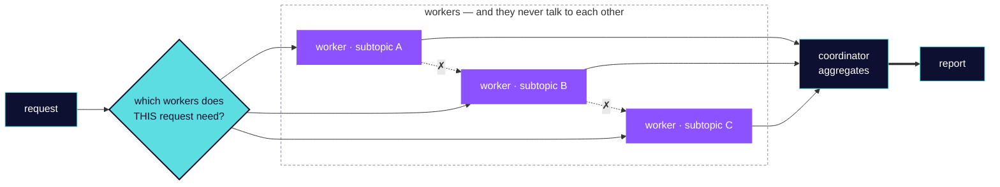

# Lesson 1.2 — The coordinator, and why everything goes through it

**Domain 1: Agentic Architecture & Orchestration — 27% of CCAR-F**
**Task Statement 1.2:** Orchestrate multi-agent systems with coordinator-subagent
patterns.

Lab artifact: Course Doctor's coordinator deciding which workers a given lesson needs,
rather than running all of them every time.

## What you will be able to do afterwards

Design a hub-and-spoke system, partition work so two workers do not do the same job, and
name the failure that comes from decomposing a task too narrowly.

## Why the exam cares

The guide specifies the architecture rather than leaving it open: **hub-and-spoke, where a
coordinator manages all inter-subagent communication, error handling, and information
routing.** Workers do not talk to each other.

And it gives a reason that is worth more than the rule: routing everything through the
coordinator buys **observability, consistent error handling, and controlled information
flow.** Those are the three things you lose the moment two workers start exchanging
results directly, and you lose them silently — the system still works, you just cannot see
what it did.

It also names a failure most people would never think to guard against: **overly narrow
task decomposition, leading to incomplete coverage of broad topics.** The coordinator can
be too good at splitting.

## Fundamentals 📘

*Glossed for a newcomer, skippable if you already build with this stack. Each term
carries why it matters in this lesson and where to go for depth.*

**Hub-and-spoke.** One central node; all traffic passes through it. *Why it matters here:*
it is the named architecture. *Depth:* network topology treatments; the trade is the same
— a single point of visibility and a single point of congestion.

**Isolated context.** Each worker has its own window and its own history. *Why it matters
here:* workers cannot share by default, which is why the coordinator must pass things
explicitly. *Depth:* lesson 1.3.

**Partitioning.** Dividing work so the pieces do not overlap. *Why it matters here:* the
guide names minimising duplication as a skill, and overlap is paid for twice in tokens.
*Depth:* any treatment of work decomposition.

**Aggregation.** Combining results into one answer. *Why it matters here:* it is where
attribution gets lost, and where gaps become invisible. *Depth:* Domain 5 TS 5.3 on
coverage annotations.

**Dynamic routing.** Choosing which components to run based on the request. *Why it
matters here:* the guide explicitly prefers this over always running the full pipeline.
*Depth:* lesson 1.6 on decomposition strategy.

## The idea, before any configuration

**The coordinator does four jobs**, and the guide lists them: decompose the task, delegate
it, aggregate the results, and **decide which workers to invoke based on the complexity of
the request.** That fourth one is the one people skip. A coordinator that always runs
every worker is a pipeline with extra steps — it pays for the full fan-out on a request
that needed one worker.

**Workers never talk to each other.** Not because it would not work, but because the
moment they do, you cannot see what happened, errors are handled three different ways, and
information flows in paths nobody designed.

**Partition before you delegate.** Give each worker a distinct subtopic or source type.
Two workers handed "research this" will overlap, and you pay for the same reading twice
while still having gaps elsewhere.

**And check your own coverage.** The guide's named skill is an iterative refinement loop:
the coordinator **evaluates the synthesis output for gaps**, re-delegates with targeted
queries, and re-invokes synthesis until coverage is sufficient. Not one pass — a loop with
a coverage test.



**Every path in and out of a worker passes through the middle.** The dashed ✗ links are the
ones that would destroy that, and they are barred for observability rather than because
they could not be made to work. The first decision is the one most often skipped — *which*
workers, not all of them.

**The coverage loop is deliberately not drawn.** It belongs to the same lesson and it is a
second shape; one diagram that tries to show a fan-out and a feedback loop at once lays out
as neither. It is in the paragraph above instead.

## The build

### Step 1 — the shape

```
                      coordinator
                     /     |      \
              reader    fetcher   synthesiser
```

Every arrow is bidirectional and no arrow connects two workers. The coordinator holds the
plan; the workers hold their piece and nothing else.

### Step 2 — route on complexity, not habit

```
A lesson with no cited URLs        -> reader only
A lesson with citations            -> reader, then fetcher, then synthesiser
A lesson already marked verified
  within the threshold             -> nothing; report and stop
```

Three requests, three different routes. The third is the valuable one: the coordinator's
best decision is often to run no workers at all, and a pipeline cannot make it.

### Step 3 — partition so nothing is done twice

Checking fifteen lessons, the wrong split is "two workers, both check lessons." The right
split is by **distinct scope**: worker A takes the configuration domain, worker B the
tools domain. No overlap, no duplicated fetches, and the join is unambiguous about which
worker covered what.

### Step 4 — evaluate the aggregate for gaps, then re-delegate

```
1. delegate: domain 3 lessons -> worker A
2. delegate: domain 2 lessons -> worker B
3. aggregate both
4. ASK: does this cover every lesson I set out to check?
5. if not: re-delegate the gap with a targeted query
6. repeat 3-5 until coverage holds
```

Step 4 is the one that distinguishes this from fan-out-and-hope. A synthesis that reads
completely and omits three lessons is the failure mode, and only an explicit coverage test
catches it.

### Step 5 — do not over-split

The guide's named risk, and it is counterintuitive: decomposing too narrowly produces
**incomplete coverage of a broad topic.** Six workers each given a precise sliver will
collectively miss everything that falls between the slivers, and each one will report
success. The join looks complete because every worker completed.

So the coverage test in step 4 is not optional bookkeeping. It is the only thing standing
between a well-partitioned system and a confidently partial answer.

## Tips

Things that cost somebody an hour.

**A coordinator that always runs the full pipeline is not a coordinator.** The decision of
*whether* to invoke a worker is the job. If every request takes the same path, you have
paid for orchestration and bought a sequence.

**Six narrow workers all reporting success can cover less than two broad ones.** This is
the over-decomposition failure, and it is invisible at the join: nothing failed, so
nothing is reported. Ask what fell between them.

**Every returned result consumes the coordinator's context.** Fan-out is a context trade.
Five workers returning verbose findings can leave the coordinator with no room to
synthesise them, and the synthesis is the whole point.

**Worker-to-worker shortcuts are tempting and cost you the transcript.** When something
goes wrong in a system where workers talk directly, there is no single place that saw the
sequence.

**Partition by scope, never by volume.** "Half the work each" produces overlap at the
boundary and disputes about who covered what. "This domain each" does not.

## The anti-pattern

From the guide's objectives:

> **Always routing through the full pipeline** instead of dynamically selecting which
> subagents a request needs.

> **Overly narrow task decomposition**, leading to incomplete coverage of broad topics.

And the architectural one, stated as the reason for the rule rather than the rule:

> **Subagent communication that bypasses the coordinator**, losing observability,
> consistent error handling and controlled information flow.

The exam shape: when one option adds a routing decision and another adds a worker, the
routing decision is usually the answer — the guide treats *which workers to invoke* as the
coordinator's defining responsibility.

## What this lesson does not cover

- **How to spawn and configure a worker** — lesson 1.3, and read it alongside this one.
- **The loop inside a single agent** — TS 1.1.
- **Enforcement and handoff between steps** — TS 1.4.
- **Choosing a decomposition pattern** — TS 1.6, which is the strategy to this lesson's
  mechanics.
- **Error propagation through the hub** — Domain 5 TS 5.3.
- **Context budget as a subject** — Domain 5.

## Sources

Exam guide **Version 1.0, effective July 2026**, §6, TS 1.2.

| Claim | Source |
|---|---|
| Hub-and-spoke architecture where a coordinator manages all inter-subagent communication, error handling and information routing | EG §6, TS 1.2 |
| Subagents operate with isolated context and do not inherit the coordinator's conversation history automatically | EG §6, TS 1.2 |
| The coordinator's role covers task decomposition, delegation, result aggregation, and deciding which subagents to invoke based on query complexity | EG §6, TS 1.2 |
| Risks of overly narrow task decomposition leading to incomplete coverage of broad research topics | EG §6, TS 1.2 |
| Designing coordinators that analyse query requirements and dynamically select subagents rather than always routing through the full pipeline | EG §6, TS 1.2 |
| Partitioning scope across subagents to minimise duplication, e.g. distinct subtopics or source types per agent | EG §6, TS 1.2 |
| Iterative refinement loops where the coordinator evaluates synthesis output for gaps, re-delegates with targeted queries, and re-invokes synthesis until coverage is sufficient | EG §6, TS 1.2 |
| Routing all subagent communication through the coordinator for observability, consistent error handling and controlled information flow | EG §6, TS 1.2 |
| A non-fork subagent starts fresh with no conversation history, receiving only a delegation message | [sub-agents docs](https://code.claude.com/docs/en/sub-agents), read 2026-10-17 |
| Each subagent's returned result consumes the parent's context, and each spends its own tokens | [sub-agents docs](https://code.claude.com/docs/en/sub-agents), read 2026-10-17 |
