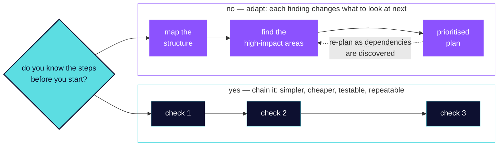

# Lesson 1.6 — Fixed pipeline or adaptive plan

**Domain 1: Agentic Architecture & Orchestration — 27% of CCAR-F**
**Task Statement 1.6:** Design task decomposition strategies for complex workflows.

Lab artifact: Course Doctor's per-lesson pass plus a separate cross-lesson pass, because
one pass cannot do both.

## What you will be able to do afterwards

Choose between a fixed sequence and an adaptive plan for a given task, and say which of
the two the task's shape demands.

## Why the exam cares

This is the strategy task statement, and the guide frames it as a binary with a clean
discriminator: **fixed sequential pipelines, which it calls prompt chaining, versus
dynamic adaptive decomposition based on intermediate findings.**

The discriminator is **predictability**. If you know the steps before you start, chain
them. If the next step depends on what the last one found, you cannot write the chain —
you need a plan that generates subtasks as it goes.

And it names one structural pattern worth memorising because it recurs everywhere:
**per-item local passes plus a separate cross-item integration pass, to avoid attention
dilution.** One pass trying to do both does neither well.

## Fundamentals 📘

*Glossed for a newcomer, skippable if you already build with this stack. Each term
carries why it matters in this lesson and where to go for depth.*

**Prompt chaining.** A fixed sequence where each step's output feeds the next. *Why it
matters here:* it is one of the two named options. *Depth:* any treatment of pipelines.

**Adaptive decomposition.** Generating the next subtask from what you just learned. *Why
it matters here:* it is the other option, and the one open-ended work requires. *Depth:*
planning literature; the mechanism is the same as iterative deepening.

**Attention dilution.** Asking one pass to hold too many concerns at once, so each gets
less. *Why it matters here:* the guide names it as the reason to split local from
integration work. *Depth:* Domain 5 TS 5.1 on the lost-in-the-middle effect, which is the
same problem at the context level.

**Local versus cross-cutting concerns.** Problems inside one item against problems between
items. *Why it matters here:* they need different passes because they need different
inputs. *Depth:* the build.

**Prioritisation under discovery.** Ordering work when the dependencies are not known
upfront. *Why it matters here:* it is the third guide skill, and the reason adaptive plans
must be re-orderable. *Depth:* any treatment of dependency resolution.

## The idea, before any design

**One question: do you know the steps before you start?**

- **Yes** — a predictable multi-aspect review, a known set of checks, a defined set of
  files. Chain it. A fixed pipeline is simpler, cheaper, testable, and repeatable.
- **No** — an open-ended investigation where each finding changes what to look at next.
  Adapt. A chain written in advance would be a guess about a shape you have not seen.

**Then ask what the task is really made of.** The guide's second pattern is the one people
miss: when a review covers many items *and* relationships between them, those are two
passes. A per-file pass finds local problems with full attention on one file. A cross-file
pass finds the integration problems, and it needs all the files' summaries rather than
all their contents.

Trying both at once dilutes attention on the local work and starves the integration work
of the overview it needs.

**And for genuinely open-ended work, the guide gives a three-step shape**: map the
structure first, identify the high-impact areas, then build a prioritised plan **that
adapts as dependencies are discovered.** Mapping before planning is the part that makes
the plan worth anything.



**The two shapes are the whole lesson, and the colour says why.** The fixed pipeline is
navy because it is *your* structure — you wrote the order down in advance, which is what
makes it testable. The adaptive path is purple because the model decides the order as it
goes, and the dashed edge is the part that makes it adaptive rather than just longer. One
question picks between them, and it is not "how big is this task" but "do I already know
the steps."

## The build

### Step 1 — chain the predictable part

Checking one lesson's citations is a known sequence:

```
read the lesson -> extract its cited URLs -> fetch each -> compare -> write findings
```

Five steps, same every time, each feeding the next. No decision about *what* to do, only
execution. Chain it, and the chain is testable because its shape never varies.

### Step 2 — split local from cross-cutting

Checking the whole course is not one bigger version of step 1. There are two different
questions:

```
PASS A, per lesson   does each claim match its own cited source?
                     input: one lesson and its citations. Full attention, one item.

PASS B, cross lesson do two lessons contradict each other? Is a task statement
                     covered twice or not at all? Does a term drift between them?
                     input: every lesson's SUMMARY, not every lesson's text.
```

Pass B cannot run inside pass A, because pass A never sees two lessons at once. And pass B
would be hopeless if given the full text of fifteen lessons — it needs the overview, which
is exactly what pass A produces.

### Step 3 — adapt when the task is open-ended

"Make this course consistent" has no knowable step list. So:

```
1. MAP        what lessons exist, which task statements they claim, which cite what
2. IDENTIFY   where the risk concentrates — lessons with the most uncited claims,
              task statements claimed twice, terms used differently
3. PLAN       a prioritised list, built from what step 2 actually found
4. ADAPT      when fixing one lesson reveals that two others share its error,
              re-order
```

Step 4 is the definition of adaptive. A fixed pipeline written at step 0 could not have
contained it, because the dependency was discovered at step 3.

### Step 4 — do not adapt what you could have chained

The failure in the other direction is real and more expensive than it looks: running an
adaptive plan over a predictable task means paying a planning step, every time, to
rediscover a sequence you already knew.

## Tips

Things that cost somebody an hour.

**If you can write the steps down before starting, write them down and chain them.** An
adaptive plan over a known sequence is a planning tax paid repeatedly for an answer you
already had.

**A single pass asked to find local *and* cross-cutting problems reliably finds neither
well.** It is not that it fails — it produces a plausible mix, with the integration
findings thin and the local findings shallow, and nothing marks which half was shortchanged.

**The cross-cutting pass wants summaries, not sources.** Feeding it everything is the
intuitive move and it reproduces the attention problem you split the passes to avoid.

**Map before you plan.** A prioritised plan built without first mapping the structure is a
list of guesses in confident order.

**An adaptive plan needs to be re-orderable, or it is a pipeline with extra ceremony.** If
discovering a dependency at step 6 cannot change steps 7 through 10, nothing is adapting.

## The anti-pattern

From the guide's objectives:

> **A single large review pass** instead of per-item local analysis plus a separate
> cross-item integration pass — the guide's named cost being **attention dilution.**

And the two mismatches, which are the same error in opposite directions:

> **Dynamic decomposition for a predictable workflow**, paying a planning step to
> rediscover a known sequence.

> **A fixed pipeline for an open-ended investigation**, where the chain was written before
> anyone knew the shape.

The exam shape: the stem will tell you whether the steps are knowable in advance. That
sentence is the answer — a "comprehensive review of four known aspects" is a chain, and
"add tests to a legacy codebase" is not.

## What this lesson does not cover

- **Spawning the workers a decomposition implies** — lesson 1.3.
- **Coordinator architecture** — lesson 1.2, which is the mechanics to this lesson's
  strategy.
- **Plan mode**, which is a Claude Code feature for planning a change; this is about
  decomposing a workflow. Lesson 3.4.
- **Iterative refinement with the author in the loop** — lesson 3.5. Related, and that one
  is about your own iteration rather than an agent's decomposition.
- **Multi-pass review architecture** — Domain 4 TS 4.6, which takes the same per-item plus
  integration idea and adds reviewer independence.

## Sources

Exam guide **Version 1.0, effective July 2026**, §6, TS 1.6.

| Claim | Source |
|---|---|
| When to use fixed sequential pipelines (prompt chaining) versus dynamic adaptive decomposition based on intermediate findings | EG §6, TS 1.6 |
| Prompt chaining patterns that break reviews into sequential steps, e.g. analyse each file individually then run a cross-file integration pass | EG §6, TS 1.6 |
| The value of adaptive investigation plans that generate subtasks based on what is discovered at each step | EG §6, TS 1.6 |
| Selecting prompt chaining for predictable multi-aspect reviews and dynamic decomposition for open-ended investigation tasks | EG §6, TS 1.6 |
| Splitting large code reviews into per-file local analysis passes plus a separate cross-file integration pass to avoid attention dilution | EG §6, TS 1.6 |
| Decomposing open-ended tasks such as "add comprehensive tests to a legacy codebase" by first mapping structure, identifying high-impact areas, then creating a prioritised plan that adapts as dependencies are discovered | EG §6, TS 1.6 |
| Multi-pass review splitting per-file local analysis from cross-file integration passes to avoid attention dilution and contradictory findings | EG §6, TS 4.6 |
